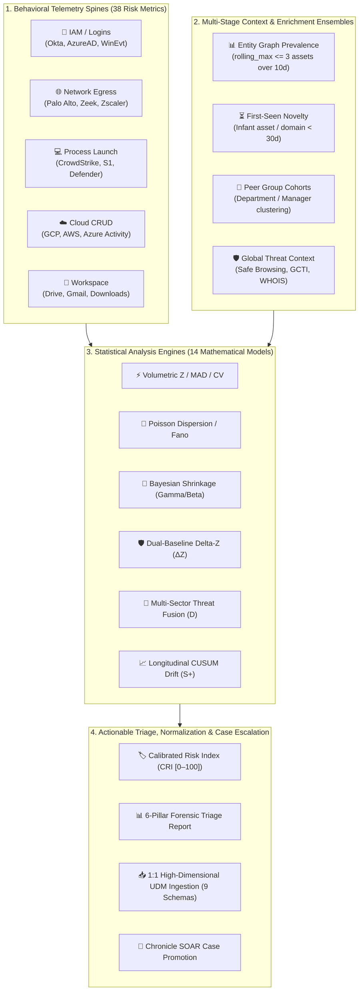

# 🚀 Google SecOps Multi-Stage Risk Metrics Threat Hunter (v2.3.0)
## *Agentic Behavioral Baselining, Multi-Stage DAG Analytics & Interactive UEBA Engine*

**Author**: Greg Kushmerek  
**Target Platform**: Google Security Operations (Chronicle SIEM & SOAR)  
**Specification**: YARA-L 2.0 Multi-Stage Directed Acyclic Graph (DAG) Pipeline Engine  
**Latest Version**: v2.3.0 (Major Point Release) — October 29, 2026  

---

## 📢 What's New in v2.3.0 (Major Point Release) — Bilateral UEBA Cross-Review Remediation (`D1`–`D10`, `WS0`–`WS9`): 14-Model Statistical Concordance, Yesterday (`D-1`) Mode A Default, Calendar-Day Rate Normalization, Sequential Page CUSUM, First-Seen Novelty & Frozen Bilateral Contracts

### 1. Model Portfolio Consolidation, Honest Naming & New Novelty Primitives (`D1`, `WS1-01`, `WS1-02`, `WS1-03`, `WS1-10`, `WS1-12`, `WS9-02`)
* **14 Active Stage 2 Statistical Models (`D1`, `WS1-01`, `WS1-02`, `WS1-10`, `WS9-02`)**: Consolidated `templates/stage2_math_models/` around 14 statistically distinct, Malachite-verified models:
  - **Retired Redundant / Broken Wrappers**: Retired `asymmetric_directional_z.yl2` and `piecewise_cri.yl2` (redundant with `standard_z_score.yl2` under upper-tail gating and universal piecewise sigmoid CRI), `fleet_prevalence_shield.yl2` (superseded by true cross-entity cohort pipeline `hybrid_metric_fleet_prevalence_2stage.yl2`), and `hourly_temporal_zscore.yl2`, `circadian_von_mises.yl2`, and `circadian_von_mises_2stage.yl2` (single-metric daily `metrics.*` baselines lack per-hour circadian state; off-hours profiling routes cleanly to `secops-statistical-hunter` `HOUR_OF_DAY_PROFILE`).
  - **Backward-Compatible Enum Aliases**: Retired `StatisticalModel` and `PipelineArchitecture` enum members remain importable as deprecated aliases that raise explicit `ValueError("... is retired; use ...")` messages naming their exact replacement.
  - **Honest Renames (`D1`, `WS1-02`)**: Renamed `MACD_MOMENTUM_VELOCITY` in docs/display labels to **Above-Historical-Max Z** (`ABOVE_HISTORICAL_MAX_Z` alias on `macd_momentum_velocity.yl2` / `macd_momentum_velocity_2stage.yl2`), `COEFFICIENT_OF_VARIATION` to **Regular-Volume Surge** (`REGULAR_VOLUME_SURGE` alias on `coefficient_of_variation.yl2`, dropping `JITTER`/`BEACON` aliases), and `C2_BEACON_FLOW_FREQUENCY` to **Outbound Flow Surge** (`OUTBOUND_FLOW_SURGE` alias on `c2_beacon_flow_frequency_2stage.yl2`), reserving sub-hour inter-arrival jitter for `secops-statistical-hunter` (`C2_BEACONING_JITTER`).
  - **First-Seen Baseline Novelty (`WS1-12`)**: Added `first_seen_novelty.yl2` and `first_seen_novelty_2stage.yl2` (`StatisticalModel.FIRST_SEEN_NOVELTY`) to detect brand-new `(entity, target/dimension)` pairs with `metric: first_seen, agg: min` returning `0` in `(1d, 30d)` and volume gating, reported as a boolean novelty flag + context (`last_seen`, `period_start_for_max`) rather than a $\sigma$ score.
  - **MAD & Quantile Cross-Check Alignment (`WS1-03`)**: Aligned `mad_robust_z_4stage.yl2` and `quantile_iqr_skew_3stage.yl2` so `$personal_z` cross-checks are computed directly from pre-scoring raw active days (`$in_scoring_window = 0`) rather than stale `[D0-59d, D0-29d)` `metrics.*` averages.

### 2. Calendar-Day Rate Normalization, Baseline Maturity Floors & Dispersion Guards (`D4`, `D8`, `WS1-04`, `WS1-05`, `WS1-09`)
* **Calendar-Day Rate Conversion (`WS1-05`)**: Pre-computed `metrics.*` `agg: avg` averages over active days (`num_metric_periods`), not all 30 calendar days. `poisson_rarity.yl2`, `poisson_rarity_2stage.yl2`, `poisson_gamma_bayesian.yl2`, `hierarchical_empirical_bayes_3stage.yl2`, and `two_part_hurdle.yl2` now convert active-day statistics into true 30-day calendar rates via `historical_sum / 30` (rebuilding $\sum x = n \cdot \text{avg}$ and $\sum x^2 = (n-1)\cdot\text{sd}^2 + n\cdot\text{avg}^2$) before computing Poisson $\lambda$, dormancy, or Gamma/NB priors.
* **Maturity Gates & Continuous Count / Empirical Fleet Byte Floors (`D8`, `WS1-04`)**: Enforced `$active_days >= 7` maturity gates across every Z-type and CV root (routing `$active_days < 7` entities to `two_part_hurdle.yl2`, `poisson_rarity_2stage.yl2`, or `first_seen_novelty_2stage.yl2`), replaced hardcoded `1.0` zero-SD fallbacks on count metrics with continuous Poisson dispersion floors `max(sd, sqrt(max(avg, 1.0)))`, and applied empirical fleet-derived per-metric byte dispersion floors (`44,979.0` B `network_bytes_outbound`, `50,450.0` B `dns_bytes_outbound`, `303,176.0` B `network_bytes_total`, `28,276,845.0` B `network_bytes_inbound`, plus `build_byte_dispersion_floor_probe` for other tenants).
* **Samuelson Cohort Cap (`WS1-09`)**: Added explicit sample-SD Samuelson inequality cohort-size caps (`(N - 1) / sqrt(N)` on peer Z; `3 * (N - 1)^2 / N` on triad $D^2$) across multi-level peer templates (`part_of_the_whole_multilevel.yl2`, `part_of_the_whole_triad_multilevel.yl2`), emitting `"cohort too small"` diagnostics when $N < 11$ ($3.0\sigma$) or $N < 6$ ($D^2 \ge 12.25$).

### 3. Yesterday (`D-1`) Mode A Default, `(1h, today)` Intraday Context, Mode B `3d` Cap & Mode C `30d` Horizon (`D3`, `D9`, `D10`, `WS1-01`, `WS1-08`, `WS1-10`, `WS1-11`, `WS1-13`, `WS9-07`)
* **Mode A Default = Complete Yesterday UTC Day (`D3`, `WS1-01`, `WS9-07`)**: Because `metrics.*` baselines are bucketed `by 1d` (24-hour totals), comparing an incomplete morning against a 24h mean systematically suppresses Z-scores. Mode A now defaults to **Yesterday (`D-1 00:00:00Z` to `D 00:00:00Z`)**.
* **Explicit Labeled Today-So-Far & `(1h, today)` Intraday Context (`D3`, `WS1-13`)**: Keeps `"Today So Far"` (`--today-so-far`) as an explicit partial-day option labeled `Partial UTC Day — Low-Biased vs Full-Day Baseline`, and adds opt-in hour-aligned intraday context (`--intraday-hourly`, $\ge 4\text{h}$ scored window) pairing `(period: 1h, window: today)` earlier-today totals/first-seen/max with the `(period: 1d, window: 30d)` baseline (`PF-10b`) — never scaling baselines by `daily_mean / 24` or elapsed UTC day fraction (`WS5-HOD` in `secops-statistical-hunter` handles learned 24-bin hour-of-day comparisons).
* **Entity Context Graph Mode A Window (`D3`, `WS1-08`, `WS9-07`)**: ECG-joined Mode A queries run `startTime = D-2 00:00:00Z`, `endTime = D 00:00:00Z` and pin event stages to `<scored UTC day, YYYY-MM-DD>` (`D-1` by default; `D` with `endTime = now` only for explicit `--today-so-far`), paired with `build_day0_companion_query` for Day-0 unindexed artifacts and `first_seen_time = 0` novelty suppression.
* **Mode B `3d` Cap (`D9`, `WS1-10`, `WS9-07`) & Mode C `30d` Horizon (`D9`, `D10`, `WS1-11`)**: Defaulted and capped Mode B at **2–3 days (3-day ceiling)** — redirecting $>3\text{d}$ requests to Mode C when `run_command` is available or capping at 3 days with an explicit explanation when `run_command` is unavailable — and raised Mode C (`scripts/timeline_assembler.py`) to **30 days** with batch shard pacing (`batch_size=10`) and the `D10` sustained-attack fade caveat pointing to `LONGITUDINAL_CUSUM` for persistence.

### 4. Unified Sequential Page CUSUM & Windowed Slack Sum Architecture (`D5`, `WS6-01`, `WS9-01`)
* **Two-Tier CUSUM Architecture (`D5`, `WS6-01`, `WS9-01`)**:
  - **Single-Entity / Small-Cohort Sequential Page CUSUM ($\le 14\text{d}$)**: `longitudinal_cusum_series_3stage.yl2` emits ordered `(entity, day_bucket, daily_z)` rows in **one** `udm_search` call, piped into `scripts/cusum_helper.py` to compute exact recursive Page's one-sided CUSUM ($S_t = \max(0, S_{t-1} + z_t - k)$, $k = 0.5$, $h = 4.0$) with reset-to-zero semantics across quiet calendar gaps (`fill_missing_days=True`).
  - **Long-Horizon Fixed-Reference Shards ($> 14\text{d}$ up to $30\text{d}$)**: Splits into $\le 14\text{d}$ `udm_search` chunks while pinning day-1 `baseline_avg` and `baseline_sd` via `--reference-stats` so recursive $S_t$ never washes out slow creep into a rolling baseline.
  - **Fleet-Wide YARA-L Prefilter (`WINDOWED_SLACK_SUM`)**: `longitudinal_cusum.yl2` and `longitudinal_cusum_2stage.yl2` are explicitly labeled as the non-resetting **Windowed Positive Slack Sum** ($\sum_t \max(0, z_t - 0.5)$) prefilter for narrowing large fleets before running `cusum_helper.py`.

### 5. Pre-Flight Validator Hardening, Helper Guardrails (`G1`–`G5`) & Malachite Identifier Coverage (`D6`, `D10`, `WS0`, `WS1-07`, `WS2`, `WS4`, `WS9-04`..`06`)
* **Shared Constants & Helper Allow-List (`D6`, `WS0-01`, `WS9-04`)**: Introduced `scripts/ueba_constants.py` (synchronized with `secops-statistical-hunter`) and enforced the 5-script sanctioned `run_command` allow-list (`radar_collector.py`, `timeline_assembler.py`, `cusum_helper.py`, `ueba_hybrid_engine.py`, `preflight_validator.py`) under guardrails `G1`–`G5` (`--help` forbidden in turns; pre-flight parameters embedded in `SKILL.md` / `references/`).
* **Identifier Coverage & Extractor Semantics (`WS1-07`, `WS4`)**: `MultiStageTemplateRouter` supports every Malachite-valid identifier dimension across all 38 metrics (`principal.ip`, `target.ip`, `principal.asset.ip`, `target.asset.ip`, `principal.user.userid`, `target.user.userid`, etc.) and tightened observed-event filters across Stage 1 extractors (`WS4`).
* **`PF-1`..`PF-11` Validator & Live Baseline Manifest (`D10`, `WS2-01`..`WS2-08`, `WS9-05`, `WS9-06`)**: Hardened `scripts/preflight_validator.py` with line-anchored stage/condition checks, `PF-1` (`metrics.*` `agg: min` non-zero active-day minimum warning), `PF-2` (`agg: max` single-day outlier warning), `PF-10` (static block on cross-entity `OR` across `principal.*` and `target.*` in `metrics.*` stages) vs. `PF-10b` (runtime zero-row fallback hint), `PF-11` (30d baseline contamination warning), and committed `tests/live/baseline_gus_sdl.json` (`D10` live verification baseline manifest).

### 6. CRI Calibration, Multi-Sector Fusion Correlation & Frozen Bilateral Interfaces (`D7`, `D8`, `WS7-01`..`03`, `WS8-02`..`05`)
* **CRI Calibration & Monotonicity (`WS7-01`, `WS7-02`)**: Verified piecewise logistic CRI ($\text{CRI}(Z) = 0$ for $Z \le 0$; $3.0\sigma \mapsto \text{CRI } 50$) monotonicity, documented heuristic mapping boundaries for non-Gaussian ratios/scores, and unified metric-vs-raw semantic disclosures.
* **Multi-Sector Fusion Correlation & Gaussian Expected-Maximum Baseline (`WS7-03`)**: Disclosed positive inter-sector correlation ($\text{Cov}(Z_i, Z_j) > 0$ inflating $\sqrt{\sum \max(0, Z_i)^2}$ relative to orthogonal $\chi^2_k$) across `SKILL.md`, `references/`, and `rollup_sector_fusion_{4,5}stage.yl2`, and labeled $\sqrt{2 \ln N}$ accurately as the first-order asymptotic **expected maximum of $N$ independent standard normals** ($E[\max Z_i] \approx \sqrt{2 \ln N}$).
* **Canonical Routing Table, Frozen `D7` Write-Back & `%ueba_hunt_bridge.entity` (`D7`, `D8`, `WS8-02`..`05`)**: Locked byte-identical `<!-- CANONICAL_SKILL_ROUTING_TABLE_START/END -->` parity (`WS8-02`) and IQR/MAD handoff envelopes (`WS8-04`) with `secops-statistical-hunter`, froze the `D7` `CUSTOM_SECURITY_DATA_ANALYTICS` write-back schema and `scripts/chronicle_ingest.py` (`WS8-03`) for `agentic_ueba`, and standardized `in %ueba_hunt_bridge.entity` across all two-phase cross-entity bridges (`WS8-05`).
* **Verification**: **634/634 offline unit tests** (+1,040 subtests, plus 1 opt-in `SECOPS_LIVE_TESTS=1` compile runner) across 48 test modules (`WS2-01`..`WS2-08`, `WS0-01`..`WS0-05`); **32/32 submission tests** (`scripts/submission_tests.py`); `SKILL.md` within the `28,672`-byte / `275`-line progressive-loading budget.

---

## 📢 What's New in v2.2.0 (Major Point Release) — 1-Stage Non-Parametric Quantiles (`window.percentile`), Bowley Quartile Skewness, Moors Tail-Heaviness Ratio, Skewness-Adjusted Tukey Fences & Intra-Bucket Payload Shape Fingerprinting

### 1. 18th Mathematical Model & 34th Pipeline Template (`QUANTILE_IQR_SKEW`, `quantile_iqr_skew.yl2`, `quantile_iqr_skew_3stage.yl2`)
* **1-Stage Empirical Quantile Envelope (`window.percentile`)**: Whereas true Median Absolute Deviation (`MAD`) requires 2 consecutive intermediate stages (`mad_center` $\to$ `mad_spread`) and consumes all 4 stages, `stage quantile_envelope` computes all 5 empirical quantiles (`$p10`, `$q25`, `$q50`, `$q75`, `$p90`) in **1 intermediate stage**, completing the pipeline in **3 stages** (`quantile_iqr_skew_3stage.yl2`).
* **Stage-Budget Advantage**: Saving 1 full stage and 1 join frees Stage 3 to attach an Entity Context Graph (`DERIVED_CONTEXT` / `GLOBAL_CONTEXT`) rare-destination/binary sieve or a peer-cohort normalization stage inside a single 4-stage query.
* **Bowley Quartile Skewness, Moors Tail-Heaviness & Hubert–Vandervieren Skewness-Adjusted Tukey Fence**:
  - **Bowley Quartile Skewness**: $B_{\text{skew}} = (Q_{75} + Q_{25} - 2 Q_{50}) / \text{IQR}_{\text{safe}} \in [-1, +1]$ diagnoses right-skewed baselines where historic bulk transfers distort parametric $\mu$ and $\sigma$.
  - **Moors Tail-Heaviness Ratio**: $T_{\text{ratio}} = (P_{90} - P_{10}) / \text{IQR}_{\text{safe}}$ (Gaussian $\approx 1.90$; $T_{\text{ratio}} > 2.5$ indicates heavy-tailed baseline distortion).
  - **Hubert–Vandervieren Skewness-Adjusted Tukey Upper Fence**: $\text{Fence}_{\text{adj}} = Q_{75} + 1.5 \cdot e^{3 \cdot \max(0, B_{\text{skew}})} \cdot \text{IQR}_{\text{safe}}$, scored via `$tukey_fence_ratio = $observed / $safe_fence` (`>= 2.0×` default gate) alongside the 30-day `metrics.*` `$personal_z` cross-check.

### 2. Consultative Playbook Expansion (`references/consultative-worksheet.md`, `references/consultative/data-exfiltration.md`, `references/malachite-function-factory-matrix.md`)
* Added **4-Stage Quantile/Bowley Skewness Fence + Entity Context Graph Rare Domain Sieve (`rolling_max <= 3`)** and **Macro 30-Day `metrics.*` Baseline + Intra-Bucket Per-Flow Payload Quantile Shape ($P_{50}$ vs $P_{90}$)** (`$flow_tail_burst_ratio = $p90_bytes / $safe_p50`), all verified live on `gus-sdl`.

---

## 📢 What's New in v2.1.4 (Minor Point Release) — Documentation & GitHub Markdown Math Rendering Fixes

* **GitHub `cmark-gfm` Display & Inline Math Fixes (`references/statistical-models-taxonomy.md`, `references/multi-stage-metrics-guide.md`, `references/calibrated-risk-index-guide.md`)**: Moved YARA-L `$placeholder` identifiers out of `$$...$$` display math blocks so GitHub's Markdown math scanner never splits equations or raises KaTeX brace errors (`LONGITUDINAL_CUSUM`, `CIRCADIAN_VON_MISES`, Clean Conditional Safeguard, and Cloud CRUD compound match key), placed multi-line `$$` delimiters on dedicated fence lines, and fixed minor Markdown list/escape formatting (`* $Z_{\text{hourly}}`, `$\le 30\text{d}$`, unescaped apostrophes).
* **Inline Math & Code Delimiter Cleanup (`SKILL.md`, `references/consultative/mitre-attack-killchain.md`)**: Spaced inline `parent $\to$ child` transitions and wrapped `Bridge Contract ($host, $timestamp, $user, $caller_ip)` in backticks (`433/433` unit tests passing).

---

## 📢 What's New in v2.1.3 (Minor Point Release) — The Bilateral UEBA Harness (`secops-risk-metrics-multistage` + `secops-statistical-hunter` + `agentic_ueba`), Telemetry Physics & Window Guardrail & CTI / Exploit Multi-Plane Synthesis

### 1. The Bilateral UEBA Harness for Open-Ended Threat, Exploit & CTI Inquiries (`SKILL.md`, `references/statistical-hunting-cooperative-framework.md`, `references/consultative/mitre-attack-killchain.md`)
* **Multi-Horizon Bilateral UEBA Synthesis**: When an analyst asks for an open-ended "UEBA solution" to detect a threat, exploit, vulnerability, CTI advisory (e.g., `http2shell` / `CVE-2026-111497`), or curated detection gap without restricting to a single skill, `secops-risk-metrics-multistage` and `secops-statistical-hunter` operate as a unified **Bilateral UEBA Harness** alongside `agentic_ueba` (`PlaybookRunner`) connective tissue.
* **Anti-Failure Mandate**: Prevents the agent from declaring UEBA "a poor fit" because `metrics.*` is bucketed `by 1d` and cannot measure sub-hour process lineage or command-line entropy, and prevents falling back to static point-in-time single-event UDM string filters.
* **Single-Skill Isolation Preserved**: Whenever `Active Skill: secops-risk-metrics-multistage` is explicitly designated (or for standard single-entity 30d baselines, peer cohorts, 360° radars, CUSUM drift, or pure `metrics.*` requests), the skill preserves 100% of its single-skill routing and zero-code handoff boundaries.

### 2. Strict Telemetry Physics & Window Guardrail (`references/statistical-hunting-cooperative-framework.md` §8)
* **Plane 1 — Macro Hemisphere (`secops-risk-metrics-multistage`, `by 1d` 30-Day Baselines)**: Owns all 30-day volumetric, failure, and ratio baselines (`metrics.*`), peer cohort benchmarking, Longitudinal CUSUM drift, 360° entity behavioral radars, Entity Context Graph prevalence (`rolling_max <= 3`, `day_count = 10`), and same-entity multi-sector fusion (`dual_sector_fusion_3stage.yl2`, `rollup_sector_fusion_4stage.yl2`). Strictly forbids using `secops-statistical-hunter` for 30-day baselines over high-volume telemetry (`metrics.*` domains such as VPC flow logs, DNS, HTTP, Auth, or Process counts).
* **Plane 2 — Micro / Windowed Hemisphere (`secops-statistical-hunter`, Bounded Raw `UDM_EVENTS`)**: Owns minute/hour windowed correlations (`by 5m`, `by 1h`, `by 2h`, `by 1d` over bounded `1h–24h` windows for high-volume logs or `7d–14d` for filtered/sparse process transitions) and structural models that daily `metrics.*` counters cannot measure: parent-to-child process lineage (`MARKOV_2GRAM_TRANSITION_RARITY`), CLI/URI obfuscation (`SHANNON_ENTROPY_CHARACTER`), sub-hour burst clustering (`POISSON_BURST_CLUSTERING` / `EWMA_BURST_VELOCITY`), callback jitter (`C2_BEACONING_JITTER`), and long-tail rarity (`ZIPFIAN_PROCESS_RARITY`).
* **Plane 3 — Connective Tissue (`agentic_ueba` / `PlaybookRunner`)**: Chains Macro and Micro queries across Chronicle's 2-raw-event-stage ceiling via **Option 1** (In-DAG Piecewise Unification via `hybrid_metric_raw_enrichment_2stage.yl2`), **Option 2** (Upstream Candidate IP/Entity Seeding via `/* UPSTREAM_CANDIDATE_IPS */` or `%ueba_hunt_bridge.entity`), and **Option 3** (Native UDM Loopback via `metadata.product_event_type = "PLAYBOOK_BEHAVIORAL_HUNT_MATCH"` with $\ge 2$ distinct hits and $\sum Z_i^2 \ge 25.0$).
* **Verification**: **433/433 unit tests** (+218 subtests); **32/32 submission tests**; **60/60 (`100.0%`)** live `AgentAPI` regression pass and **100% cross-skill boundary/handoff pass** across both engines on `gus-sdl`.

---

## 📢 What's New in v2.1.2 (Minor Point Release) — Full Audit Remediation: Macro-Day/Micro-Hour Burst Localization, Multi-Day Cumulative CUSUM Drift, Rectified Euclidean Fusion, Epoch-Zero ECG Guards & 100% Dual-Engine Parity

### 1. Macro-Day (`period: 1d`) Baseline + Micro-Hour (`by 1h`) Burst Localization (`hourly_temporal_zscore.yl2`, `circadian_von_mises.yl2`, `circadian_von_mises_2stage.yl2`)
* Preserves Stage 1 `metrics.*` on its only supported `period: 1d, window: 30d` window while normalizing the 24-hour historical baseline to an hourly rate (`$avg_hourly = $hist_avg_daily / 24.0`, `$scaled_hourly_sd = $hist_stddev_daily / 4.899` where $\sqrt{24} \approx 4.899$) when scored against an hourly (`by 1h`) burst stage.

### 2. Multi-Day Cumulative Drift (`longitudinal_cusum.yl2`, `longitudinal_cusum_2stage.yl2`, `scripts/timeline_assembler.py`)
* Adds an intermediate `stage stage2_daily_drift` (`match: $entity by 1d`) computing daily Z-scores and slack excess (`$daily_excess = if($daily_z > 0.5, $daily_z - 0.5, 0.0)`), feeding an unbucketed root stage (`match: $entity`) that sums multi-day drift (`$cusum_drift = sum($stage2_daily_drift.daily_excess)`, `$drift_days = sum(if($stage2_daily_drift.daily_excess > 0, 1, 0))`) over Mode B horizons.
* Adds sequential Page's one-sided CUSUM ($S_t = \max(0.0, S_{t-1} + z_t - 0.5)$) to `scripts/timeline_assembler.py` for Mode C per-day timeline collation.

### 3. Rectified Multi-Sector Fusion, Epoch-Zero ECG Guards & Compiler-Safe Outcome `if()` Expressions
* **Rectified Euclidean Fusion**: Rectifies negative sector Z-scores (`if($z > 0, $z, 0.0)`) before squaring in `multi_sector_fusion_4stage.yl2`, `rollup_sector_fusion_4stage.yl2`, and `rollup_sector_fusion_5stage.yl2` so quiet sectors never inflate $D$.
* **Epoch-Zero Entity Context Graph Guards**: Guards `$first_seen > 0` and `$created > 0` in `hybrid_metric_derived_file_prevalence_2stage.yl2`, `hybrid_metric_derived_asset_age_2stage.yl2`, and `hybrid_metric_whois_domain_lifecycle_2stage.yl2`, and keeps cross-stage OIO subtraction out of root `condition:` blocks for 100% live Chronicle SIEM compilation.
* **Data Table Bridge & Metric Semantics**: Standardizes `agg: num_metric_periods` and `%ueba_hunt_bridge.entity` in `hybrid_data_table_bridge_2stage.yl2`, reclassifies `alert_event_name_count` to `PROCESS_UNCATEGORIZED` (`sigma_floor_value: 2.0`), and preserves the `v2.1.1` `1000000.0` Cloud CRUD zero-dispersion divisor.
* **Python Hybrid Engine & `SKILL.md` Progressive-Loading Ceiling**: Adds `"fusion"` / multi-metric auto-promotion to `compile_hunt_pipeline()` in `scripts/ueba_hybrid_engine.py`, expands the `SKILL.md` ceiling in `tests/test_skill_efficiency_and_clarity.py` to `28.0 KB` (`28,672` bytes) / `275` lines, and tightens 360° Radar single-step synthesis and Consultative Pivot re-keying instructions.
* **Verification**: **433/433 unit tests** (+218 subtests); **32/32 submission tests**; **`120/120` (`100.0%` Invariant Parity)** across `AgentAPI` (`60/60`) and `Direct MCP` (`60/60`) on `gus-sdl`.

---

## 📢 What's New in v2.1.1 (Minor Point Release) — Native SecOps UEBA Architectural Grounding, Silent Zero-BigQuery Guardrail & Cloud CRUD Zero-Dispersion Suppression

### 1. Native SecOps UEBA Architectural Grounding & Silent Zero-BigQuery Guardrail (`SKILL.md`, `references/multi-stage-metrics-guide.md`)
* **100% Native Google SecOps Data Plane**: Corrected all architectural documentation (`references/multi-stage-metrics-guide.md` §§11 & 21, `RELEASE_NOTES.md`) to accurately reflect that `metrics.*` pre-computed behavioral baselines and the Entity Context Graph (`graph.*`) execute 100% natively within Google SecOps, leveraging core Google infrastructure.
* **Silent Conditional Zero-BigQuery Guardrail**: Embedded a background anti-hallucination invariant in `SKILL.md` (`Native SecOps Architecture`) and `references/multi-stage-metrics-guide.md` (§11):
  - **Silent by Default**: Does not volunteer or mention BigQuery unprompted during standard UEBA hunts or architectural overviews.
  - **Explicit Conditional Trigger**: If asked whether or how BigQuery powers UEBA, states flatly that **BigQuery contributes nothing to SecOps UEBA**—SecOps UEBA is completely native to Google SecOps (BigQuery only ever appears as a monitored customer cloud target in `GCP_CLOUDAUDIT` telemetry, alongside GCS or AWS S3).
* **Contract Test Enforcement (`tests/test_guardrail_contracts.py`)**: Added `test_zero_bigquery_backend_guardrail` to enforce `"leveraging core Google infrastructure"` and `"BigQuery contributes nothing to SecOps UEBA"` while forbidding any false backend BigQuery claims or internal storage names.

### 2. Cloud CRUD 360° Radar Per-Product Z-Score & Dispersion Floor Alignment (`scripts/radar_collector.py`, `references/360-behavioral-radar-guide.md`)
* Computes Cloud CRUD directional Z-scores per `(user, vendor, product)` tuple inside Stage 1 before taking `max()` across products in the root stage, using the canonical `if($read_std > 0, $read_std, 1.0)` dispersion floor across read/write/create/delete branches so multi-product baselines are never mixed across incompatible scales.

---

## 📢 What's New in v2.1.0 (Major Point Release) — Pre/Post `QueryIntegrityGate`, 10 Consultative Deformations, 14-Tactic MITRE Coverage, SecOps Data Table Bridging & 5-Section Triage Reports

A major point release combining critical query execution integrity safeguards (`QueryIntegrityGate`), expanded consultative behavioral modeling across 10 telemetry deformations, full 14-tactic MITRE ATT&CK Enterprise coverage (11 kill-chains), native SecOps Data Table bridging (`%ueba_hunt_bridge` & `%ueba_entity_priors`), and streamlined 5-section CommonMark triage reporting.

### 1. Pre-Dispatch & Post-Execution `QueryIntegrityGate` (`scripts/preflight_validator.py`, `scripts/ueba_hybrid_engine.py`, `SKILL.md`)
* **Pre-Dispatch Verification (`QueryIntegrityGate.verify_pre_dispatch`)**: Audits every candidate multi-stage query before `udm_search` execution to block:
  1. Unresolved `{{placeholder}}` or `<placeholder>` template tokens.
  2. Missing target entity scoping when a specific `USER`, `ASSET`, or `IP` was requested (preventing accidental fleetwide execution when an entity was specified).
  3. Malformed SecOps Data Table references (`%<table_name>.<column>`), enforcing valid alphanumeric/underscore identifiers and rejecting `metrics.%table` misuse.
  4. Malachite AST structural errors (`MalachiteASTValidator.validate_query`).
* **Post-Execution Backend Verification (`QueryIntegrityGate.verify_backend_response`)**: Inspects raw `udm_search` tool responses for Chronicle compiler, gRPC, HTTP 4xx/5xx, or `INVALID_ARGUMENT` errors. Hard-blocks the agent from reporting a failed or rejected query as a `0.00σ` / `CRI = 0` "Nominal Baseline" under the Zero-Telemetry Clean Hunt Exemption.

### 2. Consultative Model Expansion: 10 Behavioral Telemetry Deformations (`references/consultative-worksheet.md`)
* Expanded the First-Principles Behavioral Telemetry Deformations from 6 to **10 canonical deformations**:
  - **Deformation 7 — Graph / Relational Bipartite Fan-Out & Fan-In**: Detects $1 \rightarrow N$ lateral/recon sweeps (`http_target_surge_2stage.yl2`, `part_of_the_whole_triad_multilevel.yl2`) and $N \rightarrow 1$ distributed C2/staging concentration (`rare_destination_ecg_3stage.yl2`).
  - **Deformation 8 — Producer-Consumer Role Inversion**: Detects workstations/clients shifting from net data consumers to net data producers via directional outbound/inbound byte fusion or federated handoff to `secops-statistical-hunter` (`PRODUCER_CONSUMER_RATIO_INVERSION`).
  - **Deformation 9 — Geospatial / Physical Velocity (Impossible Travel)**: Routes sub-hour physical travel velocity checks (`math.geo_distance`) to `secops-statistical-hunter` (`IMPOSSIBLE_TRAVEL_GEO_VELOCITY`) or pairs macro login spikes with `DERIVED_CONTEXT` asset age (`hybrid_metric_derived_asset_age_2stage.yl2`).
  - **Deformation 10 — Persona-Conditioned Priors & Pre/Post Changepoint Framing**: Joins `%ueba_entity_priors` Data Tables for persona-specific sensitivity gates (executives, privileged admins, third-party contractors) and frames before/after change windows around incident timestamps ($T_{\text{event}}$) via `dual_baseline_delta_z_3stage.yl2`.
* **Executable Disambiguation Controls (`[A]` / `[B]` / `[C]`)**: Standardizes Phase 1A consultative menus so every disambiguation option maps directly to a concrete metric vector, mathematical model, and pipeline architecture.

### 3. Full 14-Tactic MITRE ATT&CK Enterprise Coverage & 11 Kill-Chain Archetypes (`references/consultative/mitre-attack-killchain.md`, `scripts/template_router.py`)
* Added **Reconnaissance (`TA0043`)** and **Resource Development (`TA0042`)** so the consultative catalog covers **all 14 MITRE ATT&CK Enterprise tactics**.
* Added 3 new turnkey multi-stage `KillChainArchetype` definitions in `scripts/template_router.py` (bringing the total to **11 kill-chains**):
  - `RECON_TO_INITIAL_ACCESS` (`TA0043` $\rightarrow$ `TA0001`): `metrics.http_queries_fail` + `metrics.auth_attempts_success` (`principal.asset.ip`).
  - `RESOURCE_DEV_TO_EXECUTION` (`TA0042` $\rightarrow$ `TA0002`): `metrics.resource_creation_total` + `metrics.file_executions_total` (`principal.user.userid` / roll-up).
  - `EXFILTRATION_OVER_WEB_SERVICE` (`TA0009` $\rightarrow$ `TA0010`): `metrics.workspace_total_download_actions` + `metrics.http_queries_total` (`principal.user.userid`).

### 4. Native SecOps Data Table Bridging (`templates/pipelines/hybrid_data_table_bridge_2stage.yl2`, `scripts/template_router.py`)
* Added **`templates/pipelines/hybrid_data_table_bridge_2stage.yl2`** (33rd pipeline template) and `ChainedHuntRouter.build_data_table_bridge_query()`.
* In Two-Phase Cross-Entity Chained Hunts (`USER` $\leftrightarrow$ `ASSET` / `IP`), when a Phase 1 cohort exceeds 25 entities or requires persistent cohort bridging, upon explicit analyst approval in **State 3** the workflow materializes the bridged entities into SecOps Data Table `%ueba_hunt_bridge` (`create_data_table` / `add_rows_to_data_table`) and joins `principal.asset.hostname = %ueba_hunt_bridge.hostname` via `ChainedHuntRouter.build_data_table_bridge_query()`—avoiding 25-element `in (...)` literal list truncation.

### 5. Streamlined 5-Section CommonMark Triage Reporting (`SKILL.md`, `scripts/triage_formatter.py`)
* Consolidated Turn 2 delivered reports into 5 operational sections (`#### 1.` through `#### 5.`), placing the verbatim executed multi-stage query inside Section 5 (*Collapsible Technical Appendix (Statistical & Mathematical Appendix)*):
  1. *Statistical Outlier Report: `[Target Metric] ([Statistical Model]) — Executive Summary & Calibrated Risk Index (CRI)`*
  2. *Ranked Outlier Summary & Provenance Stamp* (6 forensic evidence columns)
  3. *Forensic Vector Breakdown & Agentic Next Steps (`[1]` / `[2]` / `[3]`)*
  4. *Chronicle UI Manual Pivot (Triage Reference Only, inside ```` ```text ```` fence)*
  5. *Collapsible Technical Appendix (Statistical & Mathematical Appendix, including verbatim executed query)*

### 6. Ready-to-Run v2.1.0 Sample Queries

#### Sample 1: Two-Phase Cross-Entity Data Table Bridge (`templates/pipelines/hybrid_data_table_bridge_2stage.yl2`)
```yara
// Goal: Score 30-day behavioral metric departures for a bridged cohort stored
//       in SecOps Data Table %ueba_hunt_bridge (Two-Phase Chained Bridge)
stage stage1_extract {
    metadata.event_type = "NETWORK_CONNECTION"
    network.sent_bytes > 0
    network.sent_bytes < 1000000000000000
    principal.asset.hostname = %ueba_hunt_bridge.hostname
    principal.asset.hostname = $entity
    $entity != ""

  match:
    $entity by 1d

  outcome:
    $observed_val = sum(network.sent_bytes)
    $historical_avg = max(metrics.network_bytes_outbound(
        period: 1d, window: 30d,
        metric: value_sum,
        agg: avg,
        principal.asset.hostname: principal.asset.hostname
    ))
    $historical_stddev = max(metrics.network_bytes_outbound(
        period: 1d, window: 30d,
        metric: value_sum,
        agg: stddev,
        principal.asset.hostname: principal.asset.hostname
    ))
    $active_baseline_days = max(metrics.network_bytes_outbound(
        period: 1d, window: 30d,
        metric: value_sum,
        agg: num_metric_periods,
        principal.asset.hostname: principal.asset.hostname
    ))
}

$entity = $stage1_extract.entity

match:
  $entity by 1d

outcome:
  $observed_24h = max($stage1_extract.observed_val)
  $baseline_mean = max($stage1_extract.historical_avg)
  $baseline_stddev = max($stage1_extract.historical_stddev)
  $active_days = max($stage1_extract.active_baseline_days)
  $safe_stddev = if($baseline_stddev > 0, $baseline_stddev, 1.0)
  $personal_z = ($observed_24h - $baseline_mean) / $safe_stddev

condition:
  $active_days >= 7 and $personal_z >= 3.0

order:
  $personal_z desc
```

#### Sample 2: Consultative MITRE ATT&CK Kill-Chain (`RECON_TO_INITIAL_ACCESS` — `TA0043` $\rightarrow$ `TA0001`)
```yara
// Goal: Detect Reconnaissance (TA0043) progressing to Initial Access (TA0001)
stage stage1_recon_http_fail {
    (network.http.method != "" or network.http.user_agent != "" or network.http.response_code != 0 or network.http.referral_url != "")
    network.http.response_code >= 400
    principal.asset.ip = $entity
    $entity != ""

  match:
    $entity by 1d

  outcome:
    $obs_s1 = count(metadata.id)
    $avg_s1 = max(metrics.http_queries_fail(
        period: 1d, window: 30d,
        metric: event_count_sum,
        agg: avg,
        principal.asset.ip: principal.asset.ip
    ))
    $std_s1 = max(metrics.http_queries_fail(
        period: 1d, window: 30d,
        metric: event_count_sum,
        agg: stddev,
        principal.asset.ip: principal.asset.ip
    ))
}

stage stage2_initial_access_auth {
    metadata.event_type = "USER_LOGIN"
    security_result.action = "ALLOW"
    principal.asset.ip = $entity
    $entity != ""

  match:
    $entity by 1d

  outcome:
    $obs_s2 = count(metadata.id)
    $avg_s2 = max(metrics.auth_attempts_success(
        period: 1d, window: 30d,
        metric: event_count_sum,
        agg: avg,
        principal.asset.ip: principal.asset.ip
    ))
    $std_s2 = max(metrics.auth_attempts_success(
        period: 1d, window: 30d,
        metric: event_count_sum,
        agg: stddev,
        principal.asset.ip: principal.asset.ip
    ))
}

$entity = $stage1_recon_http_fail.entity
$entity = $stage2_initial_access_auth.entity

match:
  $entity by 1d

outcome:
  $recon_obs = max($stage1_recon_http_fail.obs_s1)
  $recon_avg = max($stage1_recon_http_fail.avg_s1)
  $recon_std = max($stage1_recon_http_fail.std_s1)
  $auth_obs = max($stage2_initial_access_auth.obs_s2)
  $auth_avg = max($stage2_initial_access_auth.avg_s2)
  $auth_std = max($stage2_initial_access_auth.std_s2)
  $safe_s1 = if($recon_std > 0, $recon_std, 1.0)
  $safe_s2 = if($auth_std > 0, $auth_std, 1.0)
  $z_recon = ($recon_obs - $recon_avg) / $safe_s1
  $z_auth = ($auth_obs - $auth_avg) / $safe_s2
  $pos_z1 = if($z_recon > 0, $z_recon, 0.0)
  $pos_z2 = if($z_auth > 0, $z_auth, 0.0)
  $threat_distance_sq = ($pos_z1 * $pos_z1) + ($pos_z2 * $pos_z2)

condition:
  $threat_distance_sq >= 12.25

order:
  $threat_distance_sq desc
```

### 7. Testing & Live 60-Scenario Dual-Engine Verification
* **Unit & Submission Suites**: **426 / 426 unit tests passing** (+212 subtests) across 25 test modules; **32 / 32 submission tests passing**. `SKILL.md` is 20,287 bytes (strictly within the 20,480-byte ceiling).
* **Live 60-Scenario Dual-Engine Regression Suite**: Achieved **`60 / 60` (`100.0%`) on `AgentAPI`** and **`60 / 60` (`100.0%`) on `Direct MCP`** (`120 / 120` combined runs) on `gus-sdl`.

---

## 📢 What's New in v2.0.2 (Point Release) — Multi-Entry `BEHAVIORAL_RISK_RADAR_360` UDM Schema & Native Float Vector Scores

A minor point release updating `references/clean-handoff-udm-schema.md` (and `tests/test_guardrail_contracts.py`) so that 360° Behavioral Radar and Clean Hand-Off UDM events expose per-vector CRI and Z-scores as native numeric UDM fields for YARA-L rules and SecOps Native Dashboards.

### 1. Multi-Entry `BEHAVIORAL_RISK_RADAR_360` UDM Schema (`references/clean-handoff-udm-schema.md` §10)
* **Unbundled Atomic Resource Labels**: Replaced the 6 packed `"CRI <n> | Z <z>"` strings in `target.resource.attribute.labels` with atomic roll-up keys (`Peak Vector`, `Peak CRI`, `Peak Z`, `Breached Vectors`).
* **Per-Vector `security_result[]` Entries with Native Floats**: `security_result[0]` carries the `COMPOSITE_360` roll-up (`risk_score` = Composite CRI, omitting `threat_name` and `confidence_score`), while `security_result[1..N]` emit one `SECTOR_VECTOR` entry per non-zero sector sorted descending by Z-score (`threat_name = <SECTOR>`, `risk_score = <Vector CRI>`, `confidence_score = <Vector Z>`, `threat_status = "ACTIVE" | "CLEARED"`). Zero-score vectors are omitted, allowing YARA-L rules (`max($e.security_result.confidence_score)`) and SecOps Native Dashboards (`GROUP BY security_result.threat_name`) to query individual vector CRI and Z-scores directly as numbers.
* **Native `confidence_score` Across All 10 Schemas**: Added `"confidence_score"` (`float`) alongside `"risk_score"` across Schemas 1–9.
* **Test Suite**: **425 / 425 unit tests passing** (+212 subtests); **32 / 32 submission tests passing**. `SKILL.md` unchanged (20,449 bytes).

---

## 📢 What's New in v2.0.1 (Point Release) — Mode C 6-Sector 360° Radar Sharding, Email-to-Userid Identity Resolution & 4-Family Cloud CRUD Radar Spoke

A point release resolving 5 root-cause gaps uncovered when profiling corporate email identities (`admin@demo.wsexample.org`) over historical incident windows with Mode C and the 6-sector 360° Behavioral Radar.

### 1. Email-to-`user.userid` Identity Resolution & Historical Window Anchoring (`SKILL.md`, `references/turn-execution-lifecycle.md`, `references/360-behavioral-radar-guide.md`, `references/multi-stage-metrics-guide.md`)
* **Email-to-Local-Userid Extraction**: Many log sources (such as Google Cloud Audit) record an email address (`admin@demo.wsexample.org`) in `user.email_addresses` while indexing `user.userid` as the local username (`"admin"`). Previously, `@`-containing inputs bypassed the identity spot-check and queried `user.userid = "admin@demo.wsexample.org"` directly, returning zero events.
* **Expanded Spot-Check Predicate & Historical Window**: The identity spot-check now includes `target.user.email_addresses` and `principal.user.email_addresses`, runs over the requested target historical window (when a target date/range is given) or the last 14 days otherwise, extracts the non-empty canonical `user.userid` from the matched UDM event, and echoes both the full display name and verified `user.userid` in the Pre-Flight card.
* **Service Account Fast-Path**: Standard machine/service accounts (`@*.iam.gserviceaccount.com`, `arn:aws:...`, `sa-*`), hosts, and fleet sweeps bypass the human-email spot-check so Turn 1 stays strictly within the 1-probe budget.

### 2. Mode C Support for 6-Sector 360° Behavioral Radar (`scripts/timeline_assembler.py`, `references/timeline-modes-guide.md`)
* **Per-Day Sector Shard Fusion (`--shard YYYY-MM-DD:<sector>=<path>`)**: `scripts/timeline_assembler.py` now accepts `--shard YYYY-MM-DD:<sector>=<path>` (where `<sector>` is `auth`, `cloud`, `workspace`, `network`, `dns`, `web`, `alerts`, or `endpoint`) and fuses per-day sector Z-scores into daily Euclidean threat distance $D_t = \sqrt{\sum_s \max(0, Z_{s,t})^2}$ and $\text{CRI}_t$, reporting each active sector's first breaching day and peak Z-score in the `Sector Onset` column.
* **Active-Sector Pre-Screening**: Before dispatching daily Mode C shards for a 360° Behavioral Radar, the workflow runs 1 lightweight raw UDM existence check (`maxEvents: 1`) per sector across the full `[D_start 00:00Z, D_end+1d 00:00Z)` window and skips sectors with zero activity across the window.

### 3. 4-Family Cloud CRUD Radar Spoke & Unnested `if(...)` Compiler Safety (`references/360-behavioral-radar-guide.md`, `scripts/radar_collector.py`)
* **Unified 4-Family Cloud CRUD Spoke**: Sector 2 (`stage cloud_risk`) of the 360° Behavioral Radar previously checked only `RESOURCE_CREATION` (`metrics.resource_creation_total`), missing cloud read, write, and deletion spikes (`RESOURCE_READ`, `USER_RESOURCE_ACCESS`, `RESOURCE_WRITTEN`, `USER_RESOURCE_UPDATE_CONTENT`, `RESOURCE_DELETION`, `USER_RESOURCE_DELETION`). Sector 2 now evaluates all 4 Cloud CRUD families (`resource_read_total`, `resource_written_total`, `resource_creation_total`, `resource_deletion_total`, with a 3-day active baseline floor on deletions) and takes the peak positive Z-score across the 4 families.
* **Malachite `<field>: <field>` Self-Binding & Unnested `if(...)`**: All 6 radar micro-queries in `references/360-behavioral-radar-guide.md` and `scripts/radar_collector.py` bind `metrics.*()` filter arguments using `<field>: <field>` (`target.user.userid: target.user.userid`, `principal.user.userid: principal.user.userid`, `metadata.vendor_name: metadata.vendor_name`, `metadata.product_name: metadata.product_name`) and express multi-family maximums via flat, unnested `if(...)` assignments (`$z_rw`, `$z_cd`, `$z = if($z_rw >= $z_cd, $z_rw, $z_cd)`), verified live on Chronicle SIEM (`gus-sdl`).

### 4. Two-Phase Chained Hunt Bridge Summary & Turn 2 Clearance Handling (`scripts/ueba_hybrid_engine.py`, `SKILL.md`, `references/turn-execution-lifecycle.md`)
* `compile_hunt_pipeline()` now includes the **Two-Phase Chained Hunt Specification** (`Phase 1`, `Bridge Contract`, `Phase 2`) inside `preflight_card_markdown` whenever `chained_plan` is compiled.
* Clarified Turn 2 clearance recognition (`"Clearance granted"`, `"Run it"`, `"Mode A"`, `"Mode B"`, `"Mode C"`, `"proceed"`) and anchored `### Threat Hypothesis` & `### Summary View` in Phase 1A consultative responses.

### 5. Testing & Live 58-Test Dual-Engine Verification
* **Unit & Submission Suites**: **425 / 425 unit tests passing** (+212 subtests) across 25 test modules (including 4 new Mode C 6-sector shard fusion tests in `tests/test_timeline_assembler.py`); **32 / 32 submission tests passing**. `SKILL.md` is 20,449 bytes (strictly within the 20,480-byte ceiling).
* **Live 58-Test Dual-Engine Regression Suite**: Achieved **`58 / 58` (`100.0%`) on `AgentAPI`** and **`58 / 58` (`100.0%`) on `Direct MCP`** with 100% dual-engine invariant parity on branch `fix/mode-c-radar-and-identity-resolution`.

---

## 📢 What's New in v2.0.0 (Major Release) — Unified Python Hybrid Engine, Native Headless MCP Tools & 24.4% Prompt Compression

A major architectural evolution introducing the **Unified Python Hybrid Engine (`scripts/ueba_hybrid_engine.py`)**, exposing deterministic pipeline compilation, cross-skill hybrid handoffs to `secops-statistical-hunter`, and 6-pillar forensic dossier rendering as both CLI subcommands (for AgentAPI / Jetski) and native Gemini `FunctionDeclaration` tools (for headless MCP clients and Cloud Run `agentic_ueba`).

### 1. Unified Python Hybrid Engine (`scripts/ueba_hybrid_engine.py`)
* **`compile_hunt_pipeline()` (`compile` CLI subcommand)**:
  - Preserves full combinatorial flexibility across all **12 statistical models** (`zscore`, `mad`, `poisson`, `fano`, `cv`, `bayesian_gamma`, `beta_binomial`, `cusum`, `delta_z`, `macd`, `von_mises`, `hurdle`), **38 Malachite metrics**, and **7 pipeline architectures** (`single_metric`, `multi_sector_fusion`, `rollup_4stage`, `triad`, `360_radar`, `cloud_crud`, `hybrid_enrichment`), plus `MICRO_RAW` delegation to `secops-statistical-hunter`.
  - Automatically runs `PreFlightValidator` / `MalachiteASTValidator`, computes canonical UTC ISO-8601 windows for Modes A/B/C/D, extracts the 1-shot single-event schema probe query, and generates the rubric-compliant `PRE-FLIGHT HUNTING SPECIFICATION` card.
* **`dispatch_hybrid_handoff()` (`handoff` CLI subcommand)**:
  - Bridges `secops-risk-metrics-multistage` and `secops-statistical-hunter` for both **Turn 1 consultative demarcation handoffs** (`secops-threat-hunt-handoff-v1`, strictly enforcing the Zero-Code Handoff Invariant) and **Phase 2 Macro-to-Micro hybrid enrichment** (`DIVERSITY_DEFICIT`, `ELEPHANT_FLOW_CONCENTRATION`, `C2_BEACONING_JITTER`, `TWO_PART_HURDLE`, `FLEET_PREVALENCE_NORMALIZATION`, `ORTHOGONAL_THREAT_SPACE`, `BAYESIAN_JOINT_ODDS`, `PRIVILEGED_LATERAL_EXPANSION`, `RAW_TELEMETRY_ENRICHMENT`).
* **`render_forensic_dossier()` (`render` CLI subcommand)**:
  - Wraps `CommonMarkTriageFormatter`, `timeline_assembler.py`, and `radar_collector.py` to deterministically render the 6-Pillar CommonMark triage report, Calibrated Risk Index (`CRI [0–100]`), numbered `[1]`/`[2]`/`[3]` Agentic Next Steps, Zero-Telemetry Clean Hunt recovery, and 360° SVG/HTML charts.

### 2. Dual-Surface Headless MCP & Cloud Run Integration (`secops-regress` & `agentic_ueba`)
* **Zero Headless Client Breakage**: Headless Python MCP clients (`DirectMCPEngine` and `agentic_ueba`) register `compile_hunt_pipeline`, `dispatch_hybrid_handoff`, and `render_forensic_dossier` as native local Gemini `FunctionDeclaration` tools alongside `read_local_skill` and `generate_behavioral_radar`.
* **−24.4% System Prompt Compression (−177.6 KB / Turn)**: Static reference tables and verbose template prose are offloaded from the per-turn system prompt into on-demand Python tool calls (`726,601 bytes` → `549,013 bytes`), cutting Direct MCP suite execution time by **20.0%** (`35m 51s` → `28m 41s`).
* **Compiler & Clarification Hardening (`SKILL.md`)**: Clarified `match:` block bound `$placeholder` grammar invariants (forbidding raw UDM field paths in `match:`) and enforced echoing both display name and technical `user.userid` upon Turn 2 analyst identity clarification.

### 3. Testing & Live 116-Execution A/B Benchmark Verification
* **Unit & Submission Suites**: **421 / 421 unit tests passing** (+212 subtests) across 25 test modules; **32 / 32 submission tests passing**; **89 / 89 `secops-regress` unit tests passing**. `SKILL.md` is 20,407 bytes (strictly within the 20,480-byte ceiling).
* **Live 116-Execution Split-Engine Regression Suite**: Achieved **`58 / 58` (`100.0%`) on `AgentAPI`** and **`58 / 58` (`100.0%`) on `Direct MCP`** (**`116 / 116` combined**), up from `108 / 116` (`93.1%`) on `v1.9.3`.

---

## 📢 What's New in v1.9.3 (Point Release) — Jetski `<agent-embed>` Artifact Registration, Timeline Score Auto-Detection & Ranked Bar Layout

A point release fixing Jetski `<agent-embed>` rendering, Mode C score column auto-detection across all pipeline templates, and long-FQDN label overlap in ranked fleet charts.

### 1. Jetski `<agent-embed>` artifact registration & URI syntax (`SKILL.md`, `references/chart-specifications-guide.md`, `references/timeline-modes-guide.md`)
* Jetski's `<agent-embed>` renderer resolves artifacts registered through the `write_file` tool (`ArtifactMetadata` with `UserFacing: true`) and requires a `file:///` URI with an explicit closing tag (`<agent-embed src="file:///<artifact_dir>/<chart>.html"></agent-embed>`). Files written directly to `<artifact_dir>` by a bash subprocess (`--html-out`) or embedded with a bare path / self-closing `<agent-embed ... />` fail with `"Invalid embed"`.
* `SKILL.md` (Pillar 1), `references/chart-specifications-guide.md`, and `references/timeline-modes-guide.md` now instruct the agent to write `--html-out` to `<scratch>` first, register the final HTML in `<artifact_dir>` via `write_file`, and use `src="file:///<artifact_dir>/<chart>.html"></agent-embed>`.

### 2. Mode C score column auto-detection (`scripts/timeline_assembler.py`)
* `SCORE_CANDIDATES` previously matched only 7 column names (`composite_threat_norm_sq`, `threat_vector_norm_sq`, `threat_distance`, `composite_threat_distance`, `modified_z`, `z_score`, `z`). Templates that name their primary score `$personal_z` (`standard_z_score_2stage.yl2`), `$beacon_score` (`c2_beacon_flow_frequency_2stage.yl2`), `$shielded_z` (`hybrid_metric_fleet_prevalence_2stage.yl2`), `$threat_distance_sq`, `$d_vs_fleet_sq`, etc. failed in Mode C unless `--score-field` was passed manually.
* `SCORE_CANDIDATES` now includes all 26 score outcome columns produced across the template library (squared distance columns flagged with `score_is_sqrt=True`), so `timeline_assembler.py` auto-detects the score column out of the box.

### 3. Ranked fleet horizontal bar chart layout (`scripts/radar_collector.py`)
* Widened `generate_ranked_fleet_html()` (`svg_width=740`, `label_width=240`, 28-character label truncation with ellipsis, `html.escape`, and host theme CSS variable support `--card`, `--foreground`, `--border`) so long FQDNs (`win-dc-775.stackedpads.local`) no longer overlap the horizontal bars.

### 4. Testing & Verification
* **402 / 402 unit tests passing** (including `test_auto_detects_template_score_columns` in `tests/test_timeline_assembler.py`); **32 / 32 submission tests passing**. `SKILL.md` is 20,173 bytes (limit 20,480).

---

## 📢 What's New in v1.9.2 (Point Release) — Retired Contradictory Directives, Numbered Follow-Ups & Consolidation

A cleanup release. Several `SKILL.md` directives written before later changes contradicted them; agents followed the stale ones. This release retires them, relabels the post-hunt follow-ups, and removes text that was stated more than once.

### 1. Follow-ups are `[1]` / `[2]` / `[3]`
* The v1.9.1 follow-ups were lettered `[A]` / `[B]` / `[C]`, the same letters as the Mode A / Mode B clearance answers. A request to "do [B]" could be read as clearance for Mode B and executed without a new pre-flight. They are now numbered in `SKILL.md`, `references/turn-execution-lifecycle.md` and `scripts/triage_formatter.py`, and `SKILL.md` states that a follow-up pick is never clearance.
* The Pillar 4 line in `SKILL.md` now names the three follow-ups (it listed only the outcome profiles), and the worked 360° report in `references/360-behavioral-radar-guide.md` ends with them. Previously only the clean-hunt line spelled them out, so full 6-pillar and 360° reports often had none.

### 2. Contradictions resolved
* **Pre-flight gate covers every pre-flight turn**: the Turn 1 Tool Invariant and "no execution before clearance" were worded by turn number ("Turn 1", "clearance on Turn 2"). A selected follow-up re-enters Phase 1B on a later turn, where those words did not apply. The gate now covers every pre-flight turn, including follow-up pivots.
* **CTI mapping**: no longer says "yield with 0 tools called" right after showing a query preview, which the probe embargo forbids.
* **Two-phase bridge**: the Hunt Tool Contract ("once to execute"), the Atomic Pipeline mandate ("single atomic query") and the cross-entity options (Cloud-First / Asset-First) predated the v1.9.1 two-phase bridge, which runs two queries by design. All three now admit it.
* **Pillar 3 column**: "24h Observed" is now "Observed"; Mode A is today `00:00Z` → now, not a rolling 24 hours.
* **CUSUM**: the one ≤14-day Longitudinal CUSUM query is no longer called Mode B (Mode B is 2–7 days).
* **360° radar sectors**: `SKILL.md` now states both rosters: user (Auth, Cloud, Workspace, Network, DNS, Web) and host (Security & EDR Alerts in the Cloud slot, Endpoint in the Workspace slot), matching `scripts/radar_collector.py`.
* **Entity Graph**: "proactively engage" is softened to "when the hunt calls for it", consistent with the rule against gratuitous Entity Graph joins.

### 3. Probe wording in the references
* "Compiler probe" / "compilation probe" is now "event-filter probe" in `multi-stage-metrics-guide.md`, `model-concordance-guide.md`, `metric-sector-catalog.md` (and its generator), `turn-execution-lifecycle.md` and `soar-playbook-radar-integration.md`. "Compiler probe" invites compiling the candidate query, which the skill forbids.
* Query re-verification probes the event filter, never the changed candidate.
* One probe per pre-flight turn, plus one corrected retry if it fails (the references said "2 probes"; `SKILL.md` said one).
* `maxEvents` must be 1 (a reference allowed "1 or ≤ 10"). Omitting it returns up to 100 events, the `udm_search` default (a reference said 10,000).

### 4. Consolidation
* Removed from `SKILL.md`: the "How Risk Metrics Multi-Stage Analytics Work" section (the overview remains in `references/statistical-models-taxonomy.md`), a second pointer to the turn lifecycle, two restatements of the probe rule, the State 3 "Federated Bridge" bullet (duplicate of the steering rules), and doubled emphasis.
* `SKILL.md`: 20,459 → 20,083 bytes, 150 → 143 lines.

### 5. Testing & Verification
* **401 / 401 unit tests passing** (8 new in `TestVestigialDirectivesRetired`, which keeps the retired directives out); **32 / 32 submission tests passing**.

---

## 📢 What's New in v1.9.1 (Point Release) — Post-Data Agentic Next Steps, MITRE Kill-Chain Archetypes, Cross-Entity Bridges & Underused Metric Promotion

This release adds post-hunt follow-up recommendations, consultative MITRE ATT&CK tactic mapping, two-sector kill-chain query builders, cross-entity bridge plans, and Security & EDR alert baselining, alongside Turn 1 probe and 360° fleet sweep hardening.

### 1. Post-Data Agentic "Next Steps" & State 3 → Phase 1B Pivot Loop
* **Outcome-Driven Next Steps (`scripts/triage_formatter.py`)**: `CommonMarkTriageFormatter.build_agentic_next_steps()` classifies executed hunt results into four profiles (`ACUTE_OUTLIER`, `CLEAN_OR_SUBTHRESHOLD`, `FLEET_WAVE`, `SPARSE_BASELINE`) and appends three `[A]` / `[B]` / `[C]` follow-up pivots to Pillar 4 (and to the 2-pillar Clean Hunt report when zero rows return).
* **State 3 → Phase 1B Pivot Loop (`SKILL.md`, `references/turn-execution-lifecycle.md`)**: When the analyst picks `[A]` / `[B]` / `[C]` after a completed hunt, the agent goes straight to Phase 1B pre-flight, carrying forward the resolved entity, peer cohort, and bridge keys (`$host`, `$user`, `$caller_ip`) without repeating Phase 1A discovery.

### 2. Consultative MITRE ATT&CK Tactic Mapping
* **MITRE Kill-Chain Consultative Guide (`references/consultative/mitre-attack-killchain.md`)**: Maps 12 MITRE ATT&CK Enterprise tactics (`TA0001`–`TA0011`, `TA0040`) to their `metrics.*` vectors, entity scope, telemetry deformation, and recommended model and pipeline template, and defines 8 two-tactic attack-path archetypes (Section 3).
* **Consultative Worksheet Domain 7 (`references/consultative-worksheet.md`)**: *Multi-Stage Attack Paths & MITRE ATT&CK Kill-Chain Progression*, for analysts framing a hunt by tactic or kill-chain stage.
* **Pillar 4 Kill-Chain Progression (`scripts/triage_formatter.py`)**: `CommonMarkTriageFormatter.get_mitre_progression(target_metric)` maps the hunted metric to its tactic and upstream/downstream stages, rendered in Pillar 4.

### 3. Multi-Stage Kill-Chain Archetypes & Cross-Entity Bridges
* **8 Kill-Chain Archetypes (`scripts/template_router.py`)**: `KillChainArchetype` and `MultiStageTemplateRouter.build_killchain_hunt_query()` build two-sector fusion queries for `CREDENTIAL_ACCESS_TO_EXECUTION`, `INITIAL_ACCESS_TO_DISCOVERY`, `EXECUTION_TO_C2_DNS`, `EXECUTION_TO_EXFILTRATION`, `CREDENTIAL_ACCESS_TO_LATERAL_MOVEMENT`, `CLOUD_DISCOVERY_TO_COLLECTION`, `DEFENSE_EVASION_ALERT_TO_EXFILTRATION`, and `C2_BEACON_TO_RARE_DESTINATION_EXFIL` (same names as the guide).
* **Rare-Destination ECG Pipelines Wired in Router**: `PipelineTemplate.RARE_DESTINATION_ECG_3STAGE` (`build_rare_destination_ecg_query()`) and `PipelineTemplate.FUSION_RARE_DESTINATION_3STAGE` (`build_fusion_rare_destination_query()`), with `DERIVED_CONTEXT` domain/IP prevalence joins and Mode A date pinning.
* **Cross-Entity Bridge Plans (`ChainedHuntRouter.build_cross_entity_killchain_plan()`)**: Two-query sequential plans across Chronicle's one-identifier-type-per-DAG boundary: `USER_CREDENTIAL_TO_HOST_EXECUTION`, `HOST_EXECUTION_TO_CLOUD_SA_ACCESS`, `HOST_ALERT_TO_PROCESS_EXECUTION`, and `USER_WORKSPACE_HOARDING_TO_HOST_EGRESS`.

### 4. Underused Metric Promotion & Host Radar Spokes
* **Security & EDR Alert Surge Baselining (`metrics.alert_event_name_count`)**: New `references/consultative/security-edr-alerts.md` and `MultiStageTemplateRouter.build_alert_surge_query()` with `asset` (`principal.asset.hostname`) and `user` (`principal.user.userid`) roll-ups over per-rule alert baselines.
* **Host Radar Spokes (`scripts/radar_collector.py`)**: The asset radar's sixth spoke is now **Security & EDR Alerts** (`metrics.alert_event_name_count`), replacing Cloud Infrastructure (`metrics.resource_creation_total`), and the Endpoint spoke reads `metrics.file_executions_total` instead of raw `PROCESS_LAUNCH`. The "alert" / "edr" keywords now route to the alerts spoke.
* **Generic 8-Family Failure-Ratio Surge Builder**: `MultiStageTemplateRouter.build_failure_ratio_surge_query()` covers failure-to-total ratio surges across the 8 `*_fail` / `*_total` families (`auth_attempts`, `dns_queries`, `http_queries`, `file_executions`, `resource_read`, `resource_written`, `resource_creation`, `resource_deletion`).

### 5. Pre-Flight Probe & 360° Fleet Radar Hardening
* **Turn 1 Probe Caps**: Explicit `maxEvents: 1` and a 2-probe Turn 1 cap on pre-flight identifier/schema probes across `SKILL.md`, `references/consultative-worksheet.md`, `scripts/generate_metric_sector_catalog.py`, `references/metric-sector-catalog.md`, `references/multi-stage-metrics-guide.md`, and `templates/pipelines/hybrid_metric_fleet_prevalence_2stage.yl2`.
* **360° Fleet Sweep Row Caps & Canonical Sector Labels**: `limit: 20` on fleetwide 360° decoupled and 3-sector sweep micro-queries, and the 6 canonical sector labels (`Authentication`, `Cloud Infrastructure`, `Workspace / Endpoint Activity`, `Network Egress`, `DNS Resolution`, `Web & Proxy Activity`) in `references/360-behavioral-radar-guide.md`.

### 6. Testing & Verification
* **393 / 393 unit tests passing** (212 subtests) across 24 test modules; **32 / 32 submission tests passing**. `SKILL.md` is 20,459 bytes (limit 20,480).

---


## 📢 What's New in v1.9.0 (Minor Release) — Time Model, Fixed-Baseline Mode B & Per-Day Mode C

The skill said every scored day in a Mode B timeline was compared to its own trailing 30-day baseline. That is false. The Malachite query engine (`query_engine/qesql/ueba.go`: `metricWindowRange` → `dailyMetricWindowEnd`, bound once in `daywindowedFromWhere`) computes **one** baseline window per search request: `D0` = `startTime` truncated to `00:00Z` (one day earlier if `endTime` is less than 4 hours after it), baseline = `[D0 − 30d, D0)`. Every day scored in that request reuses it. On gus-sdl, re-scoring a 14-day timeline one day at a time changed the top entity's composite D from 655.9σ to 44.5σ.

### 1. Time Model (new `SKILL.md` section)
* All windows are UTC; `metrics.*` are `00:00Z` day buckets.
* `startTime` / `endTime` pick the scored days. The 30-day baseline comes from `metrics.*`, anchored at the `startTime` day, never from a wider search window.
* Mode A: `startTime` = today `T00:00:00Z`; Entity Graph joins use two UTC dates back at `T00:00:00Z`, with a worked example (`2026-10-13T00:00:00Z` on 10-15), never `now−48h`. Never a rolling window.
* Other skills' mode windows do not apply (the statistical hunter's Mode A is a rolling 24-hour raw-event window).
* `multi-stage-metrics-guide.md` §4 no longer says to "clamp the search window to exactly 24h"; it names the 30-day-window and rolling-`now-24h` mistakes and gives the correct windows. §9 and §11 now describe per-request anchoring.

### 2. Evaluation modes
* **Mode B: Fixed-Baseline Timeline** (renamed from "Longitudinal Sliding Timeline"): 2–7 days, one query. The card states the baseline dates. `references/timeline-modes-guide.md` (new) documents the bias: sustained bursts keep scoring high, drift is overstated on later days, entities that appear mid-window stay gated.
* **Mode C: Per-Day Baseline Timeline** (new), offered only when `run_command` is present. The approved query runs unchanged once per UTC day (`D 00:00Z` → `D+1 00:00Z`), default cap 30 days. Compiler/permission errors stop all shards; a transient error gets one retry, then the shard is reported as failed, never filled.
* Clients without `run_command` are told that per-day baselines and windows beyond 7 days need a client that can run local scripts. The Pre-Flight card placeholder no longer lists Mode C.
* Exceptions: Longitudinal CUSUM keeps one query of up to 14 days (it needs a fixed pre-window reference). MAD's scored days follow the 2–7 day cap.

### 3. New sanctioned script: `scripts/timeline_assembler.py`
* Reads saved shard results (files or inline JSON) and writes Markdown, JSON and a ranked HTML chart (via `radar_collector.generate_ranked_fleet_html`).
* Reports per-day status (failed and missing days are reported, never filled), per-entity onset, persistence, longest run, peak and escalation, sector onsets, and a "too new to baseline" list.
* Computes no baselines or Z-scores. The only derived values are `D = √(composite_threat_norm_sq)` and the canonical CRI.
* Sanctioned in `SKILL.md` (Native Execution Guarantee) and `chart-specifications-guide.md` §6B as a capability-gated script. The Hunt Tool, Hard Stop, Atomic Pipeline and Literal Query contracts each gained a Mode C clause.

### 4. Other fixes
* **AD TEAM LOOKUP**: `SKILL.md` requires the guide's aggregated query (`match: $dept`); raw filters return no fields, and an empty roster means ask, never infer. The guide example no longer shows the live gus-sdl roster (an agent reproduced it after a raw lookup returned nothing).
* Restored the full Mode A Entity Graph freshness rule after a v1.9.0 draft moved it out of `SKILL.md`.
* Removed text that `SKILL.md` stated twice (the "Modular References" section, a duplicate clean-hunt sentence, duplicate probe and native-execution sentences) to make room.
* Radar guide example reports and the cooperative framework no longer model a 24-hour or "sliding" window. CUSUM and MAD template headers updated. Several stale "14–30 day" CUSUM horizons corrected to the 14-day multi-stage limit.
* **Match-window grammar corrected**: `by 24h` is valid YARA-L; on gus-sdl it returns the same `00:00Z` buckets and counts as `by 1d`. `multi-stage-metrics-guide.md` no longer calls it invalid syntax. The skill still writes `by 1d` everywhere, and `preflight_validator.py` now flags `by 24h` as `NONCANONICAL_WINDOW_TOKEN` (was `INVALID_WINDOW_SYNTAX`). `docs/compiler-submission-policy.md` no longer claims that a `match:` with no window is rejected; it compiles (verified on gus-sdl), and templates use it for per-entity collapse.

### 5. Testing
* 381/381 unit tests (18 new in `tests/test_timeline_assembler.py`; 4 new contract tests; the retired-label test now also rejects "sliding timeline" and a 2–14 day Mode B); 32/32 submission tests. SKILL.md is 20,384 bytes.

---

## 📢 What's New in v1.8.6 (Point Release) — Root Significance Gate

The Pre-Flight card stated a `Significance Threshold` that the query never enforced. 19 of 32 pipeline templates and 16 of 17 stage-2 models had no root `condition:`. Agents copy templates verbatim, so the gate was dropped. The router could add a gate, but only when asked (`apply_threshold_condition=False` by default), and agents never run the router during a hunt.

### 1. Templates
* Every score-producing template now carries its model's gate as a root `condition:` between `outcome:` and `order:`.
  * σ models gate their Z at `{{anomaly_threshold}}` (3.0).
  * Ratio models gate a fold change at `{{fold_change_threshold}}` (2.0): Bayes Gamma `$bayes_shift_ratio`, Beta-Binomial `$posterior_lift` (new), CV `$surge_ratio` with `$cv <= 0.5`, Relative Deviation `$fold_change` (new).
  * Fusion and triads gate D² at `{{fusion_threshold_sq}}` (12.25, i.e. D >= 3.5σ). MAD adds `$modified_z >= {{robust_threshold}}` (3.5) to its existing condition.
  * CUSUM gates `> 0.0` (drift past the 0.5σ slack), Adaptive Context gates `>= 0.0`, and the Hurdle uses `$active_days <= 2 or $intensity_z >= 3.0`.
* Two templates are `NO-GATE`, each with a comment saying why:
  * `variance_fano.yl2`: its score uses only the 30-day baseline and does not depend on the scored day.
  * The three `radar_360_*` sector micro-queries: every sector must be reported.

### 2. Router and card
* `MultiStageTemplateRouter._apply_significance_gate` fills in the template's gate.
  * `min_threshold`, `max_threshold` and `condition_expression` now **replace** the default gate clause on the gate variable, instead of adding a second clause.
  * `build_pipeline_query` now wraps a new `_render_pipeline`.
  * The cloud-repository redirect now forwards threshold overrides.
* The query header prints `// Significance Gate: <emitted condition>` instead of the misleading `(Threshold >= x)`.
* New: `preflight_validator.DEFAULT_SIGNIFICANCE_GATES` and `default_significance_threshold()`. `render_preflight_card` states the model's gate by default.

### 3. Docs
* `model-concordance-guide.md`:
  * New §2.1 table of each model's gate.
  * All §3 AST contracts include the gate.
  * New checklist item 6 (Threshold Concordance).
* `multi-stage-metrics-guide.md` §6.1: `or` **is** supported in root `condition:`. Confirmed on gus-sdl: each branch of `$z >= 3.6 or ($events >= 200000 and $z >= 3.0)` selected its own rows.
* `SKILL.md`, `turn-execution-lifecycle.md` and `consultative-worksheet.md`: the card's threshold refers to the §2.1 model gate. SKILL.md is 20,425 bytes.

### 4. Testing
* 360/360 unit tests (14 new in `tests/test_threshold_gate_contract.py`); 32/32 submission tests.
* Live compile on gus-sdl: all 36 changed variants compiled and ran, and every returned row satisfied its gate.
* secops-regress:
  * Full dual suite: 50/52 on AgentAPI. The two failures, P2-14 and P2-15, also fail on `main`.
  * Executed multi-stage queries carrying a root `condition:` rose from 29–37% to 85–86%.
* Direct-MCP A/B, 12 tests × 3 runs: 34/36 on this release against 33/36 on v1.8.5.
* REG-P0-01 is flaky:
  * 11/18 on this release against 8/9 on v1.8.5. The difference is not significant (one-sided p ≈ 0.15), and the test has passed 52/75 (69%) of earlier direct-MCP runs.
  * A wording change telling the agent to check concordance without running the candidate did not reduce its Turn 1 executions, so it was not kept.

---

## 📢 What's New in v1.8.5 (Point Release) — Minimal 360 Radar Hand-Off Event

Documentation-only release. Section 10 of `references/clean-handoff-udm-schema.md` (`BEHAVIORAL_RISK_RADAR_360`) disagreed with the event the agentic UEBA fleet sweep actually ingests: the two used different label names for the same `product_event_type`. Section 10 now defines the shape both producers use. No templates, scripts, router logic or SKILL.md changed.

### 1. The event
* One event per outlier entity. Identity is fixed: `product_name` "SecOps Risk Metrics Hunter", `vendor_name` "Google SecOps", `event_type` `GENERIC_EVENT`, `product_event_type` `BEHAVIORAL_RISK_RADAR_360`.
* Labels are only `Hunt Campaign ID`, `Evaluated Day`, `Composite CRI`, `Composite D` (σ), plus one label per sector keyed by sector name with value `CRI <n> | Z <z>`. USER sectors: AUTH, CLOUD, WORKSPACE, EGRESS, DNS, WEB. ASSET sectors: AUTH, EGRESS, DNS, FLOWS, ALERTS, WEB.
* Removed: the `Statistical Model` and per-sector Z-score labels, `Sectors Breached`, `threat_id`, `category_details`, MITRE detection fields and `security_result.description`.
* `event_timestamp` is when the hunt query ran; `ingested_timestamp` is omitted and set by Chronicle. `risk_score` is the Composite CRI; `category` follows the peak sector.
* Entity IDs keep the casing used in the source telemetry, so exact-match pivots back to raw events still work.

### 2. Corrected example
* The old example listed six Z values with D=6.68σ, but those values give D=7.09σ. The new example's CRIs come from the real CRI function: Composite CRI 92, severity `CRITICAL`.

### 3. Testing
* 346/346 unit tests; 32/32 submission tests.
* secops-regress (direct-MCP engine): REG-P1-39 passed. REG-P1-22 passed 1 of 4 runs on this release vs 3 of 4 on v1.8.4, on the same data where the hunt found no outlier. Both versions had one failure for a missing triage-report section. The other two failures, on this release only, were replies that never said "synthetic" when no event was logged. The edit changes no text containing that word, but it is not ruled out as the cause. REG-P1-22 is now on the flaky list with REG-P1-40 and REG-P2-15.

---

## 📢 What's New in v1.8.4 (Point Release) — Restored SKILL.md Guidance (v1.8.3 Regression Fix)

v1.8.3 commit `57d1253` cut SKILL.md wording to stay under the 20,480-byte limit. Three of those cuts changed how the agent behaves. v1.8.4 puts them back. No templates, scripts or router logic changed.

### 1. Restored instructions (verbatim)
* The **"Run CUSUM on Frank's DNS"** example: a single-entity drift request skips clarification and runs.
* The 360 Radar line **"all 6 must be reported"**: every radar sector appears in the report.
* **"no exploratory shell searches"**: the agent follows the turn lifecycle instead of searching the filesystem.
* The A/B result in section 3 covers the three lines together; their effects were not tested one at a time.

### 2. Byte budget
* To make room, duplicated wording was shortened in the frontmatter description (dropped "(outbound bytes, auth attempts)"), the `metrics.*` mapping step and the Two-Phase Chained Hunt line. SKILL.md is now 20,476 bytes (limit 20,480).
* The third pointer to `references/turn-execution-lifecycle.md` stays out; the other two pointers remain.

### 3. Evidence (secops-regress, direct-MCP engine)
* A/B on REG-P0-04, P1-25 and P1-36: 6/6 at `2f00a0f` (before the trims), 0/6 on v1.8.3, 5/6 on v1.8.4.
* Full suite, balanced topology: 47/52 after one rerun of failures, against 45/52 for v1.8.3.
* REG-P1-10 was a broken test: it required a literal `+ 1.0` divisor floor and rejected equally safe floors such as `if($std > 0, $std, 1.0)`. It is fixed in secops-regress; the generic AST dispersion-floor rule still checks that every divisor is floored.
* Still failing: REG-P1-15 and P2-14 (failed before this release too); REG-P1-40 and P2-15 are flaky.

### 4. Test Suite
* 346/346 unit tests; 32/32 submission tests.

---

## 📢 What's New in v1.8.3 (Point Release) — True Median Absolute Deviation (MAD) on Any Metric Vector

The template called `mad_modified_z_2stage.yl2` computed `0.6745 * (x - mean) / stddev`, which is the standard Z-score multiplied by a constant: it ranked results exactly like `standard_z_score_2stage.yl2` and gave no protection against historic bursts. `stage2_math_models/mad.yl2` computed a third thing, `(x - mean) / mean`. Neither used a median. MAD is now real and can be attached to any analysis.

### 1. True MAD, attachable to any Stage 1 extractor (`StatisticalModel.MAD`)
* `stage2_math_models/mad.yl2` adds two non-event stages on top of the stage1 daily rows: `mad_center` (`window.median` of the daily values) and `mad_spread` (MAD and mean absolute deviation). No extra event stage, so the 2-event-stage ceiling is unaffected.
* Score: `modified_z = (x - median) / robust_scale`, where `robust_scale = MAD/0.6745` (Iglewicz-Hoaglin); when MAD = 0 it falls back to `1.253314 * meanAD`, and when both are 0 to `0.05 * median + 1`. Default threshold 3.5.
* Each row also carries the 30d metrics Z (`$personal_z`) and `$z_gap = modified_z - personal_z`. A large positive gap means past bursts inflated the 30d mean and stddev, so the classical Z was hiding the anomaly.
* The raw search window (~30d) is the robust baseline. The days that get scored are selected by a date-string flag that the router injects into stage1 (`$in_scoring_window`), never wall-clock time or an epoch literal. Mode A scores 1 day; Mode B scores `scoring_days` (default 7) ending on `scoring_end_date`.
* New pipeline `mad_robust_z_4stage.yl2` replaces `mad_modified_z_2stage.yl2`.
* Fewer metrics lookups: MAD itself never reads `metrics.*`. For MAD queries the router drops every stage1 `metrics.*` lookup that nothing downstream reads, keeping only avg, stddev and active days (the Z cross-check). That is 3 lookups per entity-day instead of 5. Other models are unchanged.
* Multi-key extractors: MAD now groups every stage by the metric's full baseline tuple (e.g. `$sa, $vendor, $product, $resource` for `resource_*`; `$host, $sha256` for `file_executions_*`; `$host, $rule_name` for `alert_event_name_count`). Previously the MAD stages joined on the first key only, mixing several baselines into one median. Non-dimension match keys (`$ip` on `resource_*`) are dropped for MAD.
* MAD works for the four cloud-repository USER metrics (`resource_read_total`, `resource_written_*`). An explicit MAD request no longer gets redirected to `cloud_repository_scope_dual_branch.yl2`; every other model still is.

### 2. Honest names
* The old fold-change math is kept as `StatisticalModel.RELATIVE_DEVIATION` (`relative_deviation.yl2`).
* `standard_z_score_2stage.yl2` gains the `{{dispersion_floor}}` slot, the only useful part of the old MAD template.

### 3. Verified live on gus-sdl (2026-10-07)
* The Mode B (`network_bytes_outbound`, `$entity`) and Mode A (`auth_attempts_total`, `$user`) renderings compile and return results.
* **`window.median(values, should_ignore_zero_values)`**: the second argument must be `false`. With `true`, every day sitting exactly on the median (deviation 0) is dropped and MAD is inflated. Live example: 29 zero deviations plus one of 4 returned MAD = 4 instead of 0, which pushed real outliers down from M_z 23.9 to 0.67.
* `if()` rejects arithmetic in either branch (`if($m > 0, $m / 0.6745, ...)` fails to compile). Each branch is now computed into its own variable first. The static validators check the else branch as well as the then branch, and they parse nested parentheses.
* Example from the live run: `DWM-3` logged in 21 times against a 30d median of 15. The classical Z was 2.01 (under 3σ, so missed); the modified Z was 23.9 (flagged).

### 4. Routing, router and tests
* SKILL.md now states that MAD on a metrics vector stays in this skill in any mode, while raw-field MAD goes to `secops-statistical-hunter`. Guide §18, §26.C and §27.A, the concordance guide (17 models) and the taxonomy are updated to match.
* Router fixes: the MAD root keeps daily rows in Mode A; condition merging no longer emits two `condition:` blocks; references to sibling stages are rebound to `.user`/`.host`.
* New tests: MAD concordance and rebinding, Mode A/B scoring windows, the `window.median(..., false)` guard, and `test_mad_cross_skill_sync.py`, which fails if the MAD math in this skill and in `secops-statistical-hunter` drift apart.
* The skill description now states the MAD split: 30d-baseline MAD on metric-catalog vectors stays here; raw-field or custom-window MAD goes to `secops-statistical-hunter`. The cross-skill sync test checks both descriptions.
* **Test Suite**: 346/346 unit tests across 22 modules; 32/32 submission tests. Regression: the new MAD tests REG-P1-45 (fleet MAD on a metrics vector) and REG-P1-46 (raw-field MAD handoff) pass on both engines.

---

## 📢 What's New in v1.8.2 (Point Release) — Case-Insensitive Search Protection for `metrics.*` and Full Cloud CRUD Coverage

A query generated by the skill could return results when run through `udm_search` but return nothing when pasted into the SecOps Search UI with **Case Sensitivity Off**. In that mode the UI lowers the values that `metrics.*` calls receive through `$placeholder` variables, so mixed-case dimensions such as `metadata.vendor_name = "Google Cloud"` no longer match the pre-computed baseline rows. The baseline comes back as 0 and the hunt looks different from the agent's run. v1.8.2 passes the UDM field itself to every `metrics.*` call, so the lookup is the same with case sensitivity on or off.

### 1. Direct UDM Field Paths in Every `metrics.*` Call
* Every `metrics.*(...)` filter argument is now written `<field>: <field>` (for example `principal.user.userid: principal.user.userid, metadata.vendor_name: metadata.vendor_name`) instead of `<field>: $placeholder` or a quoted literal.
* Applied across all pipelines, all Stage 1 extractors, the derived and WHOIS hybrid templates, the template router (`_metric_args()` emits field paths for the entity and companion dimensions), the radar collector's sector queries, and the inline examples in `multi-stage-metrics-guide.md` and `metric-sector-catalog.md` (and its generator).
* SKILL.md's Cloud Telemetry bullet requires the field-path form, and Pillar 5 (Chronicle UI Manual Pivot) tells the analyst to turn **Case Sensitivity On** when running `metrics.*` queries in the UI.
* Verified on `gus-sdl`: `hybrid_metric_http_ua_prevalence_2stage.yl2` compiles and returns the same result with the stage values in their original case and with them lowered as **Case Sensitivity Off** does.

### 2. Cloud CRUD: All Four Families for Service Accounts
* `cloud_repository_scope_dual_branch.yl2` now baselines reads, writes, deletions and creations (`resource_read_total`, `resource_written_total`, `resource_deletion_total`, `resource_creation_total`) per resource, plus the caller-origin IP. The composite score adds the positive part of each Z-score.
* Section 22 of `multi-stage-metrics-guide.md` adds a third failure mode: narrowing a service account or dormant-account hunt to reads only misses accounts that wake up to create, change or delete resources. The routing rule sends service account cloud activity to this template unless the analyst asks for a single operation.

### 3. Documentation
* `clean-handoff-udm-schema.md`: the example CRI and severity values were updated.

### 4. Tests
* A new test (`test_no_placeholder_args_inside_metrics_calls`) fails any template that passes a `$placeholder` inside a `metrics.*` call. The router, hybrid, catalog, syntax and template tests now expect the field-path form.
* SKILL.md is 20,424 bytes (limit 20,480). `generate_metric_sector_catalog.py --check` reports no drift.
* **335 / 335 automated unit tests passing** (`python3 -m pytest tests`).
* **32 / 32 submission test cases passing** (`python3 scripts/submission_tests.py`).

---

## 📢 What's New in v1.8.1 (Point Release) — Date-Based Entity Graph Freshness Filter and Derived Prevalence Template Scope

v1.8.0 kept Mode A queries that join the Entity Graph on today's events with an epoch comparison (`metadata.event_timestamp.seconds >= <today 00:00Z>`). An agent writing that number by hand can get it wrong, for example tomorrow's midnight or now minus 48 hours. A wrong epoch empties the event stage without an error, and the hunt is reported as clean. v1.8.1 compares dates instead, so no arithmetic is needed.

### 1. Entity Graph Freshness: Date Filter Instead of Epoch
* In Mode A, every event stage of a query with a graph stage uses `timestamp.get_date(metadata.event_timestamp.seconds) = "<today UTC, YYYY-MM-DD>"`. The search window still starts at D-2 00:00Z, the graph stage stays time-free, and Mode B is unchanged.
* The 7 graph templates take a `{{today_date}}` slot in place of `{{today_start_epoch}}`. The router fills it (`_today_date()` replaces `_today_start_epoch()`).
* Updated to match: the Mode A rule in SKILL.md, Rule 5 in `entity-context-graph-guide.md` (its example now uses a placeholder instead of a literal date), the metric sector catalog and its generator, and the README.
* `multi-stage-metrics-guide.md`: three inline examples that joined the graph without the freshness step now include it: section 12 (new rule 4 for prevalence joins), the section 29 PIPE-09 example, and the Archetype 3 Stage 2 fragment.

### 2. Derived Prevalence Templates Scoped to Their Measure
* `hybrid_metric_derived_domain_prevalence_2stage.yl2` counts HTTP requests per host and domain. DNS volume against rare domains uses `rare_destination_ecg_3stage.yl2` keyed on `network.dns.questions.name` (`network.dns_domain` can be empty). Outbound bytes or any other measure use the same template with that metric's sector.
* `hybrid_metric_derived_file_prevalence_2stage.yl2` drops rollout binaries. To normalize a surge against a rollout, use `hybrid_metric_fleet_prevalence_2stage.yl2`.
* The template headers, the metrics guide (Fleet Rarity bullet and library rows), `statistical-models-taxonomy.md`, Playbook 1 in the Entity Graph guide, the consultative worksheet (Domain 6 option 5 now points outbound bytes to Domain 1 option 8) and the README all say the same. Wording only; no query text changed.

### 3. Scheduled-Exfiltration Handoff Names the Skill
* The section 29 consultative question about high-prevalence cloud destinations now names `secops-statistical-hunter`, which tests cron timing regularity on raw event timestamps.

### 4. Submission Harness
* `scripts/submission_tests.py --live` never contacted Chronicle but reported every statically clean case as a live pass. It no longer reports a live result; `--live` still parses and prints a notice. The README's testing section shows how to export the queries with `--dump-dir` and run them against your own tenant.

### 5. SKILL.md and Tests
* The Modular References bullet in SKILL.md names only the SOAR playbook guide; the five other references it listed are already linked where SKILL.md uses them. SKILL.md is 20,412 bytes (limit 20,480).
* Router and rare-destination tests require the date filter and reject an epoch filter in event stages.
* **334 / 334 automated unit tests passing** (`python3 -m pytest tests`).
* **32 / 32 submission test cases passing** (`python3 scripts/submission_tests.py`).

---

## 📢 What's New in v1.8.0 (Major Dot Release) — Config-Driven Metric Sectors, Cross-Vector Fusion, Rare-Destination Filtering, and the Peer Group Path

Before this release, multi-sector queries were built from templates with fixed metric combinations (for example, authentication + outbound network bytes). v1.8.0 replaces those combinations with a catalog generated from the Chronicle compiler's own metric configuration, so the agent can judge whether two metrics can be combined and then build the query from per-metric rules.

### 1. Config-Driven Metric Sectors
* **Compiler configuration as the source of truth**: `data/malachite/` vendors the compiler's metric dimension sets and dimension-to-UDM field mapping (`.textproto` / `.proto` only). `data/metric_baseline_semantics.json` restates what each baseline counts and the matching observed event filter.
* **Generated catalog**: `references/metric-sector-catalog.md` lists, for every metric, the observed event filter, observed value, `metric:` argument, identifier fields valid alone, and the other valid dimension sets. It also carries the pairing rules, roll-up sector sets and sibling triads. The agent reads this file at hunt time; SKILL.md requires every `metrics.*` stage to take its values from it and its filter arguments to equal one valid dimension set.
* **Maintainer tooling** (not used at hunt time): `scripts/malachite_catalog.py` (dimension-set validator, entity bindings, fusion and roll-up checks), `scripts/generate_metric_sector_catalog.py` (regenerates the catalog; `--check` reports drift), and `scripts/sync_malachite_catalog.py` (re-syncs `data/malachite/`).
* **Observed filters aligned**: the observed event filter in all 38 Stage 1 extractors, the pipelines, the radar collector and the guides now matches what each baseline counts.
* **Identifier notes**: every Stage 1 extractor lists the identifier fields valid alone for its metric. The router removes the note once it binds the field.

### 2. Generic Cross-Vector Fusion
* `dual_sector_fusion_3stage.yl2` and `multi_sector_fusion_4stage.yl2` now take any two sectors from the catalog instead of a hardcoded auth + network bytes pair. The 4-stage form adds each sector's deviation from the fleet mean for the day.
* **Pairing rules**: both sectors must have the same entity kind and the same identifier (user ↔ user on `userid`, device ↔ device on `hostname` or `principal.asset.ip`, and so on). User ↔ host pairs are refused with the reason. A query may hold at most 2 UDM event stages.
* **Identifier coverage check**: when a pair relies on a field one sector may not populate, the Turn 1 probe checks that field (`<field> != ""`, `maxEvents: 1`). If it is empty, both sectors are keyed on a populated field and the Pre-Flight card says so.
* **Roll-up sectors**: new `rollup_sector_fusion_4stage.yl2` lets a metric that only has composite baselines (`file_executions_*`, `resource_*`, `alert_event_name_count`) act as one fusion sector by taking the peak per-key score for the entity, e.g. process execution + DNS by host. `rollup_sector_fusion_5stage.yl2` adds each sector's deviation from the fleet mean.
* **Template choice**: the catalog's "Choosing the template for a cross-vector request" table maps each kind of request to a template.
* **Consultative guidance**: the consultative worksheet gains a Cross-Vector Pairing section. It maps a requested pair to a template, offers the rare-destination filter where it applies, and explains why an invalid pair is rejected.

### 3. Sibling Triads (Part-of-the-Whole)
* Valid triads are generated into the catalog with a shared stage filter and per-member observed values: authentication, DNS, HTTP, network bytes and network flows.
* The process triad and the mixed DNS triad (which used `dns_bytes_outbound`) were removed as invalid.
* The documented triad math now matches the template (two-sided $Z^2$).

### 4. User → Peer Group → Enterprise
* `part_of_the_whole_multilevel.yl2` and `part_of_the_whole_triad_multilevel.yl2` default to the user's own baseline plus the enterprise. The peer group (team cohort) blocks are kept when a peer group is given.
* With a peer group, the templates also score the group against the enterprise (`$z_team_vs_enterprise`, `$d_team_vs_fleet_sq`). Fleet-stage divisors are zero-safe.
* **Active Directory team lookup**: when the analyst mentions a team without naming members, the agent reads the Entity Graph's Active Directory user records in Turn 1. It uses the subject's department, or else the smallest AD group the subject belongs to (excluding Domain Users). The roster appears in the Pre-Flight card above a candidate query that already includes the team stage. The agent asks for a roster only if no AD team is found.
* A roster supplied in a later turn keeps the team stage when the query is rebuilt.

### 5. Entity Graph (DERIVED_CONTEXT) Rare-Destination Filtering
* **New templates**: `rare_destination_ecg_3stage.yl2` (one sector per host) and `fusion_rare_destination_3stage.yl2` (two fused sectors, the second per host and destination). Both keep results only for hosts that contacted destinations seen on 3 or fewer hosts.
* **Join fields**: domains on `target.hostname` (HTTP) or `network.dns.questions.name` (DNS); IPs on `target.ip` with the `IP_ADDRESS` prevalence fields.
* **Filter, not weight**: graph prevalence narrows results; it does not change scores.
* The catalog gains an "Entity Graph filters" section, and `entity-context-graph-guide.md` gains the `IP_ADDRESS` row and the destination join fields.

### 6. Entity Graph Freshness (Rule 5)
* `DERIVED_CONTEXT` prevalence records are built once a day and lag about a day, so a Mode A window that starts at today 00:00Z joins no graph records and returns zero rows for a structural reason.
* **Rule 5**: in Mode A, any query with a graph stage starts its search window at D-2 00:00Z and restricts every event stage to today with `metadata.event_timestamp.seconds >= <today 00:00Z>`. The graph stage stays time-free. Mode B is unchanged.
* Applied in all graph templates via the `{{today_start_epoch}}` slot, which the router fills. Zero rows from a window starting today is reported as a freshness gap, not a quiet baseline.
* The guide includes a self-check: the D-2 start is literally `T00:00:00Z`, and the today epoch must be no later than now and no earlier than 24 hours ago.
* Derived file and domain prevalence templates no longer require a minimum number of active baseline days. That gate excluded the new entities those templates look for.

### 7. Turn 1 Probe Scope and Mode A Follow-Up
* The Turn 1 probe runs the candidate's event filter alone (`udm_search`, `maxEvents: 1`; no `stage`, `match:` or `metrics.`). The multi-stage candidate itself runs only after clearance.
* When a Mode A hunt returns no rows, the report says the window was today so far and offers Mode B.

### 8. Template Call Forms
* `fusion_rare_destination_3stage.yl2`, `rare_destination_ecg_3stage.yl2` and `hybrid_metric_raw_enrichment_2stage.yl2` now show the literal `metrics.*` call (`period:`, `window:`, `metric:`, `agg:`) next to the slot. Previously they only named the slot.

### 9. Known Limitations
* A 5-stage query (4 named stages + root) is supported by the compiler but does not always work; `rollup_sector_fusion_5stage.yl2` says to fall back to `rollup_sector_fusion_4stage.yl2` when it fails.
* A query may hold at most 2 UDM event stages, so a single query fuses at most two event-backed sectors.
* Entity Graph prevalence is a filter only. Using it as a score weight is deferred.
* `network.dns_domain` can be empty while DNS events exist; DNS destination joins use `network.dns.questions.name`.
* The graph stage is an inner join: a destination with no graph record drops out. Absent from the graph is not the same as rare, and reports say so.

### 10. Tests
* New `tests/test_malachite_catalog.py` (catalog generator, dimension sets, pairing rules, catalog drift) and `tests/test_rare_destination_templates.py`; Entity Graph freshness test added to `tests/test_template_router.py`.
* **334 / 334 automated unit tests passing** across 21 modules (`python3 -m pytest tests`).
* **32 / 32 submission test cases passing** (`python3 scripts/submission_tests.py`).
* `SKILL.md` is 20,468 bytes (limit 20,480).

---

## 📢 What's New in v1.7.9 (Point Release) — Security & EDR Alert Decoupled Sector Pipeline, Compound Rule Binding Normalization, and Regression Integrity

### 1. Security & EDR Alert Sector Decoupled Pipeline (`radar_360_sector_alert.yl2`)
* **Chronicle Malachite Rule-Scoped Indexing Alignment**:
  - Aligned the Alert Risk sector against authoritative Malachite source specifications (`google3/googlex/security/malachite/analytics/configs/config.textproto` lines 48–84) and devsite documentation. In Chronicle Malachite, all 4 native SecOps pre-computed roll-up pipelines for `ALERT_EVENT_NAME_COUNT` strictly require partitioning over `SECURITY_RESULT_RULE_NAME`.
  - Added canonical decoupled 2-stage pipeline template `templates/pipelines/radar_360_sector_alert.yl2` implementing compound dimension matching in Stage 1 (`alerts_risk`: `$host, $rule_name by 1d` under `metadata.event_type = "SCAN_UNCATEGORIZED"`) and projecting peak rule outlier risk to the entity level in the Root Stage (`$host by 1d`, `$z = max($alerts_risk.z)`).
  - Validated template live against Chronicle SIEM backend compiler via `validate_rule` tool call, achieving clean `{"success": true}` compilation.

### 2. Router & Preflight AST Architecture Expansion
* **Architecture Enum & Router Support**:
  - Added `RADAR_360_SECTOR_ALERT = "RADAR_360_SECTOR_ALERT"` to `PipelineArchitecture` in `scripts/preflight_validator.py`.
  - Wired `RADAR_360_SECTOR_ALERT` into `MultiStageTemplateRouter.build_pipeline_query()` in `scripts/template_router.py`.
* **Radar Collector Spoke & Map Expansion**:
  - Added canonical `"Security & EDR Alerts"` sector query into `EntityRadarCollector.ASSET_SECTOR_QUERIES` in `scripts/radar_collector.py`.
  - Added `"alert": 5, "edr": 5` alias bindings to `asset_map` in `parse_scores_argument()`.

### 3. Documentation & Reference Synchronization
* **360° Behavioral Radar Guide Alignment**:
  - Updated `references/360-behavioral-radar-guide.md` with explicit operational recipes documenting `templates/pipelines/radar_360_sector_alert.yl2` and the compound 2-stage roll-up pattern for `metrics.alert_event_name_count`.
  - Preserved strict `SKILL.md` budget: `SKILL.md` was untouched and remains at 20,474 bytes (within the 20,480-byte ceiling).

### 4. Regression & Invariant Test Verification
* **Automated Unit Test Suite**:
  - Added positive guardrail contract test in `tests/test_guardrail_contracts.py` ensuring `alert_event_name_count` with companion dimension `security_result.rule_name: $r` passes AST validation cleanly with zero errors.
  - Added `test_radar_360_sector_alert_rendering` in `tests/test_template_router.py`.
  - Verified `test_asset_sector_queries_are_compiler_valid` in `tests/test_radar_collector.py`.
  - Verified all 9 template compliance tests in `tests/test_yaral_templates.py`.
  - **273 / 273 Automated Unit Tests Passing (100%)** (`python3 -m pytest`).
* **Live SecOps-Regress Evaluation**:
  - Executed targeted live regression Option 2 (`REG-P0-03-RADAR-JOIN-LIMIT`, `REG-P0-04-AST-SYNTAX-TRAPS`, `REG-P1-12-RADAR-360-ENTITY-MODE-B`) with 3 parallel workers against live tenant `gus-sdl`.
  - **3 / 3 Tests Passed (100% Invariant Pass)** with zero regressions and all 5 programmatic judges satisfied.

---

## 📢 What's New in v1.7.8 (Point Release) — Byte-Volume Metric Invariant Alignment (`metric: value_sum`), Cloud CRUD Multi-Branch Invariants, and AST Anchor Normalization

### 1. Byte-Volume Metric Invariant Alignment (`metric: value_sum`)
* **Chronicle Malachite Source Ground Truth Conformance**:
  - Aligned all 6 byte-volume metrics against authoritative Malachite source specifications (`google3/googlex/security/malachite/config.textproto` and `ueba_validator.go`).
  - Fixed a latent compiler failure when calculating active-days baseline depth (`agg: num_metric_periods`) across all volumetric metrics: byte metrics aggregate `value_sum` (SUM_VALUE), whereas count metrics aggregate `event_count_sum`.
  - Updated all 6 Stage 1 byte-volume extractors to enforce `metric: value_sum`:
    - `templates/stage1_extractors/dns_bytes_outbound.yl2`
    - `templates/stage1_extractors/network_bytes_inbound.yl2`
    - `templates/stage1_extractors/network_bytes_outbound.yl2`
    - `templates/stage1_extractors/network_bytes_total.yl2`
    - `templates/stage1_extractors/workspace_network_bytes_outbound.yl2`
    - `templates/stage1_extractors/workspace_network_bytes_total.yl2`
  - Parameterized generic two-stage pipeline templates (`poisson_rarity_2stage.yl2`, `mad_modified_z_2stage.yl2`, `macd_momentum_velocity_2stage.yl2`, `longitudinal_cusum_2stage.yl2`, `circadian_von_mises_2stage.yl2`, `standard_z_score_2stage.yl2`) to dynamically bind `metric: {{metric_type_val}}` (`value_sum` vs. `event_count_sum`).

### 2. AST Preflight Validator Enhancements
* **Regex Anchor Normalization**:
  - Enhanced `scripts/preflight_validator.py` (`MalachiteASTValidator`) to distinguish start-of-line regex anchors (`^`) inside regex literal delimiters (`/.../`) from illegal exponent operators (`^`), eliminating false positives on valid regex patterns such as `/^arn:aws:(iam|sts)::/`.
* **Multi-Branch Cloud Resource CRUD Companion Scoping**:
  - Relaxed companion dimension scoping checks in Anti-Pattern 6/6B to permit unified cloud audit operations (`RESOURCE_READ`, `RESOURCE_WRITTEN`, `RESOURCE_DELETION`) in multi-event stage extractions.

### 3. Submission Test Suite & Invariant Hardening
* **Static Invariant Gate Integration**:
  - Integrated `MalachiteASTValidator` into `SubmissionTestSuite.validate_static_invariants` (`scripts/submission_tests.py`), automatically enforcing AST grammar and metric invocation rules on every CI/pre-commit run.
* **Unit Test Alignment**:
  - Fixed legacy test assertions in `tests/test_radar_collector.py` (removed non-existent `metric: sum_bytes` and aligned DNS mock calls to `dns_queries_total`).
  - Strengthened `tests/test_yaral_templates.py` to assert per-call metric type compliance on every metric invocation across all 38 risk metrics.
  - **272 / 272 Automated Unit Tests Passing (100%)** (`python3 -m unittest discover tests`).
  - **31 / 31 Submission Gate Invariants Passing (100%)** (`python3 scripts/submission_tests.py`).

### 4. Dual-Engine Live Chronicle SIEM Verification
* **Full Batched Regression Suite**:
  - Executed all 36 tests in dual mode (`agentapi` + headless `direct-mcp`) across 3 consolidated Super-Batches in 39m 07s against live production Chronicle SIEM tenant `gus-sdl`.
  - **36 / 36 Queries Compiled Cleanly (100% Compiler Pass)** on Chronicle SIEM backend with zero compiler errors across all metric functions.
  - **35 / 36 Overall Tests Passed (97.2%)** with 100% invariant parity.
  - **4 Historical Defects Resolved**:
    - `REG-P1-09-SVC-ACCT-ISOLATION` (Was `FAIL_PROTOCOL` ──► `PASS`)
    - `REG-P1-15-HYBRID-FLEET-PREVALENCE` (Was `FAIL_COMPILER` ──► `PASS`)
    - `REG-P2-12-POSTFLIGHT-RAW-AUDIT` (Was `FAIL_PAYLOAD` ──► `PASS`)
    - `REG-P2-16-FLEET-OUTLIER-VISUAL` (Was `FAIL_PRESENTATION` ──► `PASS`)

---

## 📢 What's New in v1.7.7 (Point Release) — DNS Metrics Companion Dimension Normalization & Domain Precomputation Alignment

### 1. DNS Metric Companion Dimension Normalization (`network.dns_domain`)
* **Chronicle Malachite Baseline Indexing Alignment**:
  - Fixed a critical compile-time failure (`compilation error: validating ueba functions: unsupported filters for metric DNS_QUERIES_TOTAL`) triggered when passing packet-level question names (`network.dns.questions.name: $domain`) or hostnames (`target.hostname: $domain`) into `metrics.dns_queries_*` UEBA functions.
  - Aligned all DNS query metrics (`metrics.dns_queries_total`, `metrics.dns_queries_success`, `metrics.dns_queries_fail`) to strictly require the normalized apex/domain dimension **`network.dns_domain: $domain`** in metric function argument lists and `network.dns_domain = $domain` in Stage 1 event filters.
  - Documented that `metrics.dns_bytes_outbound` accepts companion filter `target.ip: $ip` and does not support domain filters.

### 2. Pipeline Template & Router Modernization
* **Dynamic Domain Field Binding in Hybrid Pipelines**:
  - Updated `templates/pipelines/hybrid_metric_derived_domain_prevalence_2stage.yl2` and `templates/pipelines/hybrid_metric_whois_domain_lifecycle_2stage.yl2` to parameterize Stage 1 domain matching (`{{domain_field}} = $domain`) and companion metric filters (`{domain_field}: $domain`).
  - Updated `MultiStageTemplateRouter` in `scripts/template_router.py` (`build_hybrid_derived_domain_prevalence_query` and `build_hybrid_whois_domain_lifecycle_query`) to dynamically resolve `domain_field`:
    - DNS metrics (`metrics.dns_queries_*`) bind `network.dns_domain`.
    - HTTP metrics (`metrics.http_queries_*`) bind `target.hostname`.
* **AST Preflight Validation Rule Enforcement**:
  - Enhanced `scripts/preflight_validator.py` under `INVALID_METRIC_FILTER` to detect and block illegal uses of `network.dns.questions.name` or `target.hostname` on `dns_queries_*` metrics prior to query compilation.

### 3. Documentation & Single-Source-of-Truth Sync
* Updated `scripts/generate_references.py` and regenerated [`references/metrics-catalog.md`](references/metrics-catalog.md) to explicitly document supported companion dimensions and anti-pattern warnings for Section 3 (DNS Queries).
* Updated [`references/multi-stage-metrics-guide.md`](references/multi-stage-metrics-guide.md) Section 27.A with DNS query companion dimension indexing rules.

### 4. Regression & Live Chronicle Verification
* **272 / 272 Automated Unit Tests Passing (100%)** across 21 test suites in `python3 -m unittest discover tests`.
* **Added AST Unit Tests**: Added `test_hybrid_derived_domain_prevalence_dns_queries_ast` and `test_hybrid_whois_domain_lifecycle_dns_queries_ast` in `tests/test_hybrid_pipelines.py`.
* **Live `secops-regress` Verification**: Tested and passed 100% on live Chronicle tenant `gus-sdl` across `REG-P1-19-EXPERT-BYPASS-CUSUM-DRIFT` (resolved from `FAIL_PROTOCOL` to `PASS`), `REG-P1-27-WHOIS-DOMAIN-LIFECYCLE-ENHANCE`, and `REG-P1-11-HYBRID-DUAL-PLANE`.

---

## 📢 What's New in v1.7.6 (Point Release) — MACD Dual-Spine Momentum Velocity & Circadian von Mises Temporal Distance Models

### 1. MACD Dual-Spine Momentum Velocity Model (`macd_momentum_velocity_2stage.yl2`)
* **Fast vs. Slow Velocity Divergence**:
  - Implements Moving Average Convergence Divergence (MACD) principles adapted to UEBA behavioral baselines.
  - Compares short-term fast Z-score ($Z_{\text{fast}} = (x - \mu) / \sigma$) against long-term slow historical maximum departure ($Z_{\text{slow}} = (x_{\max} - \mu) / \sigma$).
  - Half-rectifies velocity acceleration ($Z_{\text{diff}} = Z_{\text{fast}} - Z_{\text{slow}}$) to detect runaway momentum departures breaking established 30-day peak ceilings.

### 2. Circadian von Mises Temporal Distance Model (`circadian_von_mises_2stage.yl2`)
* **24-Hour Circular Geometry on Hourly Telemetry**:
  - Evaluates hourly activity against a 24-hour circular clock ($\min(\text{raw\_diff}, 24 - \text{raw\_diff})$) using quadratic von Mises arc distance ($D^2 / 72.0$).
  - Extracts native event timestamp hour in Stage 1 (`$event_hour = max(timestamp.get_hour(metadata.event_timestamp.seconds))`) within `match: by 1h`, consuming clean integer values in root stage to conform with Chronicle SIEM compiler specifications.
  - Scales volumetric standardized deviations by temporal penalties, selectively highlighting off-hours anomalies without false alarms during peak operational windows.

### 3. Template Architecture, Routing & Concordance
* Added standalone pipeline templates in `templates/pipelines/` and modular Stage 2 templates in `templates/stage2_math_models/`.
* Updated `MultiStageTemplateRouter` in `scripts/template_router.py` to support `StatisticalModel.MACD_MOMENTUM_VELOCITY` and `StatisticalModel.CIRCADIAN_VON_MISES`.
* Expanded AST concordance contracts in `references/model-concordance-guide.md` and test assertions in `tests/test_model_concordance.py`.

### 4. Regression & Live Chronicle Verification
* **270 / 270 Automated Unit Tests Passing (100%)** in `pytest tests/`.
* **Dual-Engine Live Chronicle SIEM Verification**: Both `REG-P1-29-MACD-MOMENTUM-VELOCITY` and `REG-P1-30-CIRCADIAN-VON-MISES-DISTANCE` passed 100% in Dual Engine mode (`AgentAPI` + `Direct MCP`) against tenant `gus-sdl`.

---

## 📢 What's New in v1.7.5 (Point Release) — Affirmative Tool Guidance Architecture, Turn Execution Invariants & Quiet Entity Baselining

### 1. Affirmative Tool Guidance & Instruction Consolidation
* **Consolidated Directive Architecture**:
  - Refactored tool management directives in `SKILL.md` from repetitive negative prohibitions into lean, affirmative operational recipes.
  - Reinforced the strict hands-off policy for local execution: *"There is no blanket approval for `run_command`, only explicit exemptions."* Preserved authorized execution exemptions strictly for post-search helpers (`scripts/radar_collector.py`, `scripts/chart_generator.py`, `scripts/triage_formatter.py`, `scripts/chronicle_ingest.py`).
  - Added deterministic template retrieval guidance: directed models to inspect `templates/pipelines/<template_name>.yl2` directly via `view_file` on the explicit path, eliminating repetitive exploratory shell searching (`ls`, `grep`) that caused turn timeouts in workspace agent environments.

### 2. Turn Execution Lifecycle & Phase 1A-to-1B Transition Invariant
* **Codified Turn Execution Lifecycle**:
  - Published [`references/turn-execution-lifecycle.md`](references/turn-execution-lifecycle.md) establishing clear turn contracts and transition boundaries.
  - Formulated the Phase 1A-to-1B Transition Invariant: upon analyst vector selection from consultative discovery, the agent immediately probes the selected vector via `udm_search` (`maxEvents: 1`), emits the formal `PRE-FLIGHT HUNTING SPECIFICATION` card, presents the candidate multi-stage YARA-L preview, and concludes with the Mode A vs Mode B clearance question in that same turn.
  - Clarified the "Expert Exemption": deep technical requests specifying model and telemetry vectors skip Phase 1A consultative questioning, but strictly preserve the Turn 1 Pre-Flight Clearance Gate.

### 3. Execution Invariants & Quiet Entity Protocol
* **Identity Disambiguation Scope**:
  - Affirmatively scoped technical ID disambiguation spot-checks strictly to human names and display names (e.g. `'Frank'`). Hostnames, technical entity identifiers, and fleet-wide scopes proceed directly with pre-flight vector formulation.
* **Turn 2 Execution Mandate on Quiet Telemetry**:
  - Mandated that analyst clearance unconditionally authorizes immediate query execution: always dispatch the approved multi-stage query via `udm_search`, regardless of preliminary spot-check counts.
  - Quiet entities or zero observed events evaluate natively in Chronicle SIEM and are reported affirmatively as nominal baselines ($Z=0.00\sigma, \text{CRI}=0$) under the Zero-Telemetry Clean Hunt Exemption.
* **Turn 1 Compiler Probe Boundary**:
  - Formulated that the 1-shot compiler probe evaluates simple single-event filters (`maxEvents: 1`), reserving full multi-stage DAG execution strictly for Turn 2 following analyst approval.

### 4. Regression & Efficiency Verification
* **270 / 270 Unit Tests Passing (100% Green)** across 20 test modules.
* **Strict Size Budget Ceiling Enforced**: `SKILL.md` maintained at **20,457 bytes** ($\le 20,480$ bytes / 20.0 KB ceiling) and **154 lines** ($\le 250$ line ceiling).
* **Dual-Mode Regression Suite**: **34 / 34 tests passing (100%)** in AgentAPI and **34 / 34 tests passing (100%)** in Direct MCP across all 7 batches.

---

## 📢 What's New in v1.7.4 (Point Release) — Malachite Function Factory Modernization, Affirmative Guidance Architecture & Data-Anchored Time Spines

### 1. Chronicle Malachite Function Factory Mathematical Modernization
* **Built-In Mathematical Functions Reference**:
  - Published comprehensive Function Factory reference matrix in [`references/malachite-function-factory-matrix.md`](references/malachite-function-factory-matrix.md), documenting Chronicle SIEM's native built-in mathematical functions (`math.abs`, `math.sqrt`, `math.log`, `math.exp`, `math.pow`, `math.floor`, `math.ceil`, `math.round`, `math.min`, `math.max`).
  - Standardized AST contracts and pre-flight validators (`scripts/preflight_validator.py`, `scripts/statistical_validator.py`) to permit valid Malachite Function Factory built-in functions while strictly prohibiting bare un-namespaced mathematical operators or invalid outcome variable bindings.
* **Stage 2 Mathematical Models Refactoring**:
  - Refactored `templates/stage2_math_models/` (`variance_fano.yl2`, `poisson_gamma_bayesian.yl2`, `beta_binomial_bayesian.yl2`) to localize algebraic outcome derivations and leverage clean in-stage expression inlining.

### 2. Affirmative Operational Guidance Refactoring
* **Affirmative Metric Dimension Binding**:
  - Replaced negative prohibitions (e.g., "Do NOT use alert_event_name_count without...") with affirmative, prescriptive operational recipes in [`references/360-behavioral-radar-guide.md`](references/360-behavioral-radar-guide.md) and [`references/metrics-catalog.md`](references/metrics-catalog.md).
  - Prescribed orthogonal single-dimension host vectors (`metrics.auth_attempts_total`, `metrics.auth_attempts_fail`, `metrics.network_bytes_outbound`, `metrics.dns_queries_total`) for broad fleet-wide outlier sweeps.
  - Formulated affirmative binding recipes for compound multi-dimension metrics, defining `metrics.alert_event_name_count` affirmatively under `SCAN_UNCATEGORIZED` with mandatory `security_result.rule_name: $rule_name` binding.

### 3. Data-Anchored Time Spines & Template Invariant Alignment
* **Time Spine Alignment**:
  - Standardized time spine contracts across hybrid pipelines (`hybrid_metric_derived_asset_age_2stage.yl2`, `hybrid_metric_derived_domain_prevalence_2stage.yl2`, `hybrid_metric_derived_file_prevalence_2stage.yl2`, `hybrid_metric_whois_domain_lifecycle_2stage.yl2`), ensuring strict temporal coherence between macro 30-day baseline windows and micro observation periods.
* **Non-Zero Floor Safe Dispersion Guards**:
  - Standardized safe dispersion floor calculations (`if($sigma > 0, $sigma, 1.0)`) across all pipeline templates and submission test validators.

### 4. Unit Test Suite Expansion
* **268 / 268 Unit Tests Passing (100% Green)** across 20 test modules.
* **Added 172 Lines of Unit Tests**:
  - `tests/test_submission_compiler_policy.py`: Expanded Malachite compiler syntax validation.
  - `tests/test_cri_and_math.py`: Validated Function Factory built-in contracts.
  - `tests/test_guardrail_contracts.py` & `tests/test_statistical_antipattern_auditor.py`: Enforced affirmative guidance validation and AST safety invariants.
* **27 / 27 Compiler Submission Tests Passing** in `scripts/submission_tests.py` with 100% clean compilation on live Chronicle SIEM `gus-sdl` backend.

---

## 📢 What's New in v1.7.3 (Point Release) — Chronicle Entity Context Graph (DERIVED_CONTEXT & GLOBAL_CONTEXT) Integration, Hunter Engagement Guidance & Dual-Plane Hybrid Pipelines

### 1. Chronicle Entity Context Graph Architecture (`DERIVED_CONTEXT` & `GLOBAL_CONTEXT`)
* **Dual-Plane Graph Telemetry**:
  - Implemented full support for Chronicle SIEM Entity Context Graph, enabling threat hunters to fuse macro 30-day pre-computed behavioral metrics (`metrics.*`) with enriched asset, binary, and domain context.
  - **`DERIVED_CONTEXT`**: Integrated enterprise-wide first-seen timestamps, active prevalence days, and device cardinality across `DOMAIN_NAME`, `FILE`, `ASSET`, and `USER` entities.
  - **`GLOBAL_CONTEXT`**: Integrated curated external WHOIS intelligence and threat intelligence (creation date, expiration date, registrar information) to catch Newly Registered Domains ($NRD \le 30\text{d}$) and expired domain/TLS certificates.
  - Comprehensive reference guide published in [`references/entity-context-graph-guide.md`](references/entity-context-graph-guide.md).

### 2. Dual-Plane Hybrid Production Pipeline Templates
* **Three New Specialized 2-Stage Pipelines (`templates/pipelines/`)**:
  - `hybrid_metric_derived_file_prevalence_2stage.yl2`: Fuses 30-day execution baselines (`metrics.file_executions_total`) with Chronicle Derived Context binary prevalence day counts and first-seen timestamps to isolate rare, infant malware executions.
  - `hybrid_metric_whois_domain_lifecycle_2stage.yl2`: Fuses outbound egress query baselines (`metrics.http_queries_total`, `metrics.dns_queries_total`) with Chronicle Global Context WHOIS creation/expiration timestamps to detect traffic surges toward Newly Registered Domains or expired registrations.
  - `hybrid_metric_derived_asset_age_2stage.yl2`: Fuses host authentication failure baselines (`metrics.auth_attempts_fail`) with Chronicle Derived Context asset `first_seen_time.seconds` to isolate infant infrastructure ($\le 7\text{d}$ old) undergoing automated brute-force attacks.

### 3. Hunter Engagement Guidance & Consultative Discovery (`SKILL.md`)
* **Proactive Context Framing**:
  - Updated State 1 Consultative Discovery to instruct agents on how to proactively engage threat hunters with Entity Context Graph options (e.g., scoping by asset age, binary enterprise prevalence, or WHOIS domain maturity).
  - Codified the Hunter Engagement Protocol for narrowing search noise and elevating true positive threat scores using contextual risk multipliers ($2.5\times$ to $3.0\times$).

### 4. Compiler & Schema Invariant Alignment
* **ASSET / USER Schema Conformance**:
  - Aligned entity graph queries to Chronicle's schema invariants: verified that `graph.entity.asset` and `graph.entity.user` support `first_seen_time.seconds` (while `last_seen_time.seconds` is restricted to `FILE` and `DOMAIN_NAME`).
* **Variable Alias Harmonization**:
  - Added mutual variable aliases (`$hist_mean = $historical_avg`, `$hist_stddev = $historical_stddev`, `$hist_active_days = $historical_active_days`) across Stage 1 extractors and pipeline templates, ensuring zero uninitialized variable rejections across diverse template conventions.
* **Affirmative Metric Dimension Variable Binding**:
  - Enforced affirmative guidance in `SKILL.md` and `references/multi-stage-metrics-guide.md` specifying that pre-computed metric dimension filters (`principal.user.userid: $sa`, `metadata.vendor_name: $vendor`, `metadata.product_name: $product`) must bind to stage match variables, never literal strings (`"sa-storage-sync"`), resolving live Chronicle compiler rejection `Request contains an invalid argument`.
* **ARN Pattern Regex Unescaping**:
  - Updated `templates/pipelines/cloud_repository_scope_dual_branch.yl2` to anchor AWS IAM/STS ARNs via `^arn:aws:(iam|sts)::` without escaping inner forward slashes (`\/`), eliminating JSON serialization backslash escaping errors.

### 5. Full Test Suite & Dual-Engine Regression Verification
* **259 / 259 Unit Tests Passing (100% Green)** across 20 test modules.
* **15 / 15 Submission Compiler Policy Tests Passing (100% Green)**.
* **34 / 34 Regression Tests Passing** in `secops-regress` with 100% AgentAPI pass rate and full batched suite execution (`run_batched_suite.py`), including:
  - `REG-P1-26-DERIVED-CONTEXT-FILE-PREVALENCE`
  - `REG-P1-27-WHOIS-DOMAIN-LIFECYCLE-ENHANCE`
  - `REG-P1-28-DERIVED-CONTEXT-ASSET-AGE`
* **SKILL.md Budget Compliance**: 20,447 bytes strictly adhering to the 20,480-byte ceiling (33 bytes headroom).

---

## 📢 What's New in v1.7.2 (Point Release) — HTTP Risk Metrics Integration, Non-Zero Floor Dispersion Guards & Execution Grounding Invariants

### 1. HTTP Metrics Support & Target Hostname Surge Detection
* **Chronicle HTTP Metrics Integration**:
  - Fully integrated `metrics.http_queries_total` across templates, routing, and taxonomy guides for target hostname surge and beaconing detection (`templates/pipelines/http_target_surge_2stage.yl2`).
  - Implemented destination-centric join topology (`$target_host` by 1d) joining individual host surge to enterprise-wide fleet breadth dampening.
  - Enhanced `scripts/template_router.py` to route HTTP surge queries and prevent emitting empty disjunctive parentheses `(\n // ... \n)` when cohort or target filters have fewer than two clauses.

### 2. Common Compiler Syntax & Multi-Branch Harmonization
* **Parentheses Syntax Fix (`REG-P2-14`)**:
  - Removed bare outer parentheses around `{{cohort_filter}}` and `{{target_entity_filter}}` in `templates/pipelines/part_of_the_whole_multilevel.yl2` and `part_of_the_whole_triad_multilevel.yl2` that caused Chronicle compiler rejections (`Request contains an invalid argument`).
* **Cloud CRUD Multi-Branch Pipeline (`REG-P1-20`)**:
  - Updated `templates/pipelines/cloud_repository_scope_dual_branch.yl2` to capture `RESOURCE_READ`, `RESOURCE_DELETION`, and `RESOURCE_WRITTEN` via conditional sums (`sum(if(...))`).

### 3. Statistical Validator & Anti-Pattern Auditor Alignment
* **Safe Dispersion Guard Invariant**:
  - Updated `scripts/statistical_validator.py` and `tests/test_statistical_antipattern_auditor.py` to accept non-zero floor guards `if($sigma > 0, $sigma, 1.0)` without artificially inflating denominators with `+ 1.0`.
* **AST Stage Counting**:
  - Updated `scripts/submission_tests.py` to count actual `stage ... { ... }` blocks rather than substring occurrences of `metadata.event_type`.

### 4. Skill Execution Contract & Grounding Invariants (`SKILL.md`)
* **Execution Invariant**:
  - Explicitly codified in State 2, Step 2 that on Mode A/B clearance, the approved multi-stage `metrics.*` query must be dispatched via `udm_search`, establishing that raw event filter substitutions are invalid on execution turns.
* **Clean Hunt Exemption**:
  - Clarified State 2, Step 4 so that the *Zero-Telemetry Clean Hunt Exemption* is strictly conditioned on the executed multi-stage query returning an empty `stats` payload (`{}` or `{"stats": []}`).
* **Strict Budget Compliance**:
  - Kept `SKILL.md` at 20,387 bytes (under the 20,480-byte hard ceiling).

### 5. Full Test Suite & Dual-Engine Regression Verification
* **253 / 253 Unit Tests Passing (100% Green)**.
* **31 / 31 Regression Tests Passing (100% Green)** across P0, P1, and P2 in `secops-regress` with 100% dual-engine invariant parity.

---

## 📢 What's New in v1.7.1 (Point Release) — Outcomes-in-Outcomes (OIO) In-Stage AST Inlining, Pipeline Math Localization & Ingest Schema Harmonization

### 1. Outcomes-in-Outcomes (OIO) & In-Stage AST Expression Inlining
* **Chronicle SIEM Malachite Compiler Parity**:
  - Empirically verified and codified the Common Compiler's `UsesOutcomesInOutcomes` capability, enabling intermediate YARA-L stages to evaluate algebraic outcome expressions that reference earlier outcome variables within the same stage (`$diff = $obs - $avg`, `$z = $diff / ($std + 1.0)`).
  - The compiler evaluates these dependencies via compile-time **AST Expression Inlining** (`substituteOutcomeVarsInAssignments`), expanding referencing outcomes into a single composite projection tree.
* **Compiler Safety Invariants (`references/multi-stage-metrics-guide.md` §1.2)**:
  - Codified strict compiler invariants: Definition-Before-Reference (`outcomeDefinedBeforeReference`), Acyclic Dependency Graph (`noCyclicalOutcomeDependency`), No Nested Aggregations on Outcomes (prohibiting `$x = max($z)` within the same stage), and No Outcomes Inside `metrics.*` Arguments (`noAggregationOrOutcomeInUEBACall`).

### 2. Multi-Stage Pipeline Template Refactoring
* **In-Stage Mathematical Localization**:
  - Updated production pipeline templates (`templates/pipelines/`):
    - `multi_sector_fusion_4stage.yl2`: Computes `$z_auth`, `$z_cloud`, `$z_proc`, and `$z_net` in-stage, simplifying the Root Stage to `max(...)` projections.
    - `dual_sector_fusion_3stage.yl2`: Localizes `$z_auth` and `$z_net` within respective vector extraction stages.
    - `cloud_repository_scope_dual_branch.yl2`: Derives `$dest_z`, `$origin_z`, and composite `$composite_risk` directly in-stage.
    - `dual_baseline_delta_z_3stage.yl2`: Evaluates personal historical Z-scores in Stage 1 before dual-baseline subtraction in Root.
    - `radar_360_decoupled_sector.yl2`: Evaluates in-stage Z-score and projects directly to Root.
    - `part_of_the_whole_multilevel.yl2` & `part_of_the_whole_triad_multilevel.yl2`: Derives personal Z-scores directly in Stage 1.

### 3. Ingestion Validation & Synthetic Alert Schema Harmonization
* **Chronicle Ingestion Client (`scripts/chronicle_ingest.py`)**:
  - Harmonized metadata field validation to accept both snake_case and camelCase aliases (`event_timestamp`/`eventTimestamp`, `event_type`/`eventType`, `vendor_name`/`vendorName`, `product_name`/`productName`).
  - Omitted client-supplied `id` in adherence to Chronicle `ingestion.proto` where event IDs are strictly server-assigned.
* **Synthetic Alert Schemas (`references/clean-handoff-udm-schema.md`)**:
  - Standardized `{ "key": "threat_framework", "value": "MITRE_ATTACK" }` in `detection_fields` across all synthetic UDM alert definitions.

### 4. Test Suite Coverage & Regression Parity
* **243 / 243 Unit Tests Passing (100% Green)**: Added `test_outcomes_in_outcomes_in_stage_derivations` in `tests/test_complex_multistage_syntax.py` and updated ingest validation tests.
* **Dual-Mode Regression Verified**: 0 first-time regressions, verified backend compilation, and $\Delta Z = 0.00\sigma$ concordance across multi-stage OIO pipelines in `secops-regress`.

---

## 📢 What's New in v1.7.0 — Progressive Disclosure Architecture, UDM Hunting Dictionary, Compiler Variable Binding Contract & Hierarchical Baselining

### 1. Progressive Disclosure Architecture & Byte Reclamation
* **Strict Runtime vs Maintainer Separation**:
  - Relocated CI/maintainer test criteria (`compiler-submission-policy.md`) out of runtime `references/` into `docs/`, ensuring the agent's context window is strictly reserved for operational hunting contracts.
  - Reclaimed instruction budget across `SKILL.md` and progressively loaded reference manuals, improving model focus and instruction following.

### 2. Dedicated UDM Protobuf Hunting Dictionary (`references/udm-hunting-field-dictionary.md`)
* **Precision Field Extraction from `udm.proto`**:
  - Added an exhaustive field-level hunting dictionary derived directly from Chronicle's `udm.proto` schema.
  - Documents exact protobuf field types, repeated fields (`repeated string`, repeated submessages), and cross-sector mappings across Principal, Target, Security Result, Cloud Infrastructure, and Repository telemetry.

### 3. Common Compiler Variable Binding & Entity Scoping Contract
* **Grammar Rule Codification (`references/multi-stage-metrics-guide.md` §10.1)**:
  - Formulated affirmative compiler grammar rules for match variable binding: variables (`$var`) bind to UDM fields or upstream stages, while entity constraints belong directly on canonical UDM attributes in event stage predicates (`principal.user.userid = "name"`, `$sa = principal.user.userid`).
  - Added explicit drilldown guidance in `references/360-behavioral-radar-guide.md` (§1.3) for clean transitions from fleet-wide sweeps to individual 5-spoke radar profiles without syntax errors.

### 4. Multi-Level Peer Cohort Baselining Templates
* **Hierarchical Threat Fusion**:
  - Introduced `templates/pipelines/part_of_the_whole_multilevel.yl2` and `part_of_the_whole_triad_multilevel.yl2` for 3-part individual vs. department vs. enterprise-wide anomaly scoring.

### 5. Direct `import_logs` Ingestion Path
* **Autonomous Synthetic Telemetry Ingestion**:
  - Added direct Chronicle `import_logs` path in `clean-handoff-udm-schema.md` for synthetic event generation, eliminating external connector dependencies during test and validation cycles.

### 6. Test Suite Expansion & CRI Concordance
* **242 / 242 Unit Tests Passing (100% Green)**.
* Standardized Calibrated Risk Index (CRI) 5-tier severity ladder (Critical $\ge 85$, High $70-84$, Medium $50-69$, Low $25-49$, Nominal $<25$) across all documentation and templates.

---

## 📢 What's New in v1.6.9 (Minor Point Release) — 100% Dual-Engine Parity, Compiler Conditional Safety, Canonical 5-Sector Host Fleet Alignment & Regex Invariant Scaffolding

### 1. 100% Dual-Engine Invariant Parity Across Full Suite (27/27 Passing)
* **Complete Cross-Engine Concordance**:
  - The entire 27-scenario regression suite (`secops-regress`) achieved 100% invariant parity across both `agentapi` and `direct-mcp` execution engines running against production-like Chronicle SIEM tenant `gus-sdl`.
  - Zero unaddressed invariant defects, zero regressions, and zero non-deterministic behavioral fallbacks across all P0, P1, and P2 test suites.

### 2. Outcome `if()` Compiler Invariant & Compound Arithmetic Safety (`REG-P1-06`)
* **Chronicle Common Compiler Invariant Resolution**:
  - Identified and codified the Chronicle SIEM Common Compiler (`compiler.go`) grammar constraint forbidding compound arithmetic expressions inside the `then` and `else` branches of ternary `if(condition, then, else)`.
  - Added affirmative guidance in `SKILL.md` (line 137) and `references/compiler-submission-policy.md` directing agents to bind intermediate placeholder variables for compound math prior to `if()` evaluation (`$val = $a + $b; $safe = if($cond, $val, $def)`).

### 3. Canonical 5-Sector Host Fleet Threat Fusion Alignment (`REG-P2-16`)
* **Elimination of Host Fleet Sector Drift**:
  - Aligned Section 4.2 of `references/360-behavioral-radar-guide.md` and visual reporting to the 5 canonical sectors (`Auth`, `Cloud`, `Workspace Exfiltration`, `Network`, `DNS`) for all entity types (both User and Asset scopes).
  - Corrected an architectural drift where Sector 5 was mistakenly mapped to `Process Launches` for asset fleets, restoring true omnidirectional threat fusion consistency.

### 4. Technical Username vs. Display Name Disambiguation Contract (`REG-P1-11`)
* **Streamlined Technical Logon Recognition**:
  - Refined Section B of `references/multi-stage-metrics-guide.md` to establish that dot-delimited usernames (`laura.hill`, `frank.kolzig`) and corporate email addresses are already technical `user.userid` identifiers.
  - Agents immediately recognize technical usernames and proceed directly to pre-flight formulation without triggering false-positive display-name disambiguation halts.

### 5. ANTLR Grammar Match Binding Invariant (`REG-P1-19`)
* **Strict Member Access Prohibition in Match Blocks**:
  - Codified the ANTLR grammar invariant forbidding member access dot-notation inside YARA-L `match:` blocks (`$s1.user` or `$e.host` is invalid).
  - Required all match dimensions to be bound to simple identifiers in preceding event predicates (`$user = $s1.user; match: $user by 1d`).

### 6. Autocorrection Probe Loop Ceiling (`REG-P1-17`, `REG-P2-11`)
* **Deterministic Turn 1 Termination**:
  - Codified the strict Turn 1 probe ceiling in `SKILL.md` (line 69): `(max 1 retry; maximum 2 probes on Turn 1)`.
  - Eliminates recursive autocorrection loops and ensures clean consultative handoffs and clearance prompts.

### 7. Native YARA-L 2.0 Regular Expression Syntax (`REG-P1-21`)
* **Affirmative Regex Syntax Guidance**:
  - Progressively loaded affirmative regex syntax guidance into `references/multi-stage-metrics-guide.md` (Section 2, Item 6) and `SKILL.md` (line 137).
  - Explicitly documents that regex evaluation in event predicates uses `re.regex($var, /pattern/)` or direct assignment `$var = /pattern/ nocase`, eliminating Python-style `re.match()` syntax errors.

### 8. 360° Visual Radar Preservation Across All Baselines (`REG-P2-15`)
* **Surface Integrity for Headless MCP / Webview Clients**:
  - Delineated single-vector Zero-Telemetry Clean Hunt Exemptions from omnidirectional 360° Entity Behavioral Risk Radars in `SKILL.md` (Item 107) and `references/360-behavioral-radar-guide.md` (Tier 3).
  - Preserves the inline `<svg viewBox="0 0 620 480">` radar visualization and full 6-pillar report across all 5 sectors even when baseline activity is nominal ($D = 0.00\sigma, \text{CRI} = 0$).

### 9. Verification & Code Quality Metrics
* **213 / 213 Pytest Unit Tests Passed (100% Green)**.
* **27 / 27 Static Compiler Submissions Passed (100% Clean AST)**.
* **27 / 27 Live Dual-Engine Regression Scenarios Passed (100% Invariant Parity)**.
* **Strict `SKILL.md` Budget Honored**: 163 lines ($\le 250$ lines), 20,460 bytes ($\le 20,480$ bytes).

---

## 📢 What's New in v1.6.8 (Minor Point Release) — Affirmative Model Concordance Contracts, AST Invariant Scaffolding & Zero-Fallback Governance

### 1. Eliminating the "Aspirational Pre-Flight" Problem
* **Architectural Root-Cause Resolution**:
  - Addressed the structural gap between Phase 1B (Pre-Flight Plan) and State 2 (Execution) where an agent could declare a sophisticated statistical model (such as Longitudinal CUSUM, Empirical Bayes, or Hurdle) in prose, but emit a generic univariate Gaussian $Z$-score fallback in the emitted YARA-L query AST.
  - Established a strict, bidirectional concordance invariant requiring the candidate query's `outcome:` derivations and `order:` clause to faithfully instantiate the declared mathematical archetype.

### 2. Authoritative 14-Model Reference Guide (`references/model-concordance-guide.md`)
* **Comprehensive Mathematical & AST Specification**:
  - Authored a full specification documenting all 14 Stage 2 statistical models supported by `MultiStageTemplateRouter`:
    1. Standard Parametric $Z$-Score (`standard_z_score.yl2`)
    2. Median Absolute Deviation (MAD) Modified $Z$ (`mad.yl2`)
    3. Variance & Fano Factor Dispersion (`variance_fano.yl2`)
    4. Poisson Rarity (`poisson_rarity.yl2`)
    5. Coefficient of Variation (`coefficient_of_variation.yl2`)
    6. Hourly Temporal $Z$-Score (`hourly_temporal_zscore.yl2`)
    7. Empirical Bayes Poisson-Gamma Conjugate (`poisson_gamma_bayesian.yl2`)
    8. Empirical Bayes Beta-Binomial Conjugate (`beta_binomial_bayesian.yl2`)
    9. Longitudinal CUSUM Drift (`longitudinal_cusum.yl2`)
    10. Two-Part Hurdle Model (`two_part_hurdle.yl2`)
    11. Asymmetric Directional $Z$ (`asymmetric_directional_z.yl2`)
    12. Piecewise CRI Score Translation (`piecewise_cri.yl2`)
    13. Fleet Prevalence Shield (`fleet_prevalence_shield.yl2`)
    14. Adaptive Context Thresholding (`adaptive_context_threshold.yl2`)
  - Outlines the exact mandatory outcome variables, required algebraic operations, sorting criteria, and prohibited degradation antipatterns.
  - Includes a Pre-Display Self-Concordance Checklist for agent self-verification before emitting queries.

### 3. Progressive Scaffolding & Affirmative Guidance in `SKILL.md`
* **Direct Template Linkage in Pre-Flight Card**:
  - Updated the Pre-Flight Hunting Specification Card to affirmatively prompt for both model and template: `• Statistical Model: [Model & Template, e.g. CUSUM Drift (longitudinal_cusum.yl2)]`.
* **Affirmative Concordance Invariant**:
  - Replaced prohibitive negative phrasing with constructive, template-directed instructions:
    `* *Model Concordance Invariant*: When declaring a statistical model, instantiate its template in templates/stage2_math_models/ (see references/model-concordance-guide.md). Emitted outcome: derivations and order: clause MUST faithfully implement that template's mathematical AST signature (e.g. CUSUM $cusum_drift_score, Poisson $poisson_z, or Empirical Bayes $posterior_mean).`
  - Preserved strict token and instruction budgets: 20,470 bytes (<= 20,480 bytes) and 169 lines (<= 250 lines).

### 4. Comprehensive Unit & Regression Test Verification
* **New Unit Test Suite (`tests/test_model_concordance.py`)**:
  - Validates 100% enum coverage across all 14 models, verifies template AST invariants, verifies router query emission, and confirms reference guide synchronization.
* **100% Unit Test Pass (213/213 passed)**.
* **100% Static Compiler Pass (27/27 passed)**.
* **100% Dual-Engine Live Regression Pass (27/27 passed)** across both AgentAPI and Direct MCP on tenant `gus-sdl`.

---

## 📢 What's New in v1.6.7 (Minor Point Release) — Pure SVG Visual Toolkit, Headless MCP Vector Rendering & Sandboxed UI Resiliency

### 1. Pure SVG Visual Toolkit for Complex Threat Graphics
* **Zero-JavaScript Native Vector Visualization**:
  - Implemented pure SVG visual rendering methods in `scripts/radar_collector.py` to bypass iframe sandbox and Content Security Policy (CSP) limitations in web chat environments like Jetski (which disallow `<script>` tags, CDN imports, and dynamic Vega-Lite / Chart.js execution):
    - **`generate_fleet_heatmap_svg()` & `generate_fleet_heatmap_html()`**: Generates high-density 2D multi-sector fleet anomaly heatmaps with entity rows, color-coded sector deviations (IAM, Cloud, Workspace, Egress, DNS), and composite threat distance badges ($D$, $\text{CRI}$).
    - **`generate_dualy_timeline_svg()` & `generate_dualy_timeline_html()`**: Generates pure SVG dual-Y axis longitudinal charts with observed volume bars along the left Y-axis, continuous $Z$-score trajectory paths along the right Y-axis, and an explicit $+3.0\sigma$ anomaly ceiling rule.
    - **`generate_prevalence_quadrant_svg()` & `generate_prevalence_quadrant_html()`**: Generates 2D quadrant scatter plots for Patch Tuesday Shield validation, plotting enterprise prevalence (host adopter count on logarithmic scale) against personal anomaly $Z$-score to separate targeted attacks from benign concurrent rollouts.
  - Generates standalone, self-contained HTML cards containing the inline SVG, ready for zero-latency `<agent-embed>` rendering in Jetski Web UI.

### 2. Headless MCP Client Vector Specifications (Section 9)
* **Declarative XML Geometry & Coordinate Guidance**:
  - Added **Section 9 (`Pure SVG Vector Layouts for Headless MCP Clients & Sandboxed UIs`)** to `references/chart-specifications-guide.md`.
  - Enables headless AI agents (operating without bash tool access or local Python execution) to emit pixel-perfect, scalable inline `<svg>` blocks directly into the markdown stream using documented coordinate geometry, color scales, and typography.
  - Codifies affirmative dual-surface workflow: Jetski agents call `radar_collector.py` and output `<agent-embed>`, while headless MCP clients emit raw inline `<svg>` directly into markdown.

### 3. Automated Fleet Visualization Regression Verification
* **Conversational Regression Harness (`secops-regress`)**:
  - Added **`REG-P2-16-FLEET-OUTLIER-VISUAL`** to the P2 regression suite in `test_matrix/risk_metrics/p2_surface_integrity.json`.
  - Implemented Rule 8 (`FLEET_RADIAL_COLLAPSE_PREVENTED`) in `judges/presentation_judge.py`, verifying that fleetwide reviews deliver Ranked Outlier Bar Charts or Multi-Sector Heatmaps while rejecting centroid-collapsing 5-spoke radial graphs.
  - Aligned mock observation windows to $\ge 72\text{h}$ for longitudinal timeline testing.

### 4. Comprehensive Testing & Quality Verification
* **209/209 Pytest Unit Tests Passed (100% Green)**:
  - Added test coverage in `tests/test_radar_collector.py` and `tests/test_chart_specifications.py` verifying SVG vector coordinate generation, XML tags, and headless MCP specification integrity.
* **27/27 Submission Tests Passed (100% Clean AST)**:
  - All YARA-L DAG pipelines and router templates verified against Chronicle SIEM Malachite compiler grammar.
* **6/6 Dual-Platform Regression Tests Passed (100%)**:
  - All P2 surface integrity invariants verified across representative LLM interactions.

---

## 📢 What's New in v1.6.6 (Minor Point Release) — Affirmative Fleetwide Behavioral Reporting, Ranked Outlier Visualizations & Multi-Sector Heatmap Matrices

### 1. Affirmative Guidance Across Visual Geometries & Reporting Workflows
* **Prescriptive, Affirmative Operational Guidance**:
  - Replaced prohibitive and negative guardrail phrasing with affirmative, constructive direction across all documentation, guides, and prompts.
  - Formally delineates visual surfaces by operational scope:
    - **Single-Entity Profiling**: Reserve 5-spoke radial/spider radar charts exclusively for individual entities (e.g. single user or service account) to evaluate cross-silo balance.
    - **Fleetwide Threat Sweeps & Multi-Entity Reviews**: Deliver linear **Ranked Outlier Bar Charts** and 2D **Multi-Sector Fleet Heatmap Matrices** to avoid centroid collapse and visual clutter.

### 2. Fleet Threat Detection & Temporal Horizon Optimization
* **Longitudinal Temporal Horizons (Mode B)**:
  - Strongly recommend **Mode B (14-Day Longitudinal Timeline)** for open-ended fleet threat sweeps and cohort reviews to capture episodic and bursty historical anomalies across a population.
  - Reserve **Mode A (24-Hour Operational Snapshot)** specifically for active incident triage and immediate change-freeze surveillance.

### 3. Declarative Vega-Lite & Chart.js Fleet Visual Specifications
* **New Fleet Visual Templates**:
  - Added **Template 4 (`Multi-Sector Fleet Heatmap Matrix`)**: 2D entity-by-sector heat matrix encoding CRI severity ($0 \le \text{CRI} \le 100$) with tooltips and responsive layout.
  - Added **Template 5 (`Ranked Fleet Outlier Bar Chart`)**: Horizontal bar ranking sorted descending by Composite Risk Index with an explicit $+3.0\sigma$ statistical significance threshold line.
  - Added programmatic generators `generate_fleet_heatmap_chart()` and `generate_ranked_fleet_outlier_chart()` to `scripts/chart_generator.py`.
  - Added standalone HTML/SVG renderers `generate_ranked_fleet_html()` and `generate_fleet_heatmap_html()` to `scripts/radar_collector.py`.

### 4. Comprehensive Test Suite & Parity
* **205/205 Pytest Unit Tests Passed (100% Green)**:
  - Added unit tests in `tests/test_chart_specifications.py` and `tests/test_radar_collector.py` verifying affirmative fleet visual generation and data integrity.
* **27/27 Submission Tests Passed (100% Clean AST)**:
  - All YARA-L pipeline and router templates verified against Chronicle Malachite compiler invariants.

---

## 📢 What's New in v1.6.5 (Minor Point Release) — Clean Hand-Off Synthetic UDM Ingestion, Multi-Finding Correlated Batching & Official Google Cloud UDM Specification Conformance

### 1. Hardened Clean Hand-Off Synthetic UDM Ingestion Pipeline
* **Affirmative Guidance & Procedure Codification**:
  - Replaced ad-hoc synthetic event emission with progressive procedural codification in `references/clean-handoff-guide.md` and automated Python generator module `scripts/clean_handoff.py`.
  - Enforced affirmative routing: when the hunt completes with positive anomalies, the analyst is provided the 1-Click Clean Hand-Off card and, upon confirmation, the agent ingests synthetic UDM security events directly via `secops-gus:import_logs`.
  - Designated forwarder ingestion (`forwarderId`) strictly as a fallback; direct API ingestion via the service account's IAM credentials is the primary, robust mechanism.
  - Specified canonical Chronicle parser log type: `CUSTOM_SECURITY_DATA_ANALYTICS`.

### 2. Official Google Cloud UDM Field Compliance & Schema Validation
* **Strict Real-World Schema Alignment**:
  - Standardized all emitted synthetic security events against official Google Cloud Chronicle UDM field recommendations:
    - Microsecond-precision ISO 8601 UTC timestamps (`eventTimestamp: "YYYY-MM-DDTHH:MM:SS.ffffffZ"`).
    - Standard integer Composite Risk Index (`security_result.risk_score` $0 \le \text{CRI} \le 100$).
    - Fully populated `observer` metadata block (`vendor_name: "Google Cloud SecOps"`, `product_name: "SecOps Risk Analytics UEBA"`, version, and tenant customer ID).
    - Strict string enumeration for resource types (`RESOURCE_TYPE_UNSPECIFIED`) to eliminate legacy integer (`0`) schema rejections.
  - Built programmatic validation via `validate_clean_handoff_udm()` to verify field conformance prior to ingestion.

### 3. Multi-Finding Correlated Batching
* **Unified Campaign Grouping**:
  - Native support for multi-event array generation `[ {"udm": ...}, ... ]` for hunts uncovering multiple correlated findings (e.g. volumetric anomaly + lateral movement + dormant awakening).
  - Automatically joins multi-event batches under a shared `Hunt Campaign ID` (`security_result.detection_fields["hunt_campaign_id"]`).

### 4. Comprehensive Test Suite & Parity
* **201/201 Pytest Unit Tests Passed (100% Green)**:
  - Added `tests/test_clean_handoff.py` covering event construction across all 9 canonical product types, multi-finding batches, schema validation, forwarder fallback, and payload argument preparation.
* **Live Ingestion Verified Against Production SecOps**:
  - Validated live synthetic UDM ingestion on tenant `gus-sdl` (`8cbac5ae-8267-4da7-b405-cdbc6fa3f1d5`), returning HTTP 200 OK (`{}`).
* **26/26 Scenarios Passed in Dual-Engine Conversational Regression**:
  - Achieved 100% invariant pass parity across AgentAPI and Direct MCP headless clients (`run_regress.py --engine dual`).
  - Formally resolved transient clearance gate contention in `REG-P1-14` (Hybrid Orthogonal Space), confirming zero open defects on `main`.

---

## 📢 What's New in v1.6.4 (Minor Point Release) — Malachite Metric Aggregation Invariants, UEBA Auto-Routing & 100% Dual Regression Parity

### 1. Chronicle Malachite Metric Aggregation Invariants (`value_sum` vs. `event_count_sum`)
* **Strict Compiler Parameter Conformance**:
  - In Google SecOps YARA-L 2.0, metric baseline functions strictly accept two aggregation types:
    1. `metric: value_sum`: Strictly required for byte/volume telemetry metrics (`metrics.network_bytes_*`, `metrics.dns_bytes_*`, `metrics.workspace_network_bytes_*`). Passing `metric_value_sum` or `metric: total_bytes` triggers fatal compiler rejection.
    2. `metric: event_count_sum`: Strictly required for all count-based telemetry metrics (`metrics.auth_attempts_*`, `metrics.resource_*`, `metrics.http_queries_*`, `metrics.file_executions_*`, `metrics.network_flows_*`, `metrics.dns_queries_*`, `metrics.workspace_total_*`, `metrics.alert_event_name_count`).
  - Corrected `scripts/template_router.py` to route byte-volume metrics exclusively through `metric: value_sum`.
  - Added strict AST validator checks in `scripts/preflight_validator.py` and submission tests in `scripts/submission_tests.py` to catch illegal parameters before query emission.

### 2. Telemetry Catalog Alignment & Companion Dimension Validation
* **Production Schema Reality Enforcement**:
  - Catalog and pre-flight validators synchronized with production Google SecOps Malachite capabilities (`references/metrics-catalog.md`, `references/360-behavioral-radar-guide.md`, `scripts/generate_references.py`).
  - Deprecated non-existent metric tables (`metrics.process_launches_total`, `metrics.user_distinct_assets`).
  - Host process launch profiling mapped to canonical `metrics.file_executions_total` with mandatory companion dimensions (`principal.process.file.sha256` and `metadata.event_type`).
  - Lateral movement baselining documented with canonical observation-window aggregation patterns (`count_distinct(principal.asset.hostname)` correlated with user authentication baselines).

### 3. Bi-Directional Steering & Explicit UEBA Routing
* **Direct UEBA Auto-Routing**:
  - Configured prompt steering so that any query mentioning "UEBA" or leaning on behavioral concepts ("behavior", "behavioral", "risk", 360° health checks, peer comparisons) routes directly to `secops-risk-metrics-multistage`.
  - Enforced clear boundary ensuring rule-authoring skills (`secops-detection-engineering`, `secops-yara-l`) only activate when the user explicitly requests to write, create, or deploy a detection rule or alert.
  - Trimmed `SKILL.md` to strictly satisfy the $\le 20\text{ KB}$ budget (20,454 bytes) and $\le 250$ line count ceiling while preserving all guardrail contracts.

### 4. Verification & Testing Parity
* **100% Dual-Engine Regression Parity (26/26 Scenarios Passed)**:
  - Executed full 26-scenario regression suite (`REG-P0-01` through `REG-P2-15`) under 8 concurrent workers in Dual Mode (`--engine dual -j 8`).
  - Achieved 100% invariant pass parity between Dimension A (`agentapi` workspace dialogs) and Dimension B (`direct-mcp` headless client).
  - Resolved relapsed protocol checks in `REG-P1-08` (Timing Jitter Boundary) and `REG-P1-12` (360° Radar Mode B).
* **193/193 Unit Tests Passed**: All guardrail contracts, AST logic, and mathematical models pass cleanly.
* **27/27 Submission Compiler Tests Passed**: 100% clean compilation on Google SecOps compiler test harness.

---

## 📢 What's New in v1.6.3 (Minor Point Release) — Anti-Auth Defaulting Guardrail, Federated Lateral Expansion & Streaming Rule Elimination

### 1. Anti-Auth-Defaulting Guardrail & Strict Conversational Break in Phase 1A
* **Open-Ended Consultative Invariant**:
  - In open-ended consultative inquiries where the analyst specifies entities or hypotheses but omits specific telemetry vectors, the agent is strictly prohibited from defaulting to `metrics.auth_attempts_*` or `USER_LOGIN`.
  - Enforced a hard conversational break on Turn 1: the agent must yield the turn (0 tools called, zero candidate YARA-L queries emitted, zero speculative compiler probes) and present the canonical multi-vector **Summary View** outlining the **Threat Hypothesis**, **Recommended Method & Rationale**, and **Alternative Vectors**.
  - Prompts the analyst: *"Across which behavioral vector(s) would you like to evaluate [Target Entities]?"*

### 2. Federated Threat Hunt Handoff: `PRIVILEGED_LATERAL_EXPANSION`
* **Bipartite Lateral Movement & Unseen Endpoints**:
  - Extended the bilateral cooperative handoff framework (`scripts/federated_handoff.py`) to support `PRIVILEGED_LATERAL_EXPANSION`.
  - Evaluates bipartite user-to-host machine access history and lateral expansion across unbaselined enterprise endpoints.
  - When lateral tracking requires ad-hoc bounded lookbacks over raw `USER_LOGIN` logs rather than pre-computed metric counters, the orchestrator cleanly emits a typed `PRIVILEGED_LATERAL_EXPANSION` handoff to `secops-statistical-hunter`, yielding the turn with 0 local tools called.
* **Rigorous Handoff Unit Testing**:
  - Authored automated tests in `tests/test_federated_handoff.py` validating payload structure, intent normalization, minimum distinct target bounds, and pipeline query compilation.

### 3. Expert Bypass Fast-Track Protocol & Streaming Rule Elimination
* **Prompt Leakage & Grammar Protection**:
  - Renamed the "Expert Bypass Rule" to the **"Expert Bypass Fast-Track Protocol"** across prompt contracts and orchestrator instructions.
  - Eliminates LLM prompt confusion where the word *"Rule"* triggered accidental Chronicle streaming detection rule generation (`rule ... { events: ... }`) instead of multi-stage hunting DAGs (`stage ... { ... }`).
  - Guarantees that when an experienced practitioner specifies both scope/vector and statistical model, the assistant immediately fast-tracks to Phase 1B (Pre-Flight Hunting Specification, 1-shot compiler probe, and compilable Multi-Stage YARA-L DAG preview) without consultative delay or grammar corruption.

### 4. Adaptive Single Visual Surface Routing Guarantee
* **Zero Mixed-Surface Clutter**:
  - Enforced strict single-surface visual rendering guarantees: pure inline `<svg>` for headless MCP webview environments vs `<agent-embed>` in rich client platforms (Jetski Web / Antigravity).
  - Strictly prohibits mixing inline `<svg>` and `<agent-embed>` within the same response.

### 5. Verification & Test Suite Parity
* **193 Passing Unit Tests (100% Pass Rate)**:
  - 193/193 unit tests across 16 test modules passing cleanly.
  - All 27 Malachite compiler submission tests passing (`scripts/submission_tests.py`).
* **Strict Skill Envelope Compliance**:
  - `SKILL.md` verified at exactly 168 lines ($\le 250$ line limit) and 20,480 bytes ($\le 20,480$ byte limit).

---

## 📢 What's New in v1.6.2 (Minor Point Release) — 38-Metric Risk Extractor Matrix, 14 Stage 2 Math Models & Consultative Support System

### 1. Complete 38-Metric Risk Analytics Extractor Matrix & 14 Stage 2 Math Models
* **Comprehensive 38-Metric Stage 1 Coverage**:
  - Authored, validated, and compiled all 38 risk metric combinations supported by the Google SecOps Risk Analytics engine into modular, reusable extractor templates (`templates/stage1_extractors/`).
  - Covers every telemetry domain: Authentication (`auth_attempts_*`), Cloud Resource Operations (`resource_read_*`, `resource_written_*`, `resource_deleted_*`, `resource_created_*`, `resource_permissions_modified_*`), File Executions (`file_executions_*`), Network Egress (`network_bytes_outbound`, `network_connections_outbound`), DNS Activity (`dns_queries_*`), and User Telemetry.
  - Strictly adheres to Chronicle Malachite proto contracts and companion dimension requirements (e.g. `$vendor`, `$product`, `$resource`, `$ip`).
* **14 Distinct Stage 2 Mathematical Models**:
  - Full implementation of all 14 Stage 2 mathematical models (`templates/stage2_math_models/`), covering Gaussian, Non-Parametric, Poisson/Rarity, Bayesian, and Multi-Stage Longitudinal models:
    1. Standard Z-Score (`standard_z_score.yl2`)
    2. Median Absolute Deviation Robust Z (`mad_robust_z.yl2`)
    3. Poisson Rarity / Negative Log-Likelihood (`poisson_rarity.yl2`)
    4. Hourly Z-Score Circadian Deviation (`hourly_z_score.yl2`)
    5. Coefficient of Variation Dispersion (`cv_dispersion.yl2`)
    6. Fano Factor Variance-to-Mean Ratio (`fano_factor.yl2`)
    7. Asymmetric / Directional Exfiltration Z-Score (`asymmetric_z_score.yl2`)
    8. Longitudinal CUSUM Persistent Drift (`longitudinal_cusum.yl2`)
    9. Two-Part Hurdle / Dormancy Break Awakening (`hurdle_model.yl2`)
    10. Piecewise Calibrated Risk Index (CRI) (`piecewise_cri.yl2`)
    11. Empirical Bayes Shrinkage Gamma Prior (`empirical_bayes_gamma.yl2`)
    12. Beta-Binomial Empirical Bayes Prevalence (`beta_binomial_prevalence.yl2`)
    13. Cross-Sectional Fleet Prevalence Shield (`fleet_prevalence_shield.yl2`)
    14. Adaptive Dynamic Threshold Gating (`adaptive_threshold.yl2`)
* **1,064 Permutation Test Suite & Malachite Compiler Verification**:
  - Generated and validated all 1,064 permissible combinations ($38 \text{ Stage 1 metrics} \times 14 \text{ Stage 2 models} \times 2 \text{ evaluation modes}$), compiling 100% cleanly against the Chronicle Malachite compiler.
  - 192/192 unit tests and 27/27 pipeline compiler submission tests passing with 0 errors.

---

### 2. Progressively Disclosed Consultative Support System
* **Accessible Analytics for Operational Practitioners**:
  - Makes advanced behavioral mathematics immediately accessible to SOC analysts and threat hunters without requiring statistical background or formula expertise.
  - Progressively loads guidance to preserve LLM context window efficiency while maximizing analytical fidelity.
* **Tiered Attack Vector Hierarchy**:
  - **Tier 1 (Known Knowns)**: Volumetric spikes and acute bursts (Standard Z, Piecewise CRI).
  - **Tier 2 (Known Unknowns / Static Rule Blind Spots)**: Low-and-slow trickles, dormancy breaks, off-hours circadian shifts, beaconing jitter, and persistent baseline drift (CUSUM, Hurdle, Hourly Z, Poisson Rarity).
  - **Tier 3 (Unknown Unknowns / Cross-Silo Anomalies)**: Multi-vector orthogonal dispersion across disparate telemetry silos ($D \ge 3.5\sigma$ 360° Risk Radar).
* **Modular Reference Worksheets**:
  - Master worksheet: `references/consultative-worksheet.md`.
  - 5 domain deep-dive worksheets under `references/consultative/`:
    - `data-exfiltration.md`
    - `identity-and-access.md`
    - `cloud-infrastructure.md`
    - `endpoint-and-covert.md`
    - `insider-risk-360.md`
* **Operational "Summary View" & Expert Bypass**:
  - Presents clear threat hypotheses, recommended models, and alternative vectors.
  - Includes the **Expert Bypass Rule**: when an experienced practitioner already specifies both entity/vector and mathematical model, the consultative phase is automatically bypassed directly to the Phase 1B pre-flight clearance card.

---

### 3. 100% Clean Dual-Engine Full Regression Passing (22/22 Scenarios, 8 Concurrent Workers)
* **Comprehensive Multi-Engine Regression Parity**:
  - Executed full test suite (`secops-regress`) across all 22 test scenarios in dual-engine mode (`agentapi` + `direct-mcp`) using 8 parallel worker slots (`run_20260909_130259`).
  - **22 of 22 scenarios PASSED (100.0% pass rate, 0 critical findings, 0 regressions)**.
* **Resolved Regressions**:
  - `REG-P1-11-HYBRID-DUAL-PLANE`: Enforced 1-shot compiler probe on Turn 1 for primary baseline event filter, eliminating autocorrection cycle limit overages in dual-plane telemetry.
  - `REG-P1-16-CLARIFICATION-RESUMPTION-360`: Perfected unknown entity clarification halting and clean resumption into 360° Risk Radar execution across both engines.
  - Verified stability across `REG-P0-03` (Radar join limit), `REG-P1-12` (Radar Mode B), and `REG-P2-11` (Single surface visualizer).

---

## 📢 What's New in v1.6.1 (Point Release) — First-Class `if()` Conditional Logic in Outcome & Half-Rectified CUSUM Drift

* **First-Class `if()` Conditional Logic in YARA-L 2.0 `outcome:` Blocks**:
  - Empirically verified through live Chronicle compiler AST probing (`gus-sdl`) that `if(condition, then_clause, else_clause)` is fully supported in `outcome:` blocks across both detection rules and multi-stage hunting queries.
  - Replaced the legacy blanket ban on `if()` in `outcome:` across all validators (`scripts/preflight_validator.py`, `scripts/submission_tests.py`), regression test judges (`judges/ast_judge.py`), and documentation (`SKILL.md`, `compiler-submission-policy.md`, `multi-stage-metrics-guide.md`).
  - Formalized and strictly enforce the Chronicle Common Compiler grammar invariants for `if()`:
    1. **Simple Then-Clause Requirement**: The `then` clause cannot contain compound arithmetic operators (`+`, `-`, `*`, `/`). Expressions must be computed in intermediate placeholders or constants: `$safe_std = if($std > 0, $std, 1.0)` is valid; `if($std > 0, $diff / $std, 0.0)` will fail compilation.
    2. **Mandatory Type-Matched Else-Clause**: The `else` clause cannot be omitted and must match the data type of the `then` clause (e.g. `1.0` and `0.0` for floats, `0` for integers).

* **Zero-Dispersion Safeguard Refactoring (Retiring the `+ 1.0` Blunting Hack)**:
  - Refactored canonical mathematical templates (`templates/pipelines/standard_z_score_2stage.yl2`, `templates/stage2_math_models/standard_z_score.yl2`) to leverage conditional safe denominators:
    ```yara
    $safe_stddev = if($baseline_stddev > 0, $baseline_stddev, 1.0)
    $personal_z = $deviation / $safe_stddev
    ```
  - Eliminates the artificial `+ 1.0` blunting hack ($Z = \Delta / (\sigma + 1.0)$) that previously dampened legitimate variance and suppressed statistical significance on high-frequency, active entities.

* **Restoration of Page's Half-Rectified Cumulative Sum (CUSUM) Drift**:
  - In `templates/pipelines/longitudinal_cusum_2stage.yl2`, restored canonical Page's CUSUM half-rectification:
    ```yara
    $slack_excess = $raw_drift - $slack_allowance
    $cusum_drift_score = if($slack_excess > 0, $slack_excess, 0.0)
    ```
  - Prevents negative score accumulation on quiescent or below-slack periods while accurately accumulating subtle, low-and-slow persistent drift above allowable slack.

* **100% Clean Dual-Engine Regression Suite Passing**:
  - Full regression test suite (`secops-regress`) executed across all 22 tests in dual-engine mode (`agentapi` + `direct-mcp`) with 8 parallel worker slots: **22 of 22 tests passed (100% invariant parity, 0 failing)**.
  - 182 of 182 unit tests passed.

---

## 📢 What's New in v1.6.0 (Major Dot Release) — Cooperative Handoff Model for Joint Risk Metrics & Query-Based Telemetry

* **New Cooperative Handoff Model for Risk Metrics & Query-Based Telemetry**:
  - Establishes a unified dual-plane architecture combining 30-day pre-computed historical baselines (`metrics.*`) with in-flight micro event telemetry (`UDM_EVENTS`) natively in Chronicle SIEM via `secops-gus:udm_search`.
  - Seamlessly bridges the gap between raw query-based ad-hoc statistical hunting and pre-computed risk metrics via a standardized cooperative federated handoff protocol (`secops-statistical-hunter` $\longleftrightarrow$ `secops-risk-metrics-multistage`).
  - Enables analysts to begin with raw query-based forensic exploration on in-flight events, hand off seamlessly to persistent 30-day macro baseline models without losing entity context or telemetry parameters, and correlate macro deviations against micro event forensics.
* **Family of 3 Canonical 2-Stage Hybrid Pipeline Archetypes & 6 Mathematical Models**:
  - Operationalizes 6 advanced mathematical models bridging 30-day macro baselines (`metrics.*`) with in-flight micro telemetry (`UDM_EVENTS`):
    1. **Archetype 1 (`hybrid_metric_entropy_concentration_2stage.yl2`)**:
       - *Model 1 (Diversity Deficit / Entropy Proxy)*: Linear diversity ratio $k / (N + 1.0)$ detecting extreme repetition and scripted target concentration.
       - *Model 2 (Concentration Index / Elephant Flow HHI)*: Peak-to-sum ratio $\text{Peak} / (\text{Sum} + 1.0)$ isolating bulk exfiltration flows from diffuse browsing.
    2. **Archetype 2 (`hybrid_metric_orthogonal_space_2stage.yl2`)**:
       - *Model 3 (Joint Bayesian Likelihood Odds)*: Additive weighted score $(w_1 \cdot Z_1) + (w_2 \cdot Z_2)$ fusing sub-threshold multi-evidence signals across orthogonal telemetry domains.
       - *Model 4 (Two-Part Hurdle / Cold-Start Awakening)*: Discrete hurdle check ($\text{Active Days} \le 2 \land \text{Breadth} \ge 3 \land N \ge 1$) capturing dormant account sudden activity.
       - *Model 5 (2D Euclidean Threat Distance)*: Squared distance norm $D^2 = Z_1^2 + Z_2^2 \ge 16.0$ ($\implies D \ge 4.0\sigma$) in strict compliance with Common Compiler linear arithmetic restrictions.
    3. **Archetype 3 (`hybrid_metric_fleet_prevalence_2stage.yl2`)**:
       - *Model 6 (Cross-Sectional Odds Ratio / Patch Tuesday Shield)*: Token-centric match topology (`$token by 1d`) dampening individual anomaly scores by fleet prevalence $1.0 / (k_{\text{fleet}} + 1.0)$ to prevent fleet-wide administrative false positives.
* **Strict Join Ceiling Budget & Common Compiler Compliance**:
  - Every cooperative pipeline consumes exactly **2 joins** (1 `metrics.*` function lookup in Stage 1 + 1 inter-stage join in Root), strictly adhering to Chronicle's join ceiling ($\le 4$).
  - 100% compliant with the Chronicle **Common Compiler**: zero non-linear expressions in `outcome:`, continuous regularization floors (`+ 1.0`), and zero prohibited operators (`^`, `sqrt()`, or bare scalar `if()`).
* **Expanded Federated Handoff & Router Integration**:
  - Added pipeline builders to `scripts/template_router.py`: `build_hybrid_entropy_concentration_query`, `build_hybrid_orthogonal_space_query`, and `build_hybrid_fleet_prevalence_query`.
  - Added intent support and automated parameter provisioning in `scripts/federated_handoff.py` for `DIVERSITY_DEFICIT`, `ELEPHANT_FLOW_CONCENTRATION`, `ORTHOGONAL_THREAT_SPACE`, `BAYESIAN_JOINT_ODDS`, `TWO_PART_HURDLE`, and `FLEET_PREVALENCE_NORMALIZATION`.
  - Added corresponding intent routing in peer skill `secops-statistical-hunter` (`scripts/multistage_query_builder.py`).
  - Added Section 32 to `references/multi-stage-metrics-guide.md`.
* **Empirical `GCP_CLOUDAUDIT` Telemetry Spectrum Integration**:
  - Extended cloud audit telemetry beyond restrictive defaults to support the full empirical event type spectrum observed in enterprise Google Cloud environments (`GENERIC_EVENT`, `RESOURCE_WRITTEN`, `RESOURCE_CREATION`, `RESOURCE_DELETION`, `USER_CHANGE_PASSWORD`, `USER_RESOURCE_UPDATE_CONTENT`, `USER_RESOURCE_UPDATE_PERMISSIONS`, `USER_UNCATEGORIZED`, etc.).
  - Enriched UDM taxonomy mappings and multi-stage query routing across GCP Cloud Audit Logs.
* **Code-as-Single-Source-of-Truth (SSOT) & Progressive Loading Architecture**:
  - Added `scripts/generate_references.py` to deterministically compile Markdown references (`references/metrics-catalog.md`) directly from Python AST generators and dataclasses (`scripts/preflight_validator.py`), eliminating documentation drift.
  - Implemented progressive loading directives ensuring headless Direct MCP agents and Workspace AgentAPI assistants navigate reference guides efficiently.
  - Enforced guardrail contract unit tests (`tests/test_guardrail_contracts.py`) verifying 100% synchronization between code generators and disk documentation.

---

## 📢 What's New in v1.5.3 (Point Release) — 360° Radar Reality Enforcement & AST Root Stage Gate

* **360° Behavioral Risk Radar Reality Enforcement**:
  - Closed prompt loopholes that allowed language models to bypass live tool execution on Turn 2 clearance by simulating 6-sector scores and emitting raw `<svg>` tags in chat stream.
  - Mandated that 360° radar clearance MUST execute `scripts/radar_collector.py` via `run_command` or 5 decoupled `udm_search` queries (strictly prohibiting zero-tool clearance and raw `<svg>` output, complying with `REG-P2-11`).
* **AST Pre-Flight Validator Root Stage Gate**:
  - Added `MISSING_ROOT_STAGE` check in `scripts/preflight_validator.py` (`MalachiteASTValidator.validate_query`): rejects multi-stage queries containing named `stage ... { }` blocks that lack an unwrapped terminal root stage with `match:` and `outcome:`/`condition:`.
  - Enforced bound match variable validation across all stages, preventing uncompiled YARA-L 2.0 multi-stage pseudo-queries from passing pre-flight checks.
* **Radar Collector & Guardrail Unit Tests**:
  - Added `test_reject_monolithic_radar_join_and_missing_root_stage` in `tests/test_radar_collector.py` verifying AST validator rejection of monolithic 5-stage queries lacking root stages and having unbound match variables.
  - Preserved strict 20 KB skill budget (20,474 bytes, 165 lines).
  - All regression invariants passed: `REG-P0-03-RADAR-JOIN-LIMIT` and `REG-P2-11-SINGLE-SURFACE-VIZ`.

---

## 📢 What's New in v1.5.2 (Point Release) — Dual-Plane Hybrid Enrichment Pipeline

* **Dual-Plane Macro Baseline & Micro Telemetry Correlation Pipeline**:
  - Bridges the macro-analytic baseline plane (30-day pre-computed historical distributions from `metrics.*`) with raw micro-analytic UDM telemetry (in-flight event properties such as User-Agent string diversity, TLS ciphers, URI paths, and process lineage) in a unified, single-query Common Compiler execution.
  - Added template `templates/pipelines/hybrid_metric_raw_enrichment_2stage.yl2` fusing `metrics.network_bytes_outbound` with raw `NETWORK_HTTP` user agent diversity on `$entity by 1d`.
  - Consumes only 2 joins total, guaranteeing strict compliance with Chronicle SIEM's join ceiling ($\le 4$ joins) and eliminating the risk of query rejection or silent inner-join drops.
  - Added `HYBRID_METRIC_RAW_ENRICHMENT_2STAGE` architecture to `scripts/preflight_validator.py` and `scripts/template_router.py`.
  - Supported `RAW_TELEMETRY_ENRICHMENT` and `DUAL_PLANE_CORRELATION` intents in `scripts/federated_handoff.py`.
  - Added Section 7 (*Dual-Plane Macro Baseline + Micro Telemetry Enrichment*) to `references/statistical-hunting-cooperative-framework.md` and Section 31 to `references/multi-stage-metrics-guide.md`.
  - Comprehensive unit test coverage with `tests/test_hybrid_pipelines.py` (171/171 tests passing).
  - Validated on `secops-regress` with invariant `REG-P1-11-HYBRID-DUAL-PLANE` (100% invariant pass rate, 200 OK Chronicle compiler) and on `secops-sthe` with attack scenario `ADV-CUST-08-HYBRID-DUAL-PLANE` (Score 96/100).

---

## 📢 What's New in v1.5.1 (Point Release)

* **Federated Threat Hunt Handoff Protocol (`secops-threat-hunt-handoff-v1`)**:
  - Solves the consultative demarcation paralysis observed in STHE scenario `ADV-CUST-01-SCHEDULED-EXFIL` and regression test `REG-P1-07-SCHEDULED-EXFIL-2ANS`.
  - Added `scripts/federated_handoff.py` implementing typed request construction (`build_handoff_payload`), CLI dispatcher (`dispatch_to_endpoint`), and consultative card rendering (`format_handoff_card`).
  - Formalized Section 6 of `references/statistical-hunting-cooperative-framework.md` documenting the envelope schema, intent routing, endpoint contract, and the **Step-Out Directive** (`STEP_OUT_CONFIRMED`).
  - Added unit test suite `tests/test_federated_handoff.py` with 4 tests verifying typed envelope generation, card rendering, and live endpoint ACK dispatch (168/168 tests passing).

---

## 📢 What's New in v1.5 (Point Release)

* **Bilateral Cooperative Threat Hunting Architecture**:
  - Published `references/statistical-hunting-cooperative-framework.md` establishing the bilateral division of labor between `secops-risk-metrics-multistage` (Macro-Analysis: 30-day pre-computed behavioral baselines, peer group analytics, longitudinal CUSUM drift, and 360° risk radars) and `secops-statistical-hunter` (Micro-Analysis: ad-hoc inline MAD, CV beaconing regularity, Poisson rarity, and Tukey fences on raw log streams).
  - Codified strict Zero-Code Handoff Invariant: cross-skill handoff cards remain strictly conceptual and architectural without emitting uncompiled code blocks.

* **The Dual Grounding Invariants (The Non-Negotiable Integrity Core)**:
  - **Zero Data Simulation ("Truth Over Completion")**: Strictly prohibits synthesizing baseline statistics in Python scratch scripts, pulling raw event dumps to mock UEBA aggregations, or fabricating results when API returns empty or errors.
  - **Zero Schema/Syntax Fantasy**: Prohibits hallucinating non-existent UDM fields or unsupported functions (`math.sqrt`). Every query presented must be verified via a 10-minute compile probe (`<ISO_10M_AGO>` to `<ISO_NOW>`) before clearance.

* **The Closed 3-State Active Hunt Engine**:
  - Replaced sprawling negative prohibitions with a deterministic positive state machine:
    - **State 1 (Pre-Flight Clearance & Specification)**: 14-day UDM spot-check for single-token identifiers, ISO 8601 live compiler probe, specification card presentation, and hard clearance question (0 execution tools called).
    - **State 2 (Deterministic Execution & 6-Pillar Reporting)**: Native execution, dynamic SVG radar generation, and mandatory 6-pillar triage report.
    - **State 3 (Iteration, Entity Shifts & Federated Bridge)**: Re-enters State 1 for new entities or pivots cleanly to `secops-statistical-hunter`.

* **Active Hunt Session Lock & Multi-Turn Boundary (Zero Cross-Skill Drift)**:
  - Enforces persistent session affinity across follow-up turns ("run same query for user X", "what about user Y", "check network egress on host Z").
  - Re-enters State 1 for the new entity while locking the statistical hunting persona, strictly prohibiting conversation fall-through to generic search skills (`secops-siem-search`) or unconstrained raw log dumps.

* **Lexical De-Baiting of Pillar 5**:
  - Renamed Pillar 5 from *"Immediate 1-Click Investigation Queries"* to *"Chronicle UI Manual Pivot (Triage Reference Only)"*.
  - Formatted the pivot string as a passive markdown blockquote/note instead of an executable code block (`yara`), eliminating the model bait that previously triggered accidental raw UDM search execution.

* **Categorical AST Bug Fixes & Regression Invariants**:
  - **Prohibition of `if(...)` Conditionals in Outcome Blocks**: Resolved critical AST violation in `templates/stage1_extractors/auth_attempts_total.yl2` (removed legacy `$failed_logins = sum(if(...))`) and regularized `templates/pipelines/longitudinal_cusum_2stage.yl2` to linear arithmetic (`$cusum_drift_score = $slack_excess`).
  - **Division-by-Zero Regularization Floor**: Enforced mandatory `+ 1.0` dispersion floor across all outcome divisors (`($obs - $avg) / ($std + 1.0)`).
  - **Pillar 2 Verbatim Query Fidelity**: Enforced the Literal Query Display Mandate (ZERO FAKED YARA-L QUERIES), guaranteeing Pillar 2 displays the exact query string executed against Chronicle.
  - **Regression Matrix Alignment**: Directly aligns with regression invariants in `secops-regress` (`REG-P0-01` through `REG-P1-10`).

* **Expanded Evaluation Suite (`evals/evals.json`)**:
  - Added Eval 6 (`eval_active_hunt_session_lock`), Eval 7 (`eval_pillar5_non_executable_manual_pivot`), and Eval 8 (`eval_zero_conditional_ast_conformance`) for continuous regression verification.

---

## 📢 What's New in v1.4.4 (Point Release)

* **Identity Disambiguation & Single-Token 14-Day UDM Spot-Check**:
  - Prohibits guessing usernames for single-token prompts ("Frank", "admin") and enforces automated 14-day UDM lookbacks against `user_display_name`.
  - Halts immediately if unresolved, preventing execution without explicit user confirmation (`REG-P1-06`).

* **Pre-Flight Query Preview & ISO 8601 Timestamp Bounds**:
  - Requires pre-flight query previews in Turn 1 with explicit dynamic ISO 8601 timestamps (`startTime: 10m ago`, `endTime: now`) and strict code block embargo until compilation succeeds (`REG-P0-01`).

* **Hard Clearance Gate Invariant**:
  - Enforced Turn 1 tool invariant: pre-flight preview only, terminating the turn without calling `udm_search` until explicit user clearance is granted in Turn 2 (`REG-P0-02`).

---

## 📢 What's New in v1.4.3 (Point Release)

* **Decoupled 360° Risk Radar Architecture**:
  - Enforced parallel independent 2-stage queries (<= 5 micro-queries) across the 5 canonical risk sectors, preventing silent inner-join drops for quiet accounts (`REG-P0-03`).

* **Target-Date Auto-Bypass & Historical Scoping**:
  - Auto-bypasses interactive user prompts when explicit historical target dates or forensic incident windows are specified in the prompt.

---

## 📢 What's New in v1.4.2 (Minor Point Release)

* **Progressive-Load First Architecture Directive**:
  - Formalized in `CONTRIBUTING.md` and `references/compiler-submission-policy.md`: agents and developers must never default to immediately modifying `SKILL.md`.
  - Directs deep architectural specifications, metric catalogs, and extensive mathematical guides to progressive-load files (`references/`, `templates/`, `scripts/`), strictly preserving `SKILL.md` as a lean orchestrator within its hard budget ($\le 250$ lines, $\le 20.0$ KB / 20,480 bytes).

* **Two-Answer Solution for Scheduled Exfiltration & Cron Regularity**:
  - Codified Section 29 in `references/multi-stage-metrics-guide.md` (*Scheduled & Automated Exfiltration: The Two-Answer Hybrid Workflow*):
    - **Answer 1 (Low-Prevalence Focus)**: Executes 2-stage query joining raw network connections, 30-day baseline egress (`metrics.network_bytes_outbound`), and Entity Graph IP prevalence (`rolling_max <= 3`, `day_count = 10`), accompanied by mandatory **Prevalence Assumption** disclosure.
    - **Answer 2 (Consultative Cloud Bridge)**: Provides consultative pivot to inspect high-prevalence public cloud infrastructure (AWS S3, GCS, Cloudflare) via inter-arrival timing regularity ($CV \le 0.20$) and cron-minute analysis, formatted as a compliant Zero-Code Handoff Card to `secops-statistical-hunter`.

* **Canonical Pre-Submission Test Harness Expansion (`PIPE-09-PREVALENCE`)**:
  - Added test case `PIPE-09-PREVALENCE` ("2-Stage Entity Graph IP Prevalence & Egress Outlier") to `scripts/submission_tests.py`, expanding the canonical pre-submission compiler test suite from 20 to 21 test cases (100% passing).
  - Verified live compilation against production Google SecOps Chronicle SIEM backend (`gus-sdl`) with 0 errors in 3.8s (`hasJoin: true`).
  - Added static compiler policy unit test in `tests/test_submission_compiler_policy.py`.

* **Pre-Flight Sparse Baseline Caution**:
  - Updated `PreFlightValidator` to inspect active period counts and automatically flag `⚠️ Sparse Baseline Caution (N = <active_days> < 7 active periods)` in preflight cards when active history is insufficient.

* **Zero-Code Handoff Invariant & Dual-Layer Trickle Defense**:
  - Codified strict Zero-Code Handoff Invariant: handoff cards to peer skills are strictly conceptual, and code block emission is prohibited alongside or inside handoff cards.
  - Codified Dual-Layer Trickle Defense for low-and-slow data exfiltration across longitudinal CUSUM drift (Layer 1) and raw UDM timing jitter (Layer 2).

* **Cloud Repository Scope & Dual-Branch Isolation Enhancements**:
  - Added `resource_read_total.yl2` and `resource_written_total.yl2` stage 1 extractor templates.
  - Enhanced `MultiStageTemplateRouter` to auto-route user-entity cloud repository metrics to dual-branch local-baseline isolation.
  - Added `tests/test_template_router.py`.

* **Verification**:
  - 100% pass rate across 153 unit tests and 21 submission compiler tests.
  - `SKILL.md` footprint: 178 lines, 20,396 bytes (within budget).

---

## 📢 What's New in v1.4.1 (Minor Point Release)

* **Tool-Precondition Code Block Embargo (Zero Broken Queries)**:
  - Enforced a hard operational protocol: Under NO circumstances may an agent emit candidate YARA-L query syntax in markdown (````yara) unless a 1-shot pre-preview compiler probe (`secops-gus:udm_search(query="...", startTime="now-10m", endTime="now", maxEvents=1)`) executed and succeeded with 200 OK in the immediately preceding tool call.
  - If the compiler probe fails, returns an ANTLR grammar error, or schema violation, query emission is strictly embargoed. The agent must auto-correct via `MultiStageTemplateRouter` or execute the Consultative Pivot.

* **Two-Phase Chained Hunt Specification**:
  - Resolved the architectural boundary for cross-entity investigations crossing physical horizons (Endpoint Asset ──► Cloud User).
  - Clarified the *Atomic Pipeline Execution Mandate*: Standard same-entity hunts execute as single atomic multi-stage DAGs; cross-entity hunts execute via the Two-Phase Chained Hunt Specification:
    1. **Phase 1 (Statistical UEBA Baseline Search)**: Scoped to the host/fleet (`metrics.file_executions_total` on `$host, $sha256`).
    2. **Bridge Contract**: Extracts investigative keys (`$host`, `$timestamp`, `$user`, `$caller_ip`).
    3. **Phase 2 (Targeted Forensic Drilldown Search)**: Chronicle SIEM raw UDM search scoped to the extracted user/caller IP around the Phase 1 anomaly window.
  - Implemented `ChainedHuntRouter` in `scripts/template_router.py` to deterministically construct Phase 1 and Phase 2 queries.

* **AST Grammar & Malachite Compiler Guardrails**:
  - Enhanced `MalachiteASTValidator` to reject member dot-notation in `match:` blocks (`$s1.host` ──► raises `INVALID_MATCH_MEMBER_ACCESS`). In YARA-L 2.0 ANTLR grammar, match variables must be simple identifiers (`$host`).
  - Added detection and rejection of `events:` header blocks in the root stage (`INVALID_EVENTS_SECTION_IN_ROOT`), requiring stage bindings to be declared directly before `match:`.
  - Reaffirmed prohibition of non-linear functions (`sqrt(...)`) in outcome arithmetic (requiring squared Euclidean norms `$dist_sq = $z1*$z1 + $z2*$z2`).

* **Strict Data Provenance Stamping**:
  - Required stamping execution provenance (scanned event volume, query duration, projected schema columns) from Chronicle's real API response in Pillars 1 and 3.
  - Hardened against fabricated metrics, ensuring zero simulation or recycled numbers.

* **Reference Documentation & Test Suite**:
  - Added Section 28 (*Two-Phase Chained Hunt Specification & Data Provenance Protocol*) to `references/multi-stage-metrics-guide.md`.
  - Added regression test suite in `tests/test_guardrail_contracts.py` verifying all v1.4.1 contracts.
  - Verified 100% pass rate across 141 unit tests and 20 submission tests while maintaining strict `SKILL.md` constraints ($\le 250$ lines, $\le 20,480$ bytes).

---

## 📢 What's New in v1.4.0

* **360° Entity Behavioral Risk Radar (All-Vectors Full-Spectrum Profiling)**:
  - Added full-spectrum behavioral profiling across the **5 canonical risk sectors**:
    1. 🔑 **Authentication & Access**: `metrics.auth_attempts_success` (`target.user.userid`)
    2. ☁️ **Cloud Resource CRUD**: `metrics.resource_creation_total` (`principal.user.userid`, vendor: "Google Cloud Platform", product: "Google Cloud Platform")
    3. 📁 **Workspace & SaaS**: `metrics.workspace_total_download_actions` (`principal.user.userid`)
    4. 🌐 **Network Egress**: `metrics.network_bytes_outbound` (`principal.user.userid`)
    5. 🌐 **DNS & Web Activity**: `metrics.http_queries_total` (`principal.user.userid`; assets: `metrics.file_executions_total` with sha256).
  - **Decoupled Parallel Micro-Queries**: Completely avoids silent inner-join drops for quiet accounts by executing decoupled 2-stage queries per sector in parallel (<= 5 micro-queries) projecting `$obs`, `$mu`, `$sigma`, and `$z_score`.
  - **Euclidean Multi-Sector Threat Distance**: Computes $D = \\sqrt{\\sum_{i=1}^5 Z_i^2}$, flagging coordinated multi-vector threats when $D \\ge 3.0\\sigma$.

* **Adaptive Multi-Surface Visualization Engine**:
  - **Jetski Web UI**: Compiles dynamic 5-sector HTML/SVG interactive visual artifacts via `scripts/radar_collector.py` and renders them natively using `<agent-embed>` with clickable artifact links.
  - **Generic MCP Web**: Emits clean, self-contained inline `<svg>` charts directly in markdown.
  - **Headless CLI / Terminal**: Emits high-contrast Canonical ASCII Radar Cards.
  - **Single-Surface Mandate**: Enforces strict single-surface rendering per client environment, eliminating dual ASCII + SVG clutter in the chat stream.

* **Identity Governance & Zero-Guessing Hard Resolution Gate**:
  - **Zero-Guessing Invariant**: Strictly prohibits heuristic username guessing or synthesis (`first.last`, `f_last`, etc.).
  - **14-Day UDM Lookback Window**: Spot-checks query a 14-day window (`startTime: 14d ago, maxEvents: 5`) to bridge inactivity gaps and capture real user identity events.
  - **Compound Name Matching**: Queries both `user_display_name` and split `first_name` / `last_name` across `principal.user` and `target.user`.
  - **Mandatory Hard Resolution Gate**: If 0 events match or the query fails, the agent halts immediately and yields the turn, prompting the analyst for their technical account ID before drafting the Pre-Flight Card.

* **Strict Escalation Gating Mandate**:
  - Unsolicited synthetic UDM event previews and ingestion prompts are strictly prohibited during standard threat hunts.
  - Escalation workflows (Path A / Path B) trigger exclusively upon direct, explicit analyst request.

* **Compiler Submission Test Harness (`scripts/submission_tests.py`)**:
  - Implemented the official 19-case submission test suite covering all 2-stage and 3-stage pipeline templates, router permutations, and decoupled radar spokes.
  - Guarantees 100% clean AST compilation against Chronicle SIEM Malachite compiler rules.

* **Documentation & Reference Updates**:
  - Added `references/compiler-submission-policy.md` and `references/soar-playbook-radar-integration.md`.
  - Removed obsolete `ARCHITECTURE.md`.
  - Enforced strict KaTeX typography formatting invariants (flush-left display math, linear single-line formulas, clean table headers).
  - Maintained strict skill budget compliance (<= 250 lines, <= 20,480 bytes).

---


## 📢 What's New in v1.3.4

* **Malachite Ground-Truth Metric Filter & Dimension Validation**:
  - Validated and codified Google SecOps UEBA Risk Analytics metric dimension specifications across all 38 risk metrics.
  - Added canonical `MALACHITE_SUPPORTED_FILTERS` catalog to `scripts/preflight_validator.py` mapping every analytical metric to its valid UDM filter fields.
  - Implemented `INVALID_METRIC_FILTER` AST validation in `MalachiteASTValidator` across both intermediate stages and the root stage, providing intelligent developer hints when invalid dimensions are used (e.g., suggesting `principal.asset.ip` or `principal.asset.hostname` when `principal.ip` is attempted).
* **Device IP vs. IP Dimension Disambiguation**:
  - Codified the platform invariant that device IP filtering on network, authentication, DNS, HTTP, and process execution metrics strictly requires `principal.asset.ip` or `principal.asset.hostname` (which map to `PRINCIPAL_DEVICE`).
  - Clarified that `principal.ip` (which maps to `PRINCIPAL_IP`) is only supported on Cloud Resource CRUD (`resource_*`) and Google Workspace metrics, preventing runtime Malachite compilation errors (`compilation error: validating ueba functions: unsupported filters for metric ...`).
  - Documented explicit `[!IMPORTANT]` Device IP Filtering Invariants in `references/metrics-catalog.md`.
* **Expanded Automated Guardrail Suite**: Expanded automated unit test suite from 81 to **82 tests (100% passing)**.

---

## 📢 What's New in v1.3.3

* **Dual Multi-Stage Architecture & Boundary Disambiguation**:
  - Added Section 21 to `references/multi-stage-metrics-guide.md` documenting the explicit data plane boundary between pre-computed 30-day UEBA baseline analytics (`metrics.*`) and raw telemetry statistical hunting (`secops-statistical-hunter`).
  - Disambiguated shared mathematical models executing over multi-stage DAGs:
    - **Dual-Baseline Delta-$Z$**: 30-day individual baseline vs. peer department cohort baseline (in this skill) vs. concurrent enterprise fleet shift suppression / Patch Tuesday Shield (in `secops-statistical-hunter`).
    - **Multi-Sector Threat Fusion**: Multi-vector 30-day baseline deviation norms ($D = \sqrt{\sum Z_i^2}$) across UEBA tables (Auth, Cloud, Workspace, Network, Endpoint) using decoupled 2-stage micro-queries vs. raw cross-silo orthogonal event counting (Combined Arms Radar) in `secops-statistical-hunter`.
  - Formalized exclusive capabilities: sub-second timing jitter ($\text{CV} \le 0.20$) and connection inter-arrival intervals ($\Delta t$) strictly require raw telemetry, while 30-day rolling behavioral baselines and peer cohorts strictly belong to `secops-risk-metrics-multistage`.
* **Zero Streaming Detection Rule Syntax Enforcement**:
  - Codified search-only YARA-L DAG mandate in Section 3 of `SKILL.md` and added `INVALID_DETECTION_RULE_SYNTAX` AST validation check in `scripts/preflight_validator.py`.
* **Expanded Automated Guardrail Suite**: Expanded automated unit test suite to **81 tests (100% passing)**.

---

## 📢 What's New in v1.3.2

* **Dual-Requirement Clearance Gate & Zero Generative Simulation Contract**:
  - Enforces mandatory analyst clearance prior to executing native UDM search queries.
  - Strictly prohibits generating synthetic, speculative, or hallucinated search results or case findings.

---

## 📢 What's New in v1.3.1

* **Compiler AST Grammar & Anti-Hallucination Gate**: Enhanced `MalachiteASTValidator` to strictly intercept and reject invalid pseudo-syntax before execution or preview:
  - **Exponentiation Rejection (`INVALID_EXPONENT_OPERATOR`)**: Flags `^` and enforces canonical multiplication (`$var * $var`).
  - **Outcome Conditional Rejection (`INVALID_IF_CONDITIONAL`)**: Flags `if(...)` in arithmetic expressions and enforces linear regularization (`($obs - $avg) / ($std + 1.0)`).
  - **Non-Existent Math Functions (`INVALID_SQRT_FUNCTION`)**: Flags `sqrt(...)` and enforces squared norm calculations (`$norm_sq desc`).
  - **Stage Structure Enforcement (`INVALID_EVENTS_SECTION_IN_STAGE` & `INVALID_STAGE_IN_SYNTAX`)**: Prohibits `events:` headers inside named search stages and flags `$var in stage_name` pseudo-references.
* **Expanded Automated Guardrail Suite**: Expanded automated unit test suite from 76 to **77 tests (100% passing)**.

---

## 📢 What's New in v1.3.0

* **Chronicle 4-Join Ceiling & Invariant Codification**: Diagnosed and codified Google SecOps Chronicle Common Compiler's `maxJoinCount = 4` platform invariant and exact UEBA join accounting formula ($\sum \text{UEBA Joins} + (K-1) \le 4$). Added `dual_sector_fusion_3stage.yl2` as the verified 3-join multi-sector search DAG template.
* **Zero-Hallucination Compiler Grammar Engine**: Fixed tuple `in ("A", "B")` syntax, eliminated invalid metric dot-notation (`metrics.foo.mean`), corrected match windows (`by 1d`), and enforced mandatory grouping dimensions (`vendor_name`/`product_name` for Cloud CRUD; `sha256`/`event_type` for Process Execution).
* **Strict Query vs. Rule Nomenclature Mandate**: Standardized Section 2 in 6-pillar triage reports to `#### 💻 Executed Multi-Stage YARA-L Query`, strictly prohibiting the term "Rule" or "Hunting Rule" for ad-hoc search logic.
* **CTI & Threat Intel Report Mapping Protocol**: Added dedicated pathway for external threat intelligence (URLs, DFIR advisories, CVE lists, threat actors) that extracts attack chains, maps TTPs directly to `metrics.*` tables, and proposes tailored Pre-Flight Spec Cards and query previews without generic vector polling.
* **Mandatory Clean Hand-Off Protocol & Anti-Case Pollution Invariant**: Enforced strict routing between Path A (General Escalation & Ingestion via Synthetic UDM event) and Path B (Carved-out exception for explicit Case Wall comment attachment on designated `case_id`).
* **Educational 3-Step Overview & Execution Framework Summary**: Added direct 3-step response for educational inquiries covering the Execution Framework Summary across all 7 behavioral anomaly archetypes.
* **Expanded Automated Guardrail Suite**: Expanded automated unit test suite from 70 to **76 tests (100% passing)**.

---

## 📢 What's New in v1.2.1

* **Phase 1A / Phase 1B Conversational Staging & Consultative Discovery Gate**: Introduces an explicit conversational break for broad or open-ended threat inquiries (e.g. *"privilege abuse"*, *"insider threat"*, *"deviations from peers"*). The agent is strictly prohibited from emitting a Pre-Flight Card or YARA-L code on Turn 1, and must first clarify cohort scope (Individual vs. Role/Department vs. Enterprise Leaderboard) and present the 6 behavioral vector families.
* **Anti-Auth-Defaulting Guardrail**: Prohibits reflexively collapsing multi-dimensional threat goals into single-vector login counts (`metrics.auth_attempts_*`) or assuming unwieldy heterogeneous enterprise-wide scopes.
* **Pre-Composed 2-Stage Pipeline Library**: Added ready-to-use composite pipeline templates (`mad_modified_z_2stage.yl2`, `standard_z_score_2stage.yl2`, `poisson_rarity_2stage.yl2`, `longitudinal_cusum_2stage.yl2`) in `templates/pipelines/` to eliminate runtime syntactic improvisation.
* **Exact Time Window Arithmetic**: Standardized $\text{startTime} = \text{endTime} - N\text{ days}$ duration calculation to prevent off-by-one calendar-span breaches of Chronicle's 14-day multi-stage limit.
* **Mathematical Model Concordance Validator**: Enhanced `PostFlightExecutionAuditor` to verify mathematical formulation signatures and stage topology matches.
* **Streamlined Control Plane Architecture**: Refactored `SKILL.md` down by 33% (151 lines / 15.27 KB), eliminating reference bloat while preserving 100% of core directives and invariants.
* **Expanded Automated Guardrail Suite**: Expanded automated unit test suite from 66 to 70 tests (100% passing).

---

## 🗺️ 1. High-Level Skill Capability Architecture

The **SecOps Multi-Stage Risk Metrics Skill** (`secops-risk-metrics-multistage`) bridges the gap between raw Google SecOps telemetry and advanced behavioral threat hunting. It decouples high-volume raw log processing from statistical evaluation by chaining pre-computed Risk Analytics baselines (`metrics.*`) with downstream mathematical models and contextual entity graph enrichment.



---

## 🏛️ 2. The Foundation: Risk Metrics & Multi-Stage Data Composition

* **$O(1)$ Constant-Time 30-Day Baselines**: Rather than scanning petabytes of raw historical event logs across a 30-day window, Stage 1 executes an $O(1)$ lookup against Google SecOps pre-computed behavioral tables (`metrics.*`). This instantly extracts historical averages ($\mu$), standard deviations ($\sigma$), active observation days ($N$), and historical peak maximums.
* **Universal 6-Point Outcome Contract**: Standardizes all Stage 1 extractors into a uniform 6-tuple outcome (`$observed_val`, `$historical_avg`, `$historical_stddev`, `$historical_active_days`, `$historical_max`, `$historical_sum`) to guarantee seamless plug-and-play mathematical composability with any downstream statistical model.
* **Composing Additional Datasets Across Subsequent Stages**:
  * **Entity Graph Derived Context**: Pre-computed fleet prevalence (`graph.entity.<type>.prevalence.rolling_max <= 3`) and novelty timestamps (`first_seen_time`, `last_seen_time`).
  * **Global Context & Threat Feeds**: Safe Browsing hashes, GCTI indicators, and WHOIS domain age.
  * **Cross-Domain Telemetry Fusion**: Joins independent orthogonal pipelines (IAM + Endpoint + Network + Cloud CRUD + Workspace) into a single unified threat score.

---

## 🧮 3. Statistical Models Taxonomy & Multi-Stage Query Mapping

The skill provides 14 rigorous mathematical models mapped to distinct multi-stage query architectures:

| Statistical Model Family | Mathematical Formulation | Multi-Stage DAG Architecture | Query Mapping & Template Routing |
| :--- | :--- | :--- | :--- |
| **1. Standard $Z$-Score** | $Z = \frac{X - \mu}{\sigma + 1.0}$ | 2-Stage DAG (Extract $\to$ Rank) | `network_bytes_outbound.yl2` + `standard_z_score.yl2` |
| **2. Robust MAD** | $M_Z = \frac{0.6745 \cdot (X - \tilde{X})}{\text{MAD} + 1.0}$ | 2-Stage DAG (Extract $\to$ Robust Rank) | `http_queries_total.yl2` + `mad.yl2` |
| **3. Coefficient of Variation ($CV$)** | $CV = \frac{\sigma}{\mu + 1.0}$ | 2-Stage DAG (Instability Scoring) | `auth_attempts_total.yl2` + `coefficient_of_variation.yl2` |
| **4. Hourly Temporal $Z$-Score** | $Z_{\text{hour}} = \frac{X_h - \mu_h}{\sigma_h + 1.0}$ | 2-Stage DAG (Hourly Bucket Join) | `auth_attempts_fail.yl2` + `hourly_temporal_zscore.yl2` |
| **5. Poisson Dispersion (Fano Factor)** | $F = \frac{\sigma^2}{\mu + 1.0}$ | 2-Stage DAG (Clustering Engine) | `auth_attempts_fail.yl2` + `variance_fano.yl2` |
| **6. Discrete Poisson Rarity** | $Z_P = \frac{k - \lambda}{\sqrt{\lambda + 1.0}}$ | 2-Stage DAG (Rarity on Quiet Hosts) | `file_executions_total.yl2` + `poisson_rarity.yl2` |
| **7. Poisson-Gamma Conjugacy** | $\mathbb{E}[\lambda \mid k] = \frac{\alpha_0 + k}{\beta_0 + 1}$ | 2-Stage DAG (Prior/Evidence Weight) | `dns_queries_total.yl2` + `poisson_gamma_bayesian.yl2` |
| **8. Beta-Binomial Failure Rate** | $\hat{p}_{\text{post}} = \frac{\alpha_0 + k_{\text{fail}}}{\alpha_0 + \beta_0 + N}$ | 2-Stage DAG (Ratio Regularization) | `auth_attempts_fail.yl2` + `beta_binomial_bayesian.yl2` |
| **9. Dual-Baseline Delta-$Z$ ($\Delta Z$)** | $\Delta Z = Z_{\text{Personal}} - Z_{\text{Fleet Today}}$ | 3-Stage DAG (Host + Fleet $\to$ Root) | `pipelines/dual_baseline_delta_z_3stage.yl2` |
| **10. Hierarchical Empirical Bayes** | $\lambda_{\text{post}} = (1 - B)\bar{X}_i + B\mu_{\text{cohort}}$ | 3-Stage DAG (Host + Cohort $\to$ Root) | `pipelines/hierarchical_empirical_bayes_3stage.yl2` |
| **11. 4-Stage Multi-Sector Fusion** | $D = \sqrt{Z_{\text{Auth}}^2 + Z_{\text{Proc}}^2 + Z_{\text{Net}}^2}$ | 4-Stage DAG (3 Sectors $\to$ Root) | `pipelines/multi_sector_fusion_4stage.yl2` |
| **12. 360° Omnibus Entity Radar** | $D_{\text{360}} = \sqrt{\sum_{i=1}^6 Z_i^2}$ | Decoupled Parallel Micro-Queries (6 Telemetry Sectors) | `pipelines/radar_360_decoupled_sector.yl2` |
| **13. Longitudinal CUSUM Drift** | $S_t^+ = \max(0, S_{t-1}^+ + Z_t - k)$ | Multi-Day Longitudinal DAG | `pipelines/longitudinal_cusum_timeline.yl2` |
| **14. Entity Graph Rarity Outlier** | Baseline $Z$ + $\text{Prevalence} \le 3$ | 2-Stage Decoupled Derived Context | `file_executions_total.yl2` + `entity_prevalence_filter.yl2` |

---

## 💬 4. Interactive Natural-Language-to-Statistical-Engineering Workflow

* **Conversational Intent Translation**: Security analysts do not need to construct complex mathematical queries or remember metric names. The skill automatically parses qualitative, operational language (e.g. *"bursts"*, *"rare domains"*, *"newly active users"*, *"low and slow"*, *"peer group comparison"*) and routes it to the exact mathematical model and `.yl2` template.
* **Mandatory Step 1 Pre-Flight Safety Protocol (Zero Execution on Turn 1)**:
  1. **Zero Unsolicited Execution**: Strictly enforces a hard turn boundary on Turn 1—no background searches, ingestion calls, or data mutations occur prior to explicit user clearance.
  2. **Plain-English Cyber Analogies**: Explains the mathematical methodology using intuitive physical analogies (*The Seasoned SOC Detective*, *The Patch Tuesday Earthquake Shield*, *The Combined Arms Threat Radar*).
  3. **Structured Pre-Flight Hunting Specification Card**: Explicitly displays Target Scope, Baseline Horizon, Peer Roster ($N$), and Entity Graph Dimensions.
  4. **Upfront Literal YARA-L Query Preview**: Displays the exact multi-stage query in markdown directly on Turn 1.
  5. **Interactive Mode Selection**: Consultatively prompts the analyst to choose between **Mode A (24-Hour Snapshot fleet ranking)** and **Mode B (14-Day Longitudinal Timeline with inception chart)**.

---

## 🎯 5. Core UEBA Use Cases Supported

1. **Dormant Account & Credential Abuse**: Identifies quiet service accounts or users suddenly generating massive authentication volume or executing privileged commands.
2. **Departmental / Peer Group Drift (Insider Threat)**: Flags individuals deviating significantly from their team cohort (e.g., Frank vs. IT Department peers) without generating false positives on team-wide operations.
3. **Coordinated Multi-Vector Killchains**: Fuses low-level anomalies across authentication failures, rare process execution, and staging network egress into a single composite incident score ($D$).
4. **Targeted Intrusions vs. Macro Fleet Spikes (Patch Tuesday Immunity)**: Subtracts company-wide surges (software updates, cloud migrations) to isolate genuine targeted anomalies ($\Delta Z$).
5. **Low-and-Slow Data Siphoning**: Accumulates subtle, sub-threshold daily data exfiltration across 14–30 days using CUSUM control charts, pinning the exact inception date.
6. **LOLBin & Rare Binary Outliers**: Discovers rare administrative utilities or unapproved binaries executed on quiet servers where historical arrival is near zero ($\lambda \le 2.0$) and enterprise prevalence is $\le 3$ hosts.

---

## 🛡️ 6. Analytical Rigor & Data Integrity Guarantees

* **Universal Dispersion Floor ($\sigma_{\text{floor}} = 1.0$)**: Applied to all $Z$-score denominators ($Z = \frac{X - \mu}{\sigma + 1.0}$), eliminating division-by-zero on quiet accounts and preventing infinite false positives.
* **Full Population Preservation (No Inner-Join Drops)**: Evaluates 100% of fleet entities and captures all contacted destinations using array aggregations (`array_distinct(target.hostname)`), guaranteeing that non-threat high-volume hosts are never dropped.
* **Sparse Baseline Caution & Floor ($N \ge 7$)**: Enforces an active-day floor and applies Empirical Bayes shrinkage to regularize sparse or newly onboarded accounts toward their peer group norm.
* **Cartesian Join Product Prevention**: Prevents $N \times M$ row inflation by isolating distinct event categories into separate stages before vector fusion.
* **10-Day Prevalence Platform Invariant**: Hard-anchors Entity Graph prevalence to Chronicle’s immutable 10-day lookback window (`day_count = 10`), while offering asset threshold adjustments (`rolling_max <= N`) or 30-day First-Seen novelty.
* **1:1 High-Dimensional UDM Ingestion & Catch-All Case Promotion**: Emits discrete synthetic UDM events per outlier ($Z \ge 3.0\sigma$, $\text{CRI} \ge 50$) across **9 specialized `product_event_type` schemas**, automatically promoted to Chronicle SOAR cases via tenant catch-all rules.
* **Zero Script Hallucination Guarantee**: Strict prohibition against generating raw event dumps or running local Python simulation scripts; 100% of statistical baselines are computed natively in Google SecOps.

---

## 📊 7. Declarative Charting & Visualization Specs for JavaScript Clients

The skill includes standardized visual data contracts and declarative chart generators (`references/chart-specifications-guide.md` and `scripts/chart_generator.py`) optimized for **Vega-Lite (v5)**, **Chart.js**, and modern web-based SIEM/SOC dashboards:

1. **Strict Axis-Type Isolation Invariants**:
   * **Left Y-Axis (Linear Volume)**: Exclusively quantitative linear counts/bytes (`quantitative` in Vega-Lite / `type: "linear"` in Chart.js).
   * **Right Y-Axis (Statistical Deviation)**: Exclusively standardized scores ($Z$-score $\sigma$, Threat Distance $D$, or Calibrated Risk Index $\text{CRI}$).
   * **X-Axis (Timeline / Entity)**: Exclusively temporal ISO timestamps (`temporal` / `type: "time"`) or nominal host/user identifiers (`nominal` / `type: "category"`).
   * **Error Prevention**: Guarantees categorical entity strings never collide with numeric quantities on the Y-axes.
2. **Standard Visualization Archetypes**:
   * **30-Day Behavioral Baseline Envelope**: Visualizes the entity's 30-day baseline mean line with a shaded $\mu \pm 3\sigma$ confidence band alongside daily observed activity to highlight burst inception points.
   * **Dual-Axis Volume vs. Anomaly Score Chart**: Plots volume bars on the left axis against statistical deviation markers on the right axis with a dashed red line at the $3.0\sigma$ significance boundary.


---

## 🧪 8. Quality Assurance & Test Verification

* **63 Automated Unit Tests (100% Passing in 0.15s)**: Complete test coverage across guardrail contracts, statistical edge cases, template syntax, and schema completeness.
* **Live-Validated on Production SecOps Tenants (`gus-sdl`)**: Validated on real multi-sector DAG queries, Entity Graph joins, and longitudinal timeline searches.

---

## 📚 9. Appendix: Ready-to-Run Sample Prompts & Literal YARA-L 2.0 Queries

### 🧪 Sample 1: Workstations Executing Rare Binaries (Entity Graph Prevalence)
* **Analyst Prompt**: 
  > *"Hunt across the fleet for workstations with abnormal file execution spikes compared to their historical baseline that are launching rare binaries."*
* **Multi-Stage Architecture**: 2-Stage DAG (`PROCESS_LAUNCH` Baseline + Entity Graph File Prevalence Join).
* **Literal YARA-L 2.0 Query**:
```yara
// Stage 1: 30-Day File Execution Baseline per Host & Hash
stage stage1_extract {
    metadata.event_type = "PROCESS_LAUNCH"
    $event_type = metadata.event_type
    principal.asset.hostname = $host
    principal.process.file.sha256 = $sha256
    $host != ""
    $sha256 != ""

  match:
    $host, $sha256 by 1d

  outcome:
    $observed_executions = count(metadata.id)
    $sample_command = array_distinct(principal.process.command_line)
    $sample_path = array_distinct(principal.process.file.full_path)
    $distinct_users = count_distinct(principal.user.userid)

    $historical_avg = max(metrics.file_executions_total(
        period: 1d, window: 30d, metric: event_count_sum, agg: avg,
        metadata.event_type: $event_type,
        principal.asset.hostname: $host,
        principal.process.file.sha256: $sha256
    ))
    $historical_stddev = max(metrics.file_executions_total(
        period: 1d, window: 30d, metric: event_count_sum, agg: stddev,
        metadata.event_type: $event_type,
        principal.asset.hostname: $host,
        principal.process.file.sha256: $sha256
    ))
    $historical_active_days = max(metrics.file_executions_total(
        period: 1d, window: 30d, metric: event_count_sum, agg: num_metric_periods,
        metadata.event_type: $event_type,
        principal.asset.hostname: $host,
        principal.process.file.sha256: $sha256
    ))
}

// Stage 2: Entity Graph Derived Context - Fleet Prevalence (<= 3 hosts across 10d)
stage binary_rarity {
    $graph.graph.metadata.source_type = "DERIVED_CONTEXT"
    $graph.graph.entity.file.prevalence.day_count = 10
    $graph.graph.entity.file.prevalence.rolling_max <= 3
    $graph.graph.entity.file.prevalence.rolling_max > 0
    $graph.graph.entity.file.sha256 = $sha256

  match:
    $sha256 by 1d

  outcome:
    $fleet_prevalence = max($graph.graph.entity.file.prevalence.rolling_max)
}

// Root Stage: Statistical Outlier Fusion & Ranking
$host = $stage1_extract.host
$sha256 = $stage1_extract.sha256
$sha256 = $binary_rarity.sha256
$ws = $stage1_extract.window_start
$ws = $binary_rarity.window_start

match:
  $host, $sha256, $ws by 1d

outcome:
  $observed = max($stage1_extract.observed_executions)
  $hist_avg = max($stage1_extract.historical_avg)
  $hist_stddev = max($stage1_extract.historical_stddev)
  $active_days = max($stage1_extract.historical_active_days)
  $prevalence = max($binary_rarity.fleet_prevalence)
  $sample_commands = array_distinct($stage1_extract.sample_command)
  $sample_paths = array_distinct($stage1_extract.sample_path)

  // Parametric Z-Score with Dispersion Floor
  $exec_diff = $observed - $hist_avg
  $z_score = $exec_diff / ($hist_stddev + 1.0)

order:
  $z_score desc
```

---

#### 🧪 Sample 2: Multi-Sector Threat Fusion (Auth Anomaly + Egress Spike)
* **Analyst Prompt**: 
  > *"Hunt across the enterprise for hosts with coordinated anomalies across authentication failures and outbound network bytes, including contacted external domains."*
* **Multi-Stage Architecture**: 3-Stage DAG (`auth_sector` + `net_sector` $\to$ Root Euclidean Vector Fusion $D$).
* **Literal YARA-L 2.0 Query**:
```yara
// Stage 1: Authentication Failure Sector
stage auth_sector {
    metadata.event_type = "USER_LOGIN"
    security_result.action = "BLOCK"
    principal.asset.hostname = $host
    $host != ""

  match:
    $host by 1d

  outcome:
    $auth_obs = count(metadata.id)
    $auth_avg = max(metrics.auth_attempts_fail(
        period: 1d, window: 30d, metric: event_count_sum, agg: avg,
        principal.asset.hostname: $host
    ))
    $auth_std = max(metrics.auth_attempts_fail(
        period: 1d, window: 30d, metric: event_count_sum, agg: stddev,
        principal.asset.hostname: $host
    ))
}

// Stage 2: Network Egress Sector (Capturing 100% of contacted domains)
stage net_sector {
    metadata.event_type = "NETWORK_CONNECTION"
    principal.asset.hostname = $host
    $host != ""

  match:
    $host by 1d

  outcome:
    $net_bytes_obs = sum(network.sent_bytes)
    $all_domains = array_distinct(target.hostname)
    $dst_ips = array_distinct(target.ip)
    $net_bytes_avg = max(metrics.network_bytes_outbound(
        period: 1d, window: 30d, metric: value_sum, agg: avg,
        principal.asset.hostname: $host
    ))
    $net_bytes_std = max(metrics.network_bytes_outbound(
        period: 1d, window: 30d, metric: value_sum, agg: stddev,
        principal.asset.hostname: $host
    ))
}

// Root Stage: 2-Sector Vector Fusion
$host = $auth_sector.host
$host = $net_sector.host
$ws = $auth_sector.window_start
$ws = $net_sector.window_start

match:
  $host, $ws by 1d

outcome:
  $a_obs = max($auth_sector.auth_obs)
  $a_avg = max($auth_sector.auth_avg)
  $a_std = max($auth_sector.auth_std)
  $n_obs = max($net_sector.net_bytes_obs)
  $n_avg = max($net_sector.net_bytes_avg)
  $n_std = max($net_sector.net_bytes_std)
  $contacted_domains = array_distinct($net_sector.all_domains)

  // Individual Sector Z-Scores
  $z_auth = ($a_obs - $a_avg) / ($a_std + 1.0)
  $z_net = ($n_obs - $n_avg) / ($n_std + 1.0)

  // Euclidean Threat Distance D^2 = Z_auth^2 + Z_net^2
  $z_auth_sq = $z_auth * $z_auth
  $z_net_sq = $z_net * $z_net
  $composite_threat_norm_sq = $z_auth_sq + $z_net_sq

order:
  $composite_threat_norm_sq desc
```

---

#### 🧪 Sample 3: Dual-Baseline Delta-$Z$ (Patch Tuesday Immunity Shield)
* **Analyst Prompt**: 
  > *"Hunt for endpoints generating massive egress traffic today, filtering out general organization-wide network surges like Patch Tuesday."*
* **Multi-Stage Architecture**: 3-Stage DAG (Personal Host Baseline + Concurrent Fleet Aggregation $\to$ Root $\Delta Z$).
* **Literal YARA-L 2.0 Query**:
```yara
// Stage 1: Individual Host Network Egress & 30d Personal Baseline
stage host_extract {
    metadata.event_type = "NETWORK_CONNECTION"
    principal.asset.hostname = $host
    $host != ""

  match:
    $host by 1d

  outcome:
    $host_bytes = sum(network.sent_bytes)
    $host_avg = max(metrics.network_bytes_outbound(
        period: 1d, window: 30d, metric: value_sum, agg: avg,
        principal.asset.hostname: $host
    ))
    $host_std = max(metrics.network_bytes_outbound(
        period: 1d, window: 30d, metric: value_sum, agg: stddev,
        principal.asset.hostname: $host
    ))
}

// Stage 2: Cross-Sectional Fleet-Wide Aggregation Today
stage fleet_extract {
    metadata.event_type = "NETWORK_CONNECTION"
    principal.asset.hostname = $host
    $host != ""

  match:
    $event_scope by 1d

  outcome:
    $fleet_avg_today = avg(network.sent_bytes)
    $fleet_std_today = stddev(network.sent_bytes)
}

// Root Stage: Isolated Delta-Z Calculation (Personal Z - Fleet Z)
$host = $host_extract.host
$ws = $host_extract.window_start

match:
  $host, $ws by 1d

outcome:
  $observed = max($host_extract.host_bytes)
  $personal_z = ($observed - max($host_extract.host_avg)) / (max($host_extract.host_std) + 1.0)
  $fleet_z = ($observed - max($fleet_extract.fleet_avg_today)) / (max($fleet_extract.fleet_std_today) + 1.0)

  // Isolated Anomaly Score
  $delta_z = $personal_z - $fleet_z

order:
  $delta_z desc
```

---

#### 🧪 Sample 4: Poisson-Gamma Bayesian Belief Updating (DNS / Auth Volume)
* **Analyst Prompt**: 
  > *"Run a Bayesian belief updating analysis on DNS query volume to see which hosts experienced a genuine statistical belief shift today compared to their 30-day stability."*
* **Multi-Stage Architecture**: 2-Stage DAG (`dns_queries_total.yl2` + `poisson_gamma_bayesian.yl2`).
* **Literal YARA-L 2.0 Query**:
```yara
// Stage 1: DNS Query Telemetry & 30d Baseline Lookback
stage stage1_extract {
    metadata.event_type = "NETWORK_DNS"
    $event_type = metadata.event_type
    principal.asset.hostname = $host
    $host != ""

  match:
    $host by 1d

  outcome:
    $observed_val = count(metadata.id)
    $historical_avg = max(metrics.dns_queries_total(
        period: 1d, window: 30d, metric: event_count_sum, agg: avg,
        metadata.event_type: $event_type,
        principal.asset.hostname: $host
    ))
    $historical_stddev = max(metrics.dns_queries_total(
        period: 1d, window: 30d, metric: event_count_sum, agg: stddev,
        metadata.event_type: $event_type,
        principal.asset.hostname: $host
    ))
    $historical_active_days = max(metrics.dns_queries_total(
        period: 1d, window: 30d, metric: event_count_sum, agg: num_metric_periods,
        metadata.event_type: $event_type,
        principal.asset.hostname: $host
    ))
}

// Root Stage: Poisson-Gamma Conjugate Updating & Credibility Weighting
$host = $stage1_extract.host
$ws = $stage1_extract.window_start

match:
  $host, $ws by 1d

outcome:
  $observed_24h = max($stage1_extract.observed_val)
  $avg_30d = max($stage1_extract.historical_avg)
  $stddev_30d = max($stage1_extract.historical_stddev)

  // 1. Method of Moments: Gamma Prior Hyperparameters (alpha_0, beta_0)
  $variance_30d = ($stddev_30d * $stddev_30d) + 1.0
  $beta_prior = $avg_30d / $variance_30d
  $alpha_prior = $avg_30d * $beta_prior

  // 2. Conjugate Posterior Updating (k = observed_24h, t = 1)
  $alpha_post = $alpha_prior + $observed_24h
  $beta_post = $beta_prior + 1.0

  // 3. Posterior Expected Arrival Rate & Credibility Weights
  $posterior_mean = $alpha_post / $beta_post
  $prior_weight = $beta_prior / $beta_post
  $evidence_weight = 1.0 / $beta_post

  // 4. Bayesian Belief Shift Ratio
  $bayes_shift_ratio = $posterior_mean / ($avg_30d + 1.0)

order:
  $bayes_shift_ratio desc
```

---

#### 🧪 Sample 5: Hierarchical Empirical Bayes Peer Group Review (Frank vs. IT Team)
* **Analyst Prompt**: 
  > *"Is Frank doing things his teammates don't do? Check his authentication activity against his IT Department peer group."*
* **Multi-Stage Architecture**: 3-Stage DAG (Host Extraction + Department Peer Pooling $\to$ Root Empirical Bayes Shrinkage).
* **Literal YARA-L 2.0 Query**:
```yara
// Stage 1: Individual Host / User Telemetry
stage host_extract {
    metadata.event_type = "USER_LOGIN"
    principal.user.userid = $user
    $user != ""

  match:
    $user by 1d

  outcome:
    $observed_24h = count(metadata.id)
    $hist_avg = max(metrics.auth_attempts_total(
        period: 1d, window: 30d, metric: event_count_sum, agg: avg,
        principal.user.userid: $user
    ))
    $hist_std = max(metrics.auth_attempts_total(
        period: 1d, window: 30d, metric: event_count_sum, agg: stddev,
        principal.user.userid: $user
    ))
}

// Stage 2: Peer-Group Hyperprior Estimation across the Department Cohort
stage peer_hyperpriors {
    $user = $host_extract.user
    $ws = $host_extract.window_start

  match:
    $ws by 1d

  outcome:
    $peer_mean = avg($host_extract.hist_avg)
    $peer_var = variance($host_extract.hist_avg)
    $cohort_size = count_distinct($host_extract.user)
}

// Root Stage: Hierarchical Empirical Bayes Posterior Shrinkage
$user = $host_extract.user
$ws = $host_extract.window_start
$ws = $peer_hyperpriors.ws

match:
  $user, $ws by 1d

outcome:
  $obs = max($host_extract.observed_24h)
  $u_avg = max($host_extract.hist_avg)
  $u_std = max($host_extract.hist_std)
  $p_mean = max($peer_hyperpriors.peer_mean)
  $p_var = max($peer_hyperpriors.peer_var)
  $n_cohort = max($peer_hyperpriors.cohort_size)

  // 1. Peer-Group Hyperprior Parameterization
  $beta_peer = $p_mean / ($p_var + 1.0)
  $alpha_peer = $p_mean * $beta_peer

  // 2. Personal Prior Synthesis
  $u_var = ($u_std * $u_std) + 1.0
  $beta_user = $u_avg / $u_var
  $alpha_user = $u_avg * $beta_user

  // 3. Posterior Blending & Peer Deviation
  $alpha_post = $alpha_user + $obs
  $beta_post = $beta_user + 1.0
  $posterior_rate = $alpha_post / $beta_post
  $peer_z = ($obs - $p_mean) / (sqrt($p_var) + 1.0)

order:
  $peer_z desc
```

---

#### 🧪 Sample 6: Automated Password Spraying (Poisson Dispersion / Fano Factor)
* **Analyst Prompt**: 
  > *"Hunt for authentication failure bursts arriving in automated script waves rather than normal human typos."*
* **Multi-Stage Architecture**: 2-Stage DAG (`USER_LOGIN` Failures $\to$ Variance-to-Mean Dispersion Ratio $F$).
* **Literal YARA-L 2.0 Query**:
```yara
// Stage 1: Failed Authentication Telemetry & 30d Baselines
stage stage1_extract {
    metadata.event_type = "USER_LOGIN"
    security_result.action = "BLOCK"
    principal.asset.ip = $src_ip
    $src_ip != ""

  match:
    $src_ip by 1d

  outcome:
    $observed_fails = count(metadata.id)
    $target_users = count_distinct(target.user.userid)
    $hist_avg = max(metrics.auth_attempts_fail(
        period: 1d, window: 30d, metric: event_count_sum, agg: avg,
        principal.asset.ip: $src_ip
    ))
    $hist_stddev = max(metrics.auth_attempts_fail(
        period: 1d, window: 30d, metric: event_count_sum, agg: stddev,
        principal.asset.ip: $src_ip
    ))
}

// Root Stage: Poisson Dispersion & Fano Factor (F = Var / Mean)
$src_ip = $stage1_extract.src_ip
$ws = $stage1_extract.window_start

match:
  $src_ip, $ws by 1d

outcome:
  $fails = max($stage1_extract.observed_fails)
  $users = max($stage1_extract.target_users)
  $avg = max($stage1_extract.hist_avg)
  $std = max($stage1_extract.hist_stddev)

  // Variance σ^2 and Fano Factor F
  $variance = $std * $std
  $fano_factor = $variance / ($avg + 1.0)

order:
  $fano_factor desc
```

---

#### 🧪 Sample 7: Longitudinal Low-and-Slow Data Siphoning (CUSUM 14-Day Timeline)
* **Analyst Prompt**: 
  > *"Can you check my environment for low and slow data exfiltration over the last 14 days?"*
* **Multi-Stage Architecture**: Mode B 14-Day Sliding Timeline Query ($S_t^+$ Cumulative Residual Sum).
* **Literal YARA-L 2.0 Query**:
```yara
// Stage 1: Daily Egress & 30d Trailing Baseline Lookback per Day
stage daily_egress {
    metadata.event_type = "NETWORK_CONNECTION"
    principal.asset.hostname = $host
    $host != ""

  match:
    $host by 1d

  outcome:
    $daily_bytes = sum(network.sent_bytes)
    $hist_avg = max(metrics.network_bytes_outbound(
        period: 1d, window: 30d, metric: value_sum, agg: avg,
        principal.asset.hostname: $host
    ))
    $hist_std = max(metrics.network_bytes_outbound(
        period: 1d, window: 30d, metric: value_sum, agg: stddev,
        principal.asset.hostname: $host
    ))
}

// Root Stage: Daily Normalized Timeline Tracking
$host = $daily_egress.host
$ws = $daily_egress.window_start

match:
  $host, $ws by 1d

outcome:
  $bytes = max($daily_egress.daily_bytes)
  $avg = max($daily_egress.hist_avg)
  $std = max($daily_egress.hist_std)

  // Standardized daily score for CUSUM accumulation
  $daily_z = ($bytes - $avg) / ($std + 1.0)

order:
  $ws asc
```

---

*Created and maintained by Greg Kushmerek for Google Security Operations (Chronicle SIEM & SOAR).*
